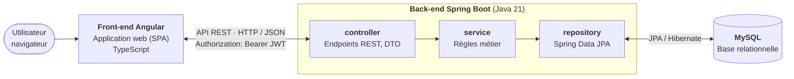
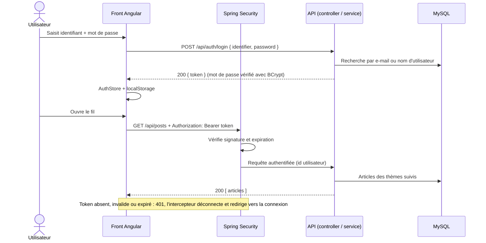
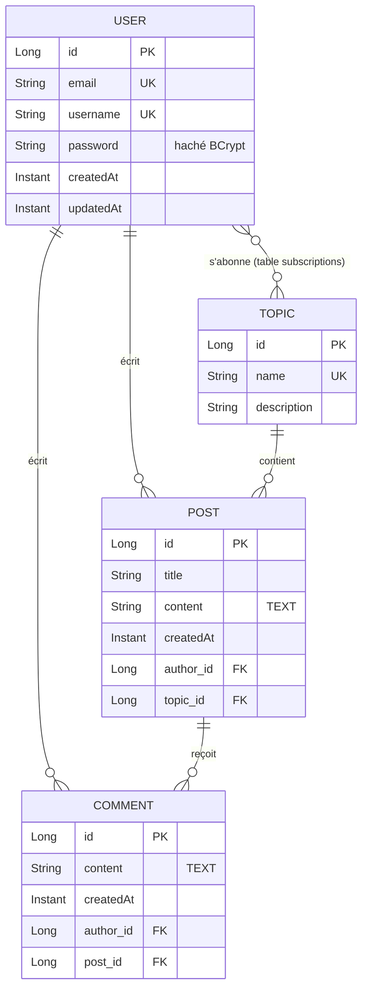

# Documentation et rapport du projet MDD

| Auteur | Version | Date |
|--------|---------|------|
| [Nom et prénom] | 0.0.1 | 10/11/2026 |

> Document de travail complété au fil du projet. Un élément non encore tranché est marqué **À décider**, une section non encore traitée **À compléter**.

## Sommaire

1. [Présentation générale du projet](#1-présentation-générale-du-projet)
   - [1.1 Objectifs du projet](#11-objectifs-du-projet)
   - [1.2 Périmètre fonctionnel](#12-périmètre-fonctionnel)
2. [Architecture et conception technique](#2-architecture-et-conception-technique)
   - [2.1 Schéma global de l'architecture](#21-schéma-global-de-larchitecture)
   - [2.2 Choix techniques](#22-choix-techniques)
     - Cadre : [Contraintes imposées](#contraintes-imposées) · [Existant repris](#existant-repris)
     - Synthèse : [Tableau des choix](#tableau-des-choix) · [Avantages et inconvénients](#avantages-et-inconvénients)
     - Choix généraux : [Choix des versions](#choix-des-versions) · [Architecture logicielle](#architecture-logicielle)
     - Back-end : [Base de données et accès aux données](#base-de-données-et-accès-aux-données) · [Sécurité et authentification](#sécurité-et-authentification) · [Librairies back-end](#librairies-back-end)
     - Front-end : [Gestion de l'état front-end](#gestion-de-létat-front-end) · [Tests unitaires front-end](#tests-unitaires-front-end) · [Architecture front-end](#architecture-front-end) · [Interface utilisateur](#interface-utilisateur)
     - Transverse : [Tests back-end et end-to-end](#tests-back-end-et-end-to-end) · [Outils de build et conventions](#outils-de-build-et-conventions) · [Design patterns](#design-patterns) · [Communication front-end / back-end](#communication-front-end--back-end)
     - Suivi : [Choix à décider](#choix-à-décider)
   - [2.3 API et schémas de données](#23-api-et-schémas-de-données)
     - [Modèle de données](#modèle-de-données) · [Endpoints](#endpoints)
3. [Tests, performance et qualité](#3-tests-performance-et-qualité)
   - [3.1 Stratégie de test](#31-stratégie-de-test)
   - [3.2 Rapport de performance et optimisation](#32-rapport-de-performance-et-optimisation)
   - [3.3 Revue technique](#33-revue-technique)
4. [Documentation utilisateur et supervision](#4-documentation-utilisateur-et-supervision)
   - [4.1 FAQ utilisateur](#41-faq-utilisateur)
   - [4.2 Supervision et tâches déléguées à l'IA](#42-supervision-et-tâches-déléguées-à-lia)
5. [Annexes](#5-annexes)
   - [Annexe A — Analyse des maquettes et des besoins front-end](#annexe-a--analyse-des-maquettes-et-des-besoins-front-end)
     - [A.1 Écrans et spécifications](#a1-écrans-et-lien-avec-les-spécifications) · [A.2 Navigation et mise en page](#a2-navigation-et-mise-en-page) · [A.3 Composants](#a3-composants-front-end-identifiés) · [A.4 Données nécessaires](#a4-données-nécessaires-impact-sur-le-modèle-et-lapi) · [A.5 Points non précisés](#a5-points-non-précisés-par-la-maquette-à-trancher-sans-ajouter-de-fonctionnalité)
   - [Annexe B — Analyse du code existant](#annexe-b--analyse-du-code-existant)

---

## 1. Présentation générale du projet

### 1.1 Objectifs du projet

ORION développe **MDD (Monde de Dév)**, un réseau social destiné aux développeurs. Son but est d'aider les développeurs en recherche d'emploi grâce à la mise en relation et à la collaboration entre pairs. À terme, MDD pourra devenir un vivier de recrutement pour les entreprises.

Avant une ouverture au grand public, ORION teste le concept avec un **MVP déployé en interne**. Ce MVP permet de :

- s'abonner à des thèmes de programmation (JavaScript, Java, Python, Web3…) ;
- consulter un fil d'actualité chronologique des articles de ces thèmes ;
- écrire des articles et les commenter.

Le MVP ne comporte pas de back-office (zone d'administration).

### 1.2 Périmètre fonctionnel

Statuts possibles : **Terminée** / **En cours** / **À venir**.

| Fonctionnalités | Description | Statut |
|-----------------|-------------|--------|
| Accueil non connecté | Accès au formulaire de connexion et d'inscription | À venir |
| Inscription | E-mail, nom d'utilisateur et mot de passe ; validation du mot de passe (8 caractères min., chiffre, minuscule, majuscule, caractère spécial) | À venir |
| Connexion | Par e-mail ou nom d'utilisateur + mot de passe ; connexion persistante entre les sessions | À venir |
| Déconnexion | Fin de la session de l'utilisateur | À venir |
| Profil | Consultation (e-mail, nom d'utilisateur, abonnements) et modification (e-mail, nom d'utilisateur, mot de passe) | À venir |
| Liste des thèmes | Tous les thèmes, abonné ou non | À venir |
| Abonnement | S'abonner depuis la page des thèmes ; le bouton devient inactif et affiche « Déjà abonné » | À venir |
| Désabonnement | Depuis la page de profil | À venir |
| Fil d'actualité | Articles des thèmes suivis, triables du plus récent au plus ancien et inversement | À venir |
| Création d'article | Choix du thème, titre et contenu ; auteur et date définis automatiquement | À venir |
| Consultation d'article | Thème, titre, auteur, date, contenu et commentaires | À venir |
| Commentaires | Ajout d'un commentaire à un article (non récursif) ; auteur et date définis automatiquement | À venir |
| Responsive | Chaque écran s'adapte au mobile et à l'ordinateur | À venir |

---

## 2. Architecture et conception technique

### 2.1 Schéma global de l'architecture

Le MVP suit une **architecture client-serveur** : un front-end Angular (client) appelle en HTTP / JSON une **API REST** Spring Boot (serveur), seule à accéder à la base de données MySQL. Le back-end est organisé **en couches**.



**Légende**
- **Front-end** : l'interface affichée dans le navigateur ; il ne communique qu'avec l'API.
- **Sécurité** : Spring Security vérifie le JWT de chaque requête avant qu'elle atteigne un contrôleur (sauf inscription et connexion).
- **controller** : reçoit les requêtes HTTP, valide les données reçues, renvoie des DTO en JSON. Aucune règle métier.
- **service** : applique les règles métier (auteur et date automatiques, abonnements, tri du fil…).
- **repository** : accès aux données via Spring Data JPA ; seule couche qui parle à la base.
- **MySQL** : stocke les utilisateurs, thèmes, abonnements, articles et commentaires. Tables créées par l'ORM.
- **Services tiers** : aucun prévu pour le MVP.

**Organisation du repository** (un seul repository GitHub, imposé par ORION) :

```
projet_5/
├── back/    # API Spring Boot (Maven)
├── front/   # Application Angular (Angular CLI)
├── docs/    # Maquettes et documents annexes
├── JUSTIFICATION_CHOIX_TECHNIQUES.md
└── README.md
```

**Organisation des packages du back-end** (par couche) :

```
com.openclassrooms.mddapi/
├── controller/   # Contrôleurs REST
├── service/      # Logique métier
├── repository/   # Interfaces Spring Data JPA
├── entity/       # Entités JPA (tables)
├── dto/          # Objets échangés avec le front
├── mapper/       # Conversion entité <-> DTO
├── exception/    # Exceptions métier et gestion globale des erreurs
├── security/     # Configuration Spring Security, authentification
└── config/       # Autres configurations (CORS, insertion des données de référence au démarrage…)
```

**Organisation du front-end** (voir [Architecture front-end](#architecture-front-end)) :

```
src/app/
├── core/                  # Singletons, chargés une fois
│   ├── models/            # Interfaces TypeScript (= DTO de l'API)
│   ├── services/          # Appels HTTP : auth, user, topic, post, comment
│   ├── stores/            # AuthStore, TopicStore, PostStore
│   ├── guards/            # authGuard (routes privées), guestGuard (connexion / inscription)
│   ├── interceptors/      # Ajout du JWT, gestion des 401
│   └── layout/            # En-tête connecté + menu mobile
├── features/              # Pages, chargées à la demande
│   ├── auth/              # Accueil, connexion, inscription
│   ├── posts/             # Fil, détail, création
│   ├── topics/            # Liste des thèmes
│   └── profile/           # Profil
└── shared/
    ├── components/        # Carte de thème, bouton retour…
    └── validators/        # Validateur du mot de passe
```

### 2.2 Choix techniques

#### Contraintes imposées

Ces contraintes viennent des spécifications fonctionnelles et du document de contraintes techniques d'ORION. Tous les choix doivent les respecter.

| Domaine | Contrainte |
|---------|------------|
| Architecture | Back-end distinct du front-end, communication par une API |
| Sécurité | Interaction front / back sécurisée (méthode libre) |
| Conception | Respect des principes SOLID |
| Back-end | Java / Spring, Spring Core obligatoire (IoC, DI), Spring Boot recommandé |
| Modules | Un module Spring est prioritaire sur une librairie tierce (ex. Spring Data plutôt qu'EclipseLink) |
| Front-end | TypeScript / Angular, Angular CLI recommandé, bonnes pratiques de sécurité Angular |
| Code | Git et GitHub, un seul repository pour tout le projet |
| Ergonomie | Écrans responsive, maquettes de la designer respectées |

#### Existant repris

Le projet a été initialisé par une collègue développeuse. Ce socle est conservé tant qu'un choix ne justifie pas de le modifier.

| Partie | Ce qui existe |
|--------|---------------|
| Back-end (`back/`) | Spring Boot 2.7.3, Java 11, Maven ; dépendances `spring-boot-starter-web`, `spring-boot-starter-data-jpa`, `mysql-connector-java`, `spring-boot-starter-test` |
| Front-end (`front/`) | Angular 14 (CLI 14.1.3), TypeScript 4.7, Angular Material 14 configuré ; une page `home` et un routing de base |

Piste proposée : base relationnelle MySQL avec Spring Data JPA (préféré à Spring Data JDBC).

#### Tableau des choix

| Éléments choisis | Type | Lien documentation | Objectif du choix | Justification |
|------------------|------|--------------------|-------------------|---------------|
| Angular 22 | Framework front-end | [angular.dev](https://angular.dev) | Structurer l'application web : composants, routing, formulaires, appels HTTP | Angular imposé par ORION ; version 22 = version active, supportée jusqu'en juin 2028 (voir [Choix des versions](#choix-des-versions)) |
| TypeScript 6.0 | Langage front-end | [typescriptlang.org](https://www.typescriptlang.org/docs/) | Typer le code du front | Langage natif d'Angular ; version imposée par Angular 22 (>= 6.0 < 6.1) |
| Java 21 (LTS) | Langage back-end | [dev.java](https://dev.java) | Développer l'API | Java imposé par ORION ; version LTS supportée jusqu'en septembre 2028 |
| Spring Boot 4.1 (inclut Spring Core) | Framework back-end | [docs.spring.io/spring-boot](https://docs.spring.io/spring-boot/) | Fournir l'IoC / DI et accélérer la configuration de l'API | Spring Core obligatoire, Spring Boot recommandé ; 4.1 = seule version avec un support OSS durable (juillet 2027) |
| Client-serveur, API REST | Architecture globale | [Spring – Building REST services](https://spring.io/guides/tutorials/rest) | Séparer le front et le back, qui communiquent en HTTP / JSON | Imposé par les contraintes (back-end distinct, communication par une API) ; standard le plus répandu (voir [Architecture logicielle](#architecture-logicielle)) |
| Architecture en couches, packages par couche | Architecture back-end | [Spring Boot – Structuring your code](https://docs.spring.io/spring-boot/reference/using/structuring-your-code.html) | Séparer les responsabilités : HTTP, métier, accès aux données | Standard Spring, lisible, applique SOLID ; adaptée à 5 entités (voir [Architecture logicielle](#architecture-logicielle)) |
| MySQL | Base de données | [dev.mysql.com/doc](https://dev.mysql.com/doc/) | Stocker les données relationnelles du MVP | Données fortement liées ; choix initial d'Heidi, déjà installé et configuré dans le `pom.xml` (voir [Base de données et accès aux données](#base-de-données-et-accès-aux-données)) |
| Spring Data JPA (Hibernate) | Accès aux données (ORM) | [docs.spring.io/spring-data/jpa](https://docs.spring.io/spring-data/jpa/reference/) | Associer les entités Java aux tables, générer les requêtes et le schéma | Module Spring prioritaire (contrainte) ; création de la base via l'ORM ; choix initial d'Heidi (voir [Base de données et accès aux données](#base-de-données-et-accès-aux-données)) |
| Spring Security | Sécurité back-end | [docs.spring.io/spring-security](https://docs.spring.io/spring-security/reference/) | Protéger l'API : authentification, routes publiques / protégées, CORS | Module Spring prioritaire (contrainte) ; standard de la sécurité dans Spring (voir [Sécurité et authentification](#sécurité-et-authentification)) |
| JWT via Spring Security OAuth2 Resource Server | Authentification | [Spring Security – OAuth2 Resource Server JWT](https://docs.spring.io/spring-security/reference/servlet/oauth2/resource-server/jwt.html) | Authentifier chaque requête par un token signé (HS256), valable 7 jours | API sans état ; connexion persistante sans stocker le mot de passe ; module Spring plutôt que la librairie jjwt (voir [Sécurité et authentification](#sécurité-et-authentification)) |
| BCrypt | Hachage des mots de passe | [Spring Security – Password Storage](https://docs.spring.io/spring-security/reference/features/authentication/password-storage.html) | Ne jamais stocker un mot de passe en clair | Algorithme de référence de Spring Security, sel intégré, coût réglable |
| Records Java + Lombok (usage limité) | Réduction du code répétitif | [Java – Records](https://docs.oracle.com/en/java/javase/21/language/records.html) · [projectlombok.org](https://projectlombok.org/features/) | Écrire des DTO immuables et des entités sans getters / setters manuels | Records natifs pour les DTO ; Lombok limité aux entités et à l'injection par constructeur, sans `@Data` (voir [Librairies back-end](#librairies-back-end)) |
| MapStruct | Conversion entité ↔ DTO | [mapstruct.org](https://mapstruct.org/documentation/stable/reference/html/) | Convertir les entités en DTO et inversement | Code généré à la compilation, oublis de champs détectés ; outil de référence en Spring (voir [Librairies back-end](#librairies-back-end)) |
| Bean Validation (`spring-boot-starter-validation`) | Validation des données | [Spring – Validation](https://docs.spring.io/spring-framework/reference/core/validation/beanvalidation.html) | Valider les données reçues par l'API, dont la règle du mot de passe | Module Spring ; règles déclarées sur les DTO, erreurs renvoyées champ par champ (voir [Librairies back-end](#librairies-back-end)) |
| `ProblemDetail` (RFC 9457) | Format des erreurs | [Spring – Error Responses](https://docs.spring.io/spring-framework/reference/web/webmvc/mvc-ann-rest-exceptions.html) | Renvoyer des erreurs au format standard, gérées en un seul endroit | Natif Spring, aucun format à inventer ; centralisé dans un `@RestControllerAdvice` (voir [Librairies back-end](#librairies-back-end)) |
| springdoc-openapi (Swagger UI) | Documentation de l'API | [springdoc.org](https://springdoc.org) | Documenter et tester les endpoints dans le navigateur | Documentation générée depuis le code, toujours à jour ; écart assumé avec la priorité aux modules Spring (voir [Librairies back-end](#librairies-back-end)) |
| Services Angular + signals | Gestion de l'état front-end | [angular.dev/guide/signals](https://angular.dev/guide/signals) | Partager l'état entre composants (utilisateur connecté, abonnements, fil d'articles) et mettre l'interface à jour automatiquement | Approche native d'Angular, suffisante pour l'état réduit du MVP ; NgRx (Store et SignalStore) étudié et écarté (voir [Gestion de l'état front-end](#gestion-de-létat-front-end)) |
| Vitest | Tests unitaires front-end | [vitest.dev](https://vitest.dev) · [angular.dev/guide/testing](https://angular.dev/guide/testing) | Tester les composants et services Angular, mesurer la couverture | Lanceur de tests officiel et par défaut d'Angular 22, déjà configuré ; Jest étudié et écarté (voir [Tests unitaires front-end](#tests-unitaires-front-end)) |
| `core/` + `features/` + `shared/`, formulaires réactifs typés | Architecture front-end | [Angular – Style guide](https://angular.dev/style-guide) · [Angular – Reactive forms](https://angular.dev/guide/forms/reactive-forms) | Organiser le front par fonctionnalité, séparer infrastructure, pages et composants réutilisables | Une fonctionnalité = un dossier, chargement à la demande ; stores et services partagés dans `core/` (voir [Architecture front-end](#architecture-front-end)) |
| SCSS et éléments HTML natifs | Interface utilisateur | [sass-lang.com](https://sass-lang.com/documentation/) · [MDN – `<dialog>`](https://developer.mozilla.org/fr/docs/Web/HTML/Element/dialog) | Reproduire les maquettes (formulaires, cartes, boutons, menu mobile) | Maquettes simples et fidélité exigée : style écrit directement, sans bibliothèque à surcharger ; valeurs centralisées en variables CSS (voir [Interface utilisateur](#interface-utilisateur)) |
| Inter · Material Icons Outlined (`@fontsource`) | Police et icônes | [fontsource.org](https://fontsource.org) | Afficher la police de la maquette et ses 4 icônes | Inter relevée dans Figma ; fichiers hébergés dans l'application, aucune requête vers un service externe |
| JUnit Jupiter + Mockito | Tests unitaires back-end | [junit.org](https://junit.org/) · [site.mockito.org](https://site.mockito.org) | Tester les services, mappers et validateurs isolément | Recommandés par les directives, fournis par les starters de test Spring Boot (voir [Tests back-end et end-to-end](#tests-back-end-et-end-to-end)) |
| `@SpringBootTest` + MockMvc, H2 | Tests d'intégration back-end | [Spring Boot – Testing](https://docs.spring.io/spring-boot/reference/testing/index.html) · [h2database.com](https://h2database.com) | Tester les endpoints de bout en bout (sécurité, validation, base) | Outils Spring ; base en mémoire, aucune dépendance à MySQL ou Docker pour lancer les tests (voir [Tests back-end et end-to-end](#tests-back-end-et-end-to-end)) |
| JaCoCo · `@vitest/coverage-v8` | Couverture de code | [jacoco.org](https://www.jacoco.org/jacoco/trunk/doc/) · [vitest.dev/guide/coverage](https://vitest.dev/guide/coverage) | Mesurer la couverture (objectif ≥ 70 %) et produire les rapports | Outils de référence côté Java et côté Vitest ; seuil vérifié par Maven |
| Cypress | Tests end-to-end | [docs.cypress.io](https://docs.cypress.io) | Tester le parcours complet dans un navigateur | Recommandé par les directives, interface de rejeu pas à pas (voir [Tests back-end et end-to-end](#tests-back-end-et-end-to-end)) |
| Maven (wrapper) · Angular CLI · npm 11 | Outils de build | [maven.apache.org](https://maven.apache.org/guides/) · [angular.dev/tools/cli](https://angular.dev/tools/cli) | Compiler, tester et empaqueter le back et le front | Déjà en place, standards de chaque écosystème (voir [Outils de build et conventions](#outils-de-build-et-conventions)) |
| Prettier · ESLint (`angular-eslint`) · SonarLint | Qualité et conventions de code | [prettier.io](https://prettier.io) · [github.com/angular-eslint](https://github.com/angular-eslint/angular-eslint) · [sonarsource.com/products/sonarlint](https://www.sonarsource.com/products/sonarlint/) | Formater et analyser le code automatiquement | Prettier déjà configuré ; ESLint est le linter officiel conseillé par Angular ; SonarLint cité par les directives (voir [Outils de build et conventions](#outils-de-build-et-conventions)) |
| Git et GitHub, un seul repository | Gestion de code | [docs.github.com](https://docs.github.com) | Versionner le front et le back ensemble | Imposé par ORION |

#### Avantages et inconvénients

| Choix | Avantages | Inconvénients |
|-------|-----------|---------------|
| Angular | Framework complet (routing, formulaires réactifs, client HTTP, intercepteurs) ; protection XSS intégrée aux templates | Courbe d'apprentissage plus raide que React ou Vue ; bundle plus lourd |
| TypeScript | Erreurs détectées à la compilation ; modèles partagés entre services et composants | Étape de compilation ; types à maintenir face à l'API |
| Java | Écosystème mature, typage fort, large communauté | Code plus verbeux que Kotlin ou des langages de script |
| Spring Boot | Auto-configuration, serveur embarqué, starters (Web, Data, Security) ; IoC et DI au service des principes SOLID | Configuration implicite parfois difficile à diagnostiquer ; démarrage et mémoire plus lourds qu'un micro-framework |
| Client-serveur, API REST | Front et back indépendants (développement, déploiement, évolution) ; standard compris de tous ; API sans état, réutilisable par un autre client (application mobile) | Deux applications à lancer et configurer ; communication réseau à sécuriser (authentification, CORS) |
| Architecture en couches | Responsabilités séparées, code lisible et testable couche par couche ; standard Spring | Le métier dépend des entités JPA ; risque de services « fourre-tout » si le projet grossit |
| MySQL | Gratuit, très répandu, déjà installé ; relations et contraintes d'intégrité gérées par la base | Moins de fonctionnalités avancées que PostgreSQL (inutiles pour le MVP) |
| Spring Data JPA | Relations gérées automatiquement ; requêtes générées depuis le nom des méthodes ; schéma créé par l'ORM | « Magie » à maîtriser : chargement paresseux, requêtes N+1 ; SQL généré moins visible |
| Spring Security | Protection complète et éprouvée (filtres, CORS, en-têtes de sécurité) ; intégré à Spring Boot | Configuration dense, comportement par défaut parfois surprenant (tout est protégé) |
| JWT (OAuth2 Resource Server) | API sans état ; connexion persistante ; vérification du token gérée par Spring, sans filtre écrit à la main | Token volé valable jusqu'à son expiration ; déconnexion uniquement côté client |
| BCrypt | Lent par conception (résiste à la force brute) ; sel intégré ; standard Spring | Argon2 est plus récent et plus robuste (non nécessaire pour le MVP) |
| Records + Lombok | DTO immuables sans dépendance ; entités courtes et lisibles | Code généré invisible, plugin d'IDE nécessaire ; pièges de `@Data` sur les entités (évité) |
| MapStruct | Peu de code ; erreurs de mapping détectées à la compilation ; aussi rapide que du code manuel | Dépendance et processeur d'annotations à configurer avec Lombok |
| Bean Validation | Validation déclarative et centralisée sur les DTO ; module Spring | Les règles métier (unicité) restent à vérifier dans le service |
| `ProblemDetail` | Format standard, natif, extensible | Un peu plus verbeux qu'un format maison |
| springdoc-openapi | Documentation interactive, à jour, importable dans Postman ; presque aucune configuration | Librairie tierce ; annotations ajoutées dans les contrôleurs |
| Services + signals | Natif Angular, aucune dépendance, très peu de code ; mise à jour automatique de l'interface ; état séparé des appels HTTP | Pas de structure imposée par un outil ; pas d'historique d'état type Redux DevTools |
| Vitest | Intégré à `ng test` et maintenu par Angular ; rapide (esbuild, mode watch ciblé) ; syntaxe compatible avec Jest | Plus récent que Jest : moins de tutoriels Angular existants l'utilisent |
| `core/` + `features/` + `shared/` | Une fonctionnalité = un dossier ; chargement à la demande ; pas d'imports croisés entre fonctionnalités | Il faut décider de ce qui relève de `core/` |
| SCSS + éléments natifs | Rendu fidèle aux maquettes ; aucune dépendance d'interface ; accessibilité de base apportée par le HTML (labels, boutons, `<dialog>`) | Styles à écrire soi-même ; accessibilité avancée non automatique |
| JUnit + Mockito | Tests rapides et isolés ; standard Java | Mocks à maintenir quand les dépendances changent |
| `@SpringBootTest` + MockMvc, H2 | Tests réalistes (filtres de sécurité, validation, JPA) sans serveur ni MySQL | Plus lents que les tests unitaires ; H2 n'est pas strictement identique à MySQL |
| JaCoCo / coverage-v8 | Rapports HTML lisibles, seuil bloquant possible | Une couverture élevée ne garantit pas des tests pertinents |
| Cypress | Parcours utilisateur réel, rejeu visuel ; recommandé par les directives | Plus lent ; nécessite le front et le back lancés |
| Maven / Angular CLI | Déjà en place, aucune installation (wrapper) | Configuration Maven verbeuse (XML) |
| Prettier / ESLint / SonarLint | Style homogène et erreurs détectées dans l'IDE | Outils de développement à maintenir à jour (ex. alerte `npm audit` modérée dans la chaîne ESLint, sans impact sur l'application livrée) |
| Git / GitHub, un seul repository | Historique partagé, revue par pull request ; front et back versionnés ensemble | Deux chaînes de build dans un même repository ; organisation des dossiers à garder rigoureuse |

#### Choix des versions

**Décision (10/11/2026) :** monter de version l'existant, qui n'était plus maintenu.

| Élément | Avant | Après | État de l'ancienne version | Support de la nouvelle |
|---------|-------|-------|----------------------------|------------------------|
| Java | 11 | **21 (LTS)** | Support Premier Oracle terminé en septembre 2023 | Premier jusqu'en septembre 2028 |
| Spring Boot | 2.7.3 | **4.1.2** | Support OSS terminé en juin 2023, plus de correctifs de sécurité | OSS jusqu'en juillet 2027 |
| Angular | 14 | **22.2** | Plus supporté (seules les versions 20 à 22 le sont) | Active, puis LTS jusqu'en juin 2028 |

Sources : [endoflife.date – Spring Boot](https://endoflife.date/spring-boot), [endoflife.date – Oracle JDK](https://endoflife.date/oracle-jdk), [Angular – Releases](https://angular.dev/reference/releases), [Angular – Compatibilité des versions](https://angular.dev/reference/versions), [Spring Boot – Prérequis](https://docs.spring.io/spring-boot/system-requirements.html).

**Alternatives écartées**
- *Conserver les versions d'origine* : plus de correctifs de sécurité, incompatible avec l'exigence d'une interaction front / back sécurisée ; Angular 14 ne fonctionne pas avec Node 22.
- *Spring Boot 3.5* : support OSS terminé en juin 2026. *Spring Boot 4.0* : support OSS jusqu'en décembre 2026 seulement.
- *Java 25 (LTS plus récente)* : possible, mais Java 21 est supporté plus longtemps que la durée du projet et compatible avec tout l'outillage.

**Méthode de migration**
- **Back-end** : `pom.xml` réaligné sur celui généré par Spring Initializr pour Spring Boot 4.1.2 / Java 21. Les starters changent de nom (`spring-boot-starter-web` → `spring-boot-starter-webmvc`, starters de test dédiés) et le driver MySQL devient `com.mysql:mysql-connector-j`. Le seul code existant (`MddApiApplication`) n'a pas changé.
- **Front-end** : projet **régénéré** avec Angular CLI 22 plutôt que migré. L'existant se limitait à une page de démonstration ; `ng update` aurait imposé 8 migrations successives (14 → 22) sans réécrire la structure en composants standalone. Les éléments personnalisés ont été repris à la main : page d'accueil, route, Angular Material, styles, logo et favicon.

**Inconvénients assumés**
- Remise en cause partielle du socle initial (impact faible : une classe côté back, une page côté front).
- Spring Boot 4 et Angular 22 diffèrent des nombreux tutoriels écrits pour Spring Boot 2 / 3 et Angular à base de `NgModule` : les exemples trouvés en ligne doivent être adaptés.
- Le thème Angular Material passe au système Material 3 (thème `azure-blue` par défaut), à ajuster aux maquettes. *Mise à jour du 24/11/2026 : Angular Material a finalement été retiré (voir [Interface utilisateur](#interface-utilisateur)).*

#### Architecture logicielle

**Décision (11/11/2026) :** architecture **client-serveur avec une API REST** ; back-end **en couches** (`controller` → `service` → `repository`), packages organisés **par couche**.

**Architecture globale**

| Option | Principe | Pour MDD |
|--------|----------|----------|
| **Client-serveur, API REST** (retenue) | Le front (Angular) appelle en HTTP / JSON une API (Spring Boot), seule à accéder à la base | Imposée par les contraintes : back-end distinct du front-end, communication par une API |
| Monolithe avec rendu serveur | Le serveur génère les pages HTML (ex. Thymeleaf) | Incompatible avec Angular, imposé pour le front |
| Microservices | Un service par domaine (utilisateurs, articles…), chacun avec sa base | Surdimensionné : communication entre services, déploiements multiples, supervision |
| Pilotée par les événements | Les composants communiquent par messages (Kafka, RabbitMQ) | Aucun besoin asynchrone dans les spécifications |

**Architecture du back-end**

| Option | Principe | Avantages | Inconvénients |
|--------|----------|-----------|---------------|
| **En couches** (retenue) | `controller` (HTTP) → `service` (métier) → `repository` (données) ; chaque couche n'appelle que celle du dessous | Standard Spring, simple à lire et à tester ; applique directement SOLID | Le métier dépend un peu de la persistance (entités JPA) |
| Hexagonale (ports et adaptateurs) | Métier au centre, indépendant de Spring et de la base ; interfaces (ports) et implémentations (adaptateurs) autour | Métier totalement isolé et testable | Beaucoup d'interfaces et de conversions pour un CRUD de 5 entités : surdimensionné |

**Organisation des packages**

| Option | Avantages | Inconvénients |
|--------|-----------|---------------|
| **Par couche** (retenue) : `controller/`, `service/`, `repository/`… | Lisible immédiatement par tout développeur Spring ; adaptée à 5 entités | Les fichiers d'une même fonctionnalité sont répartis dans plusieurs packages |
| Par fonctionnalité : `user/`, `topic/`, `post/`, `comment/` | Tout le code d'une fonctionnalité au même endroit ; mieux adaptée à un gros projet | Moins habituelle ; découpage peu utile avec 5 entités |

**Application des principes SOLID**
- **S** (responsabilité unique) : chaque couche et chaque classe a un rôle (le contrôleur ne contient pas de métier, le service n'écrit pas de SQL).
- **O** (ouvert / fermé) : gestion des erreurs centralisée et extensible (nouvelle exception = nouveau gestionnaire, sans modifier les contrôleurs).
- **L** (substitution de Liskov) : les repositories étendent les interfaces Spring Data sans en changer le contrat.
- **I** (ségrégation des interfaces) : un repository par entité, exposant uniquement les requêtes utiles.
- **D** (inversion des dépendances) : les dépendances sont injectées par Spring (IoC / DI), par constructeur.

**Évolutivité**
- L'API ne garde pas d'état entre deux requêtes : plusieurs instances du back-end peuvent tourner derrière un répartiteur de charge.
- Les couches permettent de remplacer une technologie (base, sécurité) sans toucher aux autres.
- Si le projet grossit, le passage à des packages par fonctionnalité reste un simple déplacement de fichiers.

#### Base de données et accès aux données

**Décision (11/11/2026) :** base relationnelle **MySQL**, accès par **Spring Data JPA** (Hibernate), tables créées par l'ORM.

Les données de MDD sont fortement liées : un article a un auteur et un thème, un commentaire a un article et un auteur, un utilisateur est abonné à plusieurs thèmes. Une base relationnelle garantit ces liens (clés étrangères, contraintes d'unicité) ; une base NoSQL (ex. MongoDB) serait moins adaptée.

| Critère | **MySQL** (retenue) | PostgreSQL |
|---------|---------------------|------------|
| Type | Relationnelle | Relationnelle |
| Avantages | Choix initial d'Heidi ; déjà installé (MySQL 26.7) ; pilote déjà dans le `pom.xml` ; très répandu | Plus riche (types JSON, contraintes avancées), réputé plus strict sur le standard SQL |
| Inconvénients | Moins de fonctionnalités avancées, inutiles ici | À installer ; remettrait en cause le choix initial sans gain pour le MVP |

| Critère | **Spring Data JPA** (retenu) | Spring Data JDBC |
|---------|------------------------------|------------------|
| Principe | ORM : les classes `@Entity` sont associées aux tables ; requêtes générées depuis le nom des méthodes | Correspondance simple objet / table, sans chargement paresseux ni cache, plus de SQL écrit à la main |
| Avantages | Relations (`@ManyToOne`, `@ManyToMany`) gérées automatiquement ; création du schéma par l'ORM ; très documenté | Plus prévisible, moins de « magie » |
| Inconvénients | Pièges à connaître : chargement paresseux, requêtes N+1 | Relations entre agrégats moins pratiques ; schéma à écrire soi-même |

**Justification**
- Les contraintes imposent de privilégier un module Spring Data ; les deux candidats en sont.
- JPA permet de **créer la base via l'ORM**, comme demandé pour la mise en place de l'environnement, et gère les relations du modèle sans SQL manuel.
- MySQL et JPA étaient les choix initiaux d'Heidi : les conserver évite de remettre en cause le socle sans gain.

**Mise en place (étape 3)**
- Base `mdd` en `utf8mb4` (accents et emojis dans les articles et commentaires), schéma généré par Hibernate (`spring.jpa.hibernate.ddl-auto=update`).
- Compte dédié `mdd_user`, limité à la base `mdd` et aux seuls droits nécessaires (**moindre privilège**) : `SELECT`, `INSERT`, `UPDATE`, `DELETE` pour les données, `CREATE`, `ALTER`, `INDEX`, `REFERENCES` pour la génération du schéma. Pas de `DROP` (le mode `update` ne supprime ni table ni colonne) ni d'accès aux autres bases. L'API ne se connecte jamais en `root`.
- Base et compte créés par un script versionné, `back/sql/init-database.sql`, documenté dans le README : l'installation est reproductible sur un autre poste. Le dépôt ne contient qu'un mot de passe factice (`CHANGER_MOI`), à remplacer avant exécution.
- Identifiants lus dans des variables d'environnement (fichier `back/.env` non versionné) ; les tests utilisent H2 et n'ont besoin ni de MySQL ni de ces identifiants.
- Axe d'amélioration : en production, séparer un compte de migration (outil comme Flyway ou Liquibase, seul à modifier le schéma) du compte applicatif, réduit alors à `SELECT`, `INSERT`, `UPDATE`, `DELETE`. Ici, `ddl-auto` est conservé car les directives demandent de créer la base via l'ORM.

#### Sécurité et authentification

**Décision (11/11/2026) :** **Spring Security** avec authentification par **JWT**, généré et vérifié par le module **OAuth2 Resource Server** ; mots de passe hachés avec **BCrypt**.

Besoins à couvrir : interaction front / back sécurisée (contrainte), connexion par e-mail ou nom d'utilisateur, **connexion persistante entre les sessions**, règles du mot de passe (spécifications), sans surcomplexifier la sécurité d'un MVP interne (directives).

**Mécanisme d'authentification**

| Critère | **JWT** (retenu) | Basic Auth | Session serveur (cookie) |
|---------|------------------|------------|--------------------------|
| Principe | À la connexion, le back renvoie un token signé ; le front l'envoie dans l'en-tête `Authorization: Bearer …` à chaque requête | Identifiant et mot de passe (Base64) envoyés à chaque requête | Session en mémoire côté serveur, cookie `JSESSIONID` dans le navigateur |
| Connexion persistante | Oui : token stocké côté front, valable jusqu'à son expiration | Impose de stocker le mot de passe côté front : à proscrire | Cookie de session perdu à la fermeture du navigateur (sauf « remember-me ») |
| API sans état | Oui | Oui | Non |
| Complexité | Moyenne | Faible | Moyenne (protection CSRF) |
| Inconvénient principal | Token volé valable jusqu'à son expiration | Mot de passe circulant et stocké côté client | Peu adapté à une SPA et à une API REST |

**Génération et vérification du token**

| Critère | **Spring Security OAuth2 Resource Server** (retenu) | Librairie jjwt |
|---------|-----------------------------------------------------|----------------|
| Principe | Module officiel : vérification automatique du JWT à chaque requête ; génération avec le `JwtEncoder` (Nimbus) fourni | Librairie tierce : filtre de lecture et de vérification du token à écrire soi-même |
| Avantages | Module Spring (contrainte) ; moins de code de sécurité écrit à la main | Très présente dans les tutoriels |
| Inconvénients | Moins de tutoriels « débutant » | Filtre et gestion des erreurs à écrire et tester soi-même |

Malgré son nom, ce module n'implique pas de serveur OAuth : il sert uniquement à vérifier des JWT. Le token est signé en **HS256** avec une clé secrète lue dans une **variable d'environnement**, jamais commitée.

**Mots de passe**
- Hachage avec **BCrypt** (`BCryptPasswordEncoder`).
- Règles (8 caractères minimum, un chiffre, une minuscule, une majuscule, un caractère spécial) vérifiées **côté front** (retour immédiat) **et côté back** (le front peut être contourné).
- Le mot de passe n'est jamais renvoyé par l'API, même haché, ni écrit dans les logs.

**Côté front-end**

| Sujet | Choix | Alternative écartée |
|-------|-------|---------------------|
| Stockage du token | `localStorage` : survit à la fermeture du navigateur, donc connexion persistante | Cookie `HttpOnly` : mieux protégé contre le vol par XSS, mais impose la gestion du CSRF et des cookies cross-origin, trop complexe pour le MVP. Le risque XSS est réduit par l'échappement automatique des templates Angular. |
| Envoi du token | Intercepteur HTTP qui ajoute `Authorization: Bearer …` | Ajout manuel dans chaque service : répétitif, oublis possibles |
| Routes protégées | Guard (`canActivate`) qui redirige vers la connexion | — |
| Token expiré ou invalide | Réponse 401 : l'intercepteur déconnecte l'utilisateur et le redirige vers la connexion | — |
| Déconnexion | Suppression du token côté front | Liste noire de tokens côté serveur : inutile pour le MVP |

**Durée de validité du token :** **7 jours**, réglable dans la configuration, sans refresh token. Une durée courte (1 h) serait plus sûre mais imposerait un refresh token pour garder la connexion persistante, ce qui ajoute de la complexité.

**Autorisations et protection de l'API**
- Routes publiques : `POST /api/auth/register`, `POST /api/auth/login` et la documentation Swagger (`/swagger-ui.html`, `/v3/api-docs`). Toutes les autres exigent un token valide.
- **Swagger public** (décision du 25/11/2026) : les directives n'en parlent pas ; le MVP est déployé en interne et la documentation ne donne accès à aucune donnée, chaque route demandant un token. Axe d'amélioration : la réserver au profil `dev` avant toute mise en ligne publique.
- L'utilisateur courant est **toujours déduit du token** : pas d'identifiant dans les URL du profil ou des abonnements (`/api/users/me`), impossible de modifier les données d'un autre utilisateur.
- L'auteur d'un article ou d'un commentaire vient du token, jamais du corps de la requête (règle « auteur défini automatiquement »).
- **CSRF désactivé** : sans risque, le token passe par un en-tête et non par un cookie.
- **CORS** limité à l'origine du front (`http://localhost:4200` en développement), configuré dans Spring Security.
- Erreurs : message générique en cas d'échec de connexion (« identifiants invalides »), aucune trace technique renvoyée au client.

**Vérification (étape 6)** : chaque protection est prouvée par un test ou un essai, listés avec leur raison d'être dans [`docs/tests/securite.md`](docs/tests/securite.md). Tests ajoutés à cette étape : les 10 routes protégées refusent une requête sans token, un token signé avec une autre clé est refusé ; règle ESLint interdisant `console.log` ; absence de données personnelles dans les logs vérifiée par un essai réel sur MySQL.

**Inconvénients assumés**
- Un token volé reste valable jusqu'à 7 jours ; la déconnexion ne l'invalide pas côté serveur.
- Le `localStorage` est lisible par JavaScript : la protection repose sur l'absence de faille XSS.
- Axes d'amélioration après le MVP : refresh token avec durée d'accès courte, cookie `HttpOnly`, liste de révocation.

#### Librairies back-end

**Décision (11/11/2026) :** **records Java** pour les DTO et **Lombok** limité ; **MapStruct** pour le mapping ; **Bean Validation** ; erreurs au format **`ProblemDetail`** ; documentation avec **springdoc-openapi**.

**Réduction du code répétitif**

| Critère | **Lombok, usage limité** (retenu) | Sans Lombok |
|---------|-----------------------------------|-------------|
| Principe | Annotations (`@Getter`, `@Setter`, `@NoArgsConstructor`, `@RequiredArgsConstructor`, `@Slf4j`) qui génèrent le code à la compilation | Getters, setters et constructeurs écrits dans le fichier |
| Avantages | Classes courtes et lisibles ; très répandu en Spring | Aucune dépendance, tout le code est visible |
| Inconvénients | Code invisible, plugin d'IDE ; `@Data` dangereux sur les entités JPA (`equals` / `hashCode` et `toString` qui chargent les relations ou bouclent) | Classes longues, bruit autour du métier |

Règles retenues :
- **DTO** : records Java (immuables, natifs), donc sans Lombok.
- **Entités** : `@Getter`, `@Setter`, `@NoArgsConstructor` uniquement ; **`@Data` interdit**. `@Setter` seulement sur les entités modifiables par l'application (pas sur `Topic`, donnée de référence).
- **Services et contrôleurs** : injection par constructeur via `@RequiredArgsConstructor`.
- **Logs** : `@Slf4j` déclare le logger SLF4J de la classe (pas de code répétitif `LoggerFactory.getLogger(...)`).

**Conversion entité ↔ DTO**

| Critère | **MapStruct** (retenu) | Mapping manuel | ModelMapper |
|---------|------------------------|----------------|-------------|
| Principe | Mappers générés à la compilation depuis une interface | Méthodes écrites à la main | Conversion à l'exécution par réflexion |
| Détection des erreurs | Compilation (avertissement si un champ n'est pas mappé) | Tests | Exécution |
| Performance | Équivalente à du code manuel | Optimale | Plus lente |
| Avantages | Peu de code ; champs imbriqués simples (`@Mapping(source = "author.username", target = "authorUsername")`) ; compatible avec les records | Aucune dépendance, explicite | Aucune configuration |
| Inconvénients | Processeur d'annotations à configurer avec Lombok (`lombok-mapstruct-binding`) | Répétitif, oublis lors de l'ajout d'un champ | Peu sûr, difficile à déboguer |

Le mapping manuel restait défendable pour 4 entités ; MapStruct est retenu pour la détection des oublis à la compilation et parce qu'il structure naturellement le package `mapper/`.

**Validation des données**

| Critère | **Bean Validation** (retenu) | Vérifications manuelles |
|---------|------------------------------|-------------------------|
| Principe | Annotations sur les DTO (`@NotBlank`, `@Email`, `@Size`, `@Pattern`) et `@Valid` dans les contrôleurs | Des `if` dans chaque service |
| Avantages | Module Spring ; déclaratif ; erreurs champ par champ | Aucun |
| Inconvénients | Règles métier à traiter ailleurs | Répétitif ; mélange validation et métier |

- **Mot de passe** : annotation personnalisée **`@ValidPassword`** (expression régulière centralisée), utilisée à l'inscription et à la modification du profil.
- **Unicité de l'e-mail et du nom d'utilisateur** : vérifiée dans le service, avec une contrainte d'unicité en base en garde-fou.

**Format des erreurs**

| Critère | **`ProblemDetail`** (retenu) | DTO d'erreur maison |
|---------|------------------------------|---------------------|
| Principe | Format standard RFC 9457 (`type`, `title`, `status`, `detail`) fourni par Spring | Classe `ErrorResponse` propre au projet |
| Avantages | Standard, aucun format à inventer, extensible (erreurs par champ) | Format libre |
| Inconvénients | Un peu plus verbeux | Format à documenter et maintenir |

Les erreurs sont centralisées dans un **`@RestControllerAdvice`** (package `exception/`) ; le front les affiche sous les champs concernés (voir Annexe A.5). Aucune trace technique n'est renvoyée au client.

Mise en œuvre (étape 5, inscription) :
- `400` : propriété `errors` = `{ "champ": "message" }` ; `409` : propriété `field` (`email` ou `username`) pour afficher le message sous le bon champ ; `500` : message générique, détail uniquement dans le log.
- Le gestionnaire hérite de `ResponseEntityExceptionHandler` : les erreurs standard de Spring MVC (`404`, `405`, `415`, corps illisible) gardent leur code au lieu de devenir des `500`.
- **Gestion globale côté front** (décision de l'utilisateur à la clôture de l'étape 5) : l'intercepteur traite le `401` pour toute l'application (déconnexion et retour à la connexion) ; une seule fonction, `readServerErrors`, convertit les `ProblemDetail` en messages sous les champs ou en message général, pour tous les formulaires ; chaque page affiche ses erreurs de chargement. Pas de notification globale (« serveur injoignable ») : cet élément est absent des maquettes et des spécifications.
- **Écart assumé** : le `401` lié au token (absent, invalide ou expiré) n'est pas un `ProblemDetail`. Il est renvoyé par le module OAuth2 Resource Server avant les contrôleurs, avec un corps vide et l'en-tête standard `WWW-Authenticate`. Le front n'a besoin que du code `401` pour déconnecter l'utilisateur.

**Documentation de l'API**

| Critère | **springdoc-openapi** (retenu) | Spring REST Docs | README seul |
|---------|--------------------------------|------------------|-------------|
| Principe | Spécification OpenAPI générée depuis le code, interface Swagger UI interactive | Documentation générée à partir des tests MockMvc (Asciidoctor) | Tableau des endpoints écrit à la main |
| Avantages | Presque aucune configuration ; endpoints testables avec le JWT ; spécification importable dans Postman | Module Spring ; documentation forcément exacte | Aucun outil |
| Inconvénients | Librairie tierce ; annotations dans les contrôleurs | Un test documenté par endpoint, configuration Asciidoctor, pas d'interface interactive | Se désynchronise du code |

En complément : le **tableau des endpoints dans le README**. Une **collection Postman** sert aussi aux tests manuels pendant le développement : c'est un **outil personnel**, non livré (non versionné), Swagger UI restant la documentation interactive de référence.

**Inconvénients assumés**
- springdoc-openapi est une librairie tierce, alors que les contraintes privilégient les modules Spring. Spring REST Docs, seul équivalent Spring, répond à un autre besoin (documentation tirée des tests) pour un coût bien supérieur, disproportionné pour un MVP. La version de springdoc compatible avec Spring Boot 4 sera vérifiée à l'installation.
- Lombok et MapStruct ajoutent deux processeurs d'annotations à configurer ensemble dans Maven.

#### Gestion de l'état front-end

**Décision (11/11/2026) :** **services Angular + signals**, sans bibliothèque de gestion d'état. NgRx SignalStore a été retenu un temps, puis écarté au profit de cette approche plus simple, avant qu'aucun code d'état ne soit écrit.

L'état partagé du MVP est réduit : l'utilisateur connecté, ses abonnements (partagés entre la page des thèmes et la page profil) et le fil d'articles avec son tri. Il sera réparti en trois services d'état, appelés « stores » pour les distinguer des services HTTP :

| Store (service Angular) | État géré |
|-------------------------|-----------|
| `AuthStore` | Utilisateur connecté, token |
| `TopicStore` | Liste des thèmes, abonnements de l'utilisateur |
| `PostStore` | Fil d'articles, sens du tri, article consulté |

Chaque store est un service injectable (`providedIn: 'root'`) qui garde son état dans des `signal()` privés, l'expose en lecture seule (`asReadonly()`) et en valeurs calculées (`computed()`), et ne le modifie que par ses propres méthodes. Les appels HTTP restent dans des services dédiés (un par ressource de l'API), utilisés par les stores : les services communiquent avec l'API, les stores gèrent l'état (principe de responsabilité unique).

| Critère | **Services + signals** (retenu) | NgRx Store (Redux) | NgRx SignalStore |
|---------|--------------------|--------------------|------------------|
| Principe | Un service par domaine expose des signals ; les composants les lisent | Store global unique ; l'état change uniquement via des actions traitées par des reducers ; effets de bord dans des effects | Un store par domaine, déclaré avec `signalStore()` (état, méthodes, valeurs calculées), exposé en signals |
| Code par fonctionnalité | ~1 fichier | ~4 fichiers (actions, reducer, effects, selectors) | ~1 fichier |
| Dépendance | Aucune (Angular natif) | `@ngrx/store`, `@ngrx/effects` | `@ngrx/signals` |
| Structure imposée | Aucune : conventions à fixer soi-même | Très forte, flux unidirectionnel prévisible | Moyenne, structure commune à tous les stores |
| Débogage | Outils Angular standard | Redux DevTools (historique et rejeu des actions) | Redux DevTools via une extension |
| Courbe d'apprentissage | Faible | Élevée (RxJS, actions, effects) | Moyenne |
| Adapté à un MVP de 5 écrans | Oui | Surdimensionné | Oui |

**Justification**
- Les signals sont le mécanisme de réactivité natif d'Angular, et un service exposant des signals est le pattern présenté par la documentation officielle.
- Pour un état de cette taille (trois domaines, cinq écrans), une bibliothèque ajouterait une dépendance et une couche d'abstraction sans bénéfice concret, contraire à l'objectif d'un MVP simple.
- Aucune API supplémentaire à apprendre : `signal()`, `computed()` et `asReadonly()` suffisent, et les stores se testent comme n'importe quel service.
- La séparation état (stores) / appels HTTP (services) est conservée : elle facilite les tests et applique le principe de responsabilité unique.
- Le choix est réversible : les deux approches reposant sur les signals, une migration vers NgRx SignalStore se ferait store par store, avec peu d'impact sur les composants.

**Alternatives écartées**
- *NgRx SignalStore* : structure commune à tous les stores et peu de code, mais une dépendance et une API (`signalStore`, `withState`, `withMethods`, `patchState`) en plus, pour un gain faible sur un état aussi réduit.
- *NgRx Store classique* : très structuré, avec l'historique des actions dans les Redux DevTools, mais environ 4 fichiers par fonctionnalité et une courbe d'apprentissage élevée, disproportionnés pour ce MVP.

**Inconvénients assumés**
- Aucune structure imposée par un outil : les conventions (un store par domaine, signals exposés en lecture seule, modification uniquement par les méthodes du store) doivent être respectées par discipline et vérifiées en revue.
- Pas d'historique des changements d'état comme avec les Redux DevTools.
- Écart avec NgRx, cité dans les directives OpenClassrooms : assumé et justifié ci-dessus.

#### Tests unitaires front-end

**Décision (11/11/2026) :** **Vitest** (avec `jsdom`), lancé par `ng test` via le builder officiel `@angular/build:unit-test`.

L'existant utilisait Karma + Jasmine (configuration par défaut d'Angular 14), aujourd'hui déprécié par Angular. Aucune configuration Jest n'existait dans le projet.

| Critère | Vitest | Jest | Karma + Jasmine |
|---------|--------|------|-----------------|
| Support dans Angular 22 | Officiel, lanceur par défaut | Non officiel : builder communautaire `@angular-builders/jest` (le builder Jest d'Angular est resté expérimental) | Encore supporté, mais déprécié |
| Configuration dans le projet | Déjà en place depuis la régénération | À installer et configurer (`jest`, `jest-preset-angular`, `angular.json`, `jest.config.ts`) | Supprimée lors de la régénération |
| Moteur | Vite / esbuild, modules ES et TypeScript natifs | CommonJS, transformation préalable du TypeScript | Vrai navigateur (Chrome) |
| Vitesse | Rapide, ne relance que les tests touchés en mode watch | Correcte | Plus lente (lancement d'un navigateur) |
| Syntaxe | `describe` / `it` / `expect`, mocks `vi.fn()` | `describe` / `it` / `expect`, mocks `jest.fn()` | `describe` / `it` / `expect`, espions `jasmine.createSpy()` |

**Justification**
- Les directives recommandent Jest (étape 7 : « Utiliser les outils de test recommandés : JUnit, Jest, Cypress »). Angular a depuis fait de Vitest son lanceur officiel : c'est l'outil présenté par la documentation Angular.
- La syntaxe étant quasi identique à celle de Jest, les bonnes pratiques visées (nommage, isolation, Arrange–Act–Assert, couverture) s'appliquent de la même façon.
- Vitest évite d'ajouter et de maintenir une configuration communautaire, qui risquerait de casser à chaque montée de version d'Angular.

**Inconvénients assumés**
- Écart avec la recommandation Jest des directives, justifié ci-dessus.
- Outil plus récent : une partie des ressources Angular en ligne montre encore Jest ou Karma.

#### Architecture front-end

**Décision (11/11/2026) :** organisation **`core/` + `features/` + `shared/`** (arborescence en [2.1](#21-schéma-global-de-larchitecture)), pages chargées à la demande, **formulaires réactifs typés**, composants standalone.

| Critère | **`core/` + `features/` + `shared/`** (retenu) | Par type (`components/`, `services/`, `models/`) | Bibliothèques par fonctionnalité (Nx) |
|---------|------------------------------------------------|-------------------------------------------------|---------------------------------------|
| Principe | Infrastructure et données globales dans `core/`, pages par fonctionnalité dans `features/`, composants réutilisables dans `shared/` | Un dossier par type de fichier | Mono-dépôt découpé en bibliothèques |
| Avantages | Organisation répandue dans la communauté Angular ; une fonctionnalité = un dossier ; chargement à la demande | Simple au départ | Frontières strictes |
| Inconvénients | Arbitrer ce qui va dans `core/` | Devient illisible ; fichiers d'une page dispersés | Surdimensionné |

- **Stores et services dans `core/`** : le `TopicStore` sert aux thèmes et au profil, le `PostStore` à trois pages ; les placer dans une fonctionnalité créerait des imports croisés.
- **Guards** : `authGuard` protège les pages connectées ; `guestGuard` renvoie un utilisateur déjà connecté vers le fil s'il ouvre la connexion ou l'inscription.
- **Formulaires réactifs typés** plutôt que template-driven : validateurs (dont celui du mot de passe) testables sans le HTML ; approche stable. Les *Signal Forms* d'Angular, encore expérimentaux, sont écartés.
- **Composants standalone** et syntaxe `@if` / `@for`, standards d'Angular 22 ; fichiers nommés selon le guide de style actuel (`home.ts`, sans suffixe `.component`).

#### Interface utilisateur

**Décision (révisée le 24/11/2026) :** **SCSS et éléments HTML natifs**, sans bibliothèque de composants. Police **Inter** et icônes **Material Icons Outlined**, hébergées dans l'application (`@fontsource`).

**Historique :** Angular Material avait été retenu le 11/11/2026, car il était déjà installé dans le projet d'Heidi. Au début de l'étape 6, aucun écran ne l'utilisait encore. À la demande de l'utilisateur, la décision a été revue par rapport aux besoins réels : 4 icônes, 5 formulaires, un menu mobile, des cartes et des boutons. Angular Material n'est pas exigé par les contraintes d'ORION.

| Critère | **SCSS + éléments natifs** (retenu) | Angular Material | Autre bibliothèque (PrimeNG, Bootstrap, Tailwind) |
|---------|-------------------------------------|------------------|----------------------------------------------------|
| Fidélité aux maquettes | Directe : le style dessiné est écrit tel quel | Faible : `mat-form-field` place le label dans la bordure du champ, à l'opposé de la maquette | Faible à moyenne : style propre à défaire |
| Formulaires | Templates existants gardés, logique de validation déjà testée | 5 formulaires et leurs tests à réécrire | Même travail de réécriture |
| Icônes | Police Material Icons seule (`<span>`) | `<mat-icon>`, qui affiche la même police | Jeu d'icônes de la bibliothèque |
| Menu mobile | `<dialog>` natif : focus, touche Échap, blocage de la page derrière et fond assombri (overlay) gérés par le navigateur ; fermeture au clic sur l'overlay et à l'élargissement de l'écran codées dans l'en-tête ; glissement depuis la droite en CSS (`transition`, `@starting-style`) | `mat-sidenav` | Composant de la bibliothèque |
| Accessibilité | De base, par le HTML (labels, boutons, `<dialog>`) | Avancée et automatique | Variable |
| Poids et dépendances | Aucune dépendance d'interface | Bibliothèque complète et CDK | Bibliothèque complète, parfois un outil de build en plus |

**Justification :** les maquettes sont simples (champs bordés de violet, boutons arrondis, cartes grises) et la fidélité est exigée. Le point fort de Material, l'accessibilité avancée, n'est pas demandé par les directives. Garder Material aurait obligé à défaire son style partout pour un bénéfice inutilisé.

**Organisation des styles :**

- **Jetons** : `src/styles/_tokens.scss` déclare en variables CSS toutes les valeurs de la [charte graphique](docs/maquettes/charte-graphique.md) (couleurs, tailles, espacements, arrondis). C'est la seule source de ces valeurs.
- **Point de rupture** : 768 px, en variable SCSS (une variable CSS ne fonctionne pas dans une `@media`). Les styles sont écrits **mobile d'abord**.
- **Styles globaux** : `_base`, `_icons`, `_forms`, `_buttons`, `_layout`. Le style propre à un composant reste dans son fichier `.scss`.

**Inconvénients assumés :** les styles sont à écrire soi-même, et l'accessibilité avancée n'est pas automatique (contrastes, focus personnalisé). Le gris `#939393` de la maquette a un contraste d'environ 3:1, sous le seuil recommandé de 4,5:1 ; il est gardé par fidélité.

**Commentaires de la maquette** (transmis par l'utilisateur le 25/11/2026, après l'intégration) :

- **Carte d'article** : extrait limité à 5 lignes, « … » seulement au-delà, avec le CSS proposé (`-webkit-line-clamp: 5`). Appliqué tel quel (4 lignes auparavant).
- **Menu mobile** : la designer propose un `<aside>` en `position: fixed`, déplacé hors de l'écran par une classe (`translateX(100%)`), avec un overlay qui ferme le menu au clic et une translation à la fermeture (d'où l'absence de croix). L'**effet** est repris (glissement depuis la droite à l'ouverture et à la fermeture, overlay en fondu qui ferme le menu), mais la **technique** `<dialog>` est gardée :

| Critère | `<aside>` + `translateX` (commentaire) | **`<dialog>` + transition** (retenu) |
|---------|------------------------------------------|----------------------------------------|
| Glissement et overlay | Oui | Oui (overlay = `::backdrop` natif) |
| Menu fermé | Seulement poussé hors de l'écran : ses liens restent atteignables au clavier et lus par les lecteurs d'écran, sauf à ajouter `visibility: hidden` ou `inert` | Réellement fermé |
| Page derrière le menu ouvert | Reste cliquable, sauf à la bloquer en code | Bloquée par le navigateur |
| Touche Échap, focus, overlay | À coder | Fournis et déjà testés |
| Sens de la balise | `<aside>` = contenu annexe | `<dialog>` contenant un `<nav>` |

La technique de l'`<aside>` était la méthode classique avant que `<dialog>` soit disponible dans tous les navigateurs (2022). La durée de l'animation est un jeton (`--transition-duration`) ; l'animation est désactivée pour les personnes qui l'ont demandé dans leur système (`prefers-reduced-motion`) ; dans un navigateur ancien, le menu s'ouvre simplement sans glisser.

**Formulaires** (décision de l'utilisateur du 24/11/2026) :

- **Bouton d'envoi toujours actif.** Un bouton grisé n'explique pas pourquoi il est grisé. Quand on envoie un formulaire invalide, tous les messages s'affichent sous les champs, et aucune requête ne part. Un double clic n'envoie qu'une requête : `submit()` ignore les envois pendant qu'une requête est en cours.
- **Pas de déplacement du focus** vers le premier champ en erreur : proposé par l'IA, puis retiré par l'utilisateur, car non demandé par les spécifications et sans intérêt réel pour des formulaires de 2 ou 3 champs qui tiennent à l'écran (MVP).
- **Règle du mot de passe affichée seulement quand elle n'est pas respectée** (mot de passe non vide et invalide), en rouge sous le champ ; un champ vide affiche « Le mot de passe est obligatoire. ». La règle avait d'abord été affichée en permanence (décision du 18/11/2026), puis l'utilisateur l'a jugée de trop à la relecture visuelle (25/11/2026).
- **Lecteurs d'écran** : chaque champ est relié à son message d'erreur (`aria-describedby`).

#### Tests back-end et end-to-end

**Décision (11/11/2026) :**

| Type | Outil | Portée |
|------|-------|--------|
| Unitaires back | **JUnit Jupiter + Mockito** (starters de test Spring Boot) | Services (règles métier), mappers, validateur du mot de passe |
| Intégration back | **`@SpringBootTest` + MockMvc** | Endpoints de bout en bout : sécurité, validation, base |
| Base de test | **H2 en mémoire** (profil `test`) | Tests indépendants de MySQL |
| Couverture | **JaCoCo** (seuil de 70 % vérifié par Maven) ; **`@vitest/coverage-v8`** (`ng test --coverage`) | Rapports HTML pour le livrable |
| End-to-end | **Cypress** | Parcours complet : inscription → abonnement → création d'article → commentaire → profil |

| Critère | **H2 en mémoire** (retenu) | Testcontainers (MySQL dans Docker) |
|---------|----------------------------|------------------------------------|
| Avantages | Rapide, aucune installation | Vraie base MySQL, fidélité maximale |
| Inconvénients | SQL légèrement différent de MySQL (risque faible : JPA génère les requêtes) | Docker obligatoire pour lancer les tests |

| Critère | **Cypress** (retenu) | Playwright |
|---------|----------------------|------------|
| Avantages | Recommandé par les directives ; interface de rejeu pas à pas ; très documenté | Plus rapide, plusieurs navigateurs |
| Inconvénients | Plus lent, un seul onglet | Écart supplémentaire avec les directives, sans gain décisif |

**Mise en place de Cypress (étape 3)** : Cypress 16.2.1, lancé directement (`npm run cypress:run`, dans Chrome) pendant que l'application tourne (`npm start`). L'intégration Angular CLI `@cypress/schematic` (commande `ng e2e`) a été essayée puis retirée : avec un test volontairement faux, elle répondait quand même « succès » sans exécuter Cypress. Un outil de test qui ne signale pas les échecs donne une fausse confiance ; la commande directe, elle, échoue bien. Chrome est utilisé à la place d'Electron, le navigateur par défaut de Cypress, désormais déprécié.

Les tests suivent les bonnes pratiques visées : nommage explicite, isolation, structure Arrange–Act–Assert.

#### Outils de build et conventions

**Décision (11/11/2026) :** outils de build inchangés ; **Prettier** + **ESLint** côté front, **SonarLint** dans l'IDE.

- **Build** : **Maven** avec le wrapper `mvnw` (aucune installation) côté back ; **Angular CLI** (builder esbuild) et **npm 11** côté front. Gradle n'apporterait rien et remettrait en cause le socle initial.

| Sujet | Convention |
|-------|------------|
| Formatage front | Prettier (déjà configuré, `.prettierrc`) et `.editorconfig` |
| Analyse statique front | ESLint via `angular-eslint` (ajouté avec `ng add angular-eslint`, `npm run lint`), règles recommandées TypeScript, Angular et accessibilité des templates |
| Style back | Conventions Java standard, formatage de l'IDE ; SonarLint dans l'IDE |
| Langue | Code en anglais (classes, variables, endpoints) ; textes de l'interface, documentation et commits en français |
| Javadoc | Services et méthodes publiques non évidentes |
| Commits et branches | `FRONT` / `BACK` / `PROJET : type - description` ; Gitflow `main` / `dev` / `feature/*` / `release/*` |

#### Design patterns

Récapitulatif des patterns qui découlent des choix précédents.

| Pattern | Où | Rôle | Principe SOLID servi |
|---------|----|------|----------------------|
| **Architecture en couches** | Back : `controller` → `service` → `repository` | Séparer HTTP, métier et accès aux données | S (responsabilité unique) |
| **Injection de dépendances / IoC** | Back : Spring, injection par constructeur (`@RequiredArgsConstructor`) ; front : `inject()` d'Angular | Les classes reçoivent leurs dépendances au lieu de les créer : remplaçables par des mocks dans les tests | D (inversion des dépendances) |
| **Repository** | Back : interfaces Spring Data JPA | Isoler l'accès aux données derrière une interface | I (ségrégation des interfaces), D |
| **DTO** (Data Transfer Object) | Back : records dans `dto/` ; front : interfaces dans `core/models/` | N'exposer que les données utiles (jamais le mot de passe), découpler l'API des entités | S |
| **Mapper** | Back : interfaces MapStruct dans `mapper/` | Centraliser la conversion entité ↔ DTO | S |
| **Gestionnaire d'erreurs centralisé** | Back : `@RestControllerAdvice` | Traduire chaque exception en réponse `ProblemDetail` en un seul endroit | O (ouvert / fermé) |
| **Chaîne de filtres** | Back : filtres Spring Security (vérification du JWT) | Traiter la sécurité avant les contrôleurs, sans la mêler au métier | S |
| **Intercepteur** | Front : `HttpInterceptorFn` (ajout du JWT, gestion des 401) | Traiter toutes les requêtes HTTP en un point unique | S, O |
| **Guard** | Front : `authGuard`, `guestGuard` | Contrôler l'accès aux routes | S |
| **Store** (état centralisé, flux unidirectionnel) | Front : services Angular avec signals (`AuthStore`, `TopicStore`, `PostStore`) | Une seule source de vérité par domaine ; les composants lisent l'état et appellent des méthodes | S |
| **Observer** (réactivité) | Front : signals et `HttpClient` (Observables RxJS) | Mettre l'interface à jour automatiquement quand l'état change | — |
| **Composants conteneurs / de présentation** | Front : pages de `features/` (conteneurs) et composants de `shared/` (présentation, `input()` / `output()`) | Réutiliser l'affichage (ex. carte de thème) sans dupliquer la logique | S, O |

#### Communication front-end / back-end

| Aspect | Choix |
|--------|-------|
| Protocole et format | HTTP, données en **JSON** ; routes préfixées par `/api` (voir [2.3](#23-api-et-schémas-de-données)) |
| URL de l'API côté front | Fichiers `environments` d'Angular (`apiUrl`), une valeur par environnement |
| Authentification | En-tête **`Authorization: Bearer <JWT>`** ajouté par l'intercepteur ; seules l'inscription et la connexion sont publiques |
| Codes HTTP | `200` lecture / modification, `201` création, `204` sans contenu ; `400`, `401`, `404`, `409` en erreur |
| Format des erreurs | **`ProblemDetail`** (RFC 9457), avec la liste des erreurs par champ en cas de validation échouée ; affichées sous les champs côté front |
| CORS | Origine du front uniquement (`http://localhost:4200` en développement), configurée dans Spring Security |
| Dates | `Instant` sérialisé en ISO 8601 UTC, affiché dans le fuseau du navigateur |
| Contrat | Interfaces TypeScript de `core/models/` alignées sur les DTO du back ; spécification OpenAPI consultable dans Swagger UI |

Exemple : connexion puis consultation du fil.



#### Choix à décider

Chaque décision rejoint le tableau des choix une fois tranchée. La piste indiquée est un point de départ, pas un choix.

- [x] **Versions** : Java 21, Spring Boot 4.1, Angular 22 (voir [Choix des versions](#choix-des-versions)).
- [x] **Architecture globale** : client-serveur, API REST (voir [Architecture logicielle](#architecture-logicielle)).
- [x] **Base de données** : MySQL (voir [Base de données et accès aux données](#base-de-données-et-accès-aux-données)).
- [x] **Accès aux données** : Spring Data JPA.
- [x] **Authentification et sécurisation de l'API** : Spring Security, JWT (OAuth2 Resource Server), BCrypt (voir [Sécurité et authentification](#sécurité-et-authentification)).
- [x] **Architecture back-end** : en couches, packages par couche (voir [Architecture logicielle](#architecture-logicielle)).
- [x] **DTO et mapping** : records Java, MapStruct (voir [Librairies back-end](#librairies-back-end)).
- [x] **Validation des données** : Bean Validation, `@ValidPassword` ; règles vérifiées côté front et côté back (voir [Librairies back-end](#librairies-back-end)).
- [x] **Format des erreurs** : `ProblemDetail`, `@RestControllerAdvice` (voir [Librairies back-end](#librairies-back-end)).
- [x] **Bibliothèque d'interface** : aucune ; SCSS et éléments HTML natifs, police d'icônes Material (décision révisée le 24/11/2026, voir [Interface utilisateur](#interface-utilisateur)).
- [x] **Gestion de l'état front-end** : services + signals (voir [Gestion de l'état front-end](#gestion-de-létat-front-end)).
- [x] **Architecture front-end** : `core/` + `features/` + `shared/`, formulaires réactifs typés (voir [Architecture front-end](#architecture-front-end)).
- [x] **Outils de build** : Maven (wrapper), Angular CLI, npm 11 (voir [Outils de build et conventions](#outils-de-build-et-conventions)).
- [x] **Tests unitaires front** : Vitest (voir [Tests unitaires front-end](#tests-unitaires-front-end)).
- [x] **Tests back et e2e** : JUnit + Mockito, `@SpringBootTest` + MockMvc, H2, JaCoCo, Cypress (voir [Tests back-end et end-to-end](#tests-back-end-et-end-to-end)).
- [x] **Modèle de données et endpoints** : 4 entités, abonnements en `@ManyToMany`, 12 endpoints (voir [2.3 API et schémas de données](#23-api-et-schémas-de-données)).
- [x] **Documentation de l'API** : springdoc-openapi, tableau dans le README ; collection Postman en outil personnel, non livré (voir [Librairies back-end](#librairies-back-end)).
- [x] **Design patterns** : récapitulatif (voir [Design patterns](#design-patterns)).
- [x] **Communication front / back** : JSON, Bearer JWT, `ProblemDetail`, CORS (voir [Communication front-end / back-end](#communication-front-end--back-end)).
- [x] **Conventions de code** : Prettier, ESLint, SonarLint, code en anglais, commits normés (voir [Outils de build et conventions](#outils-de-build-et-conventions)).

### 2.3 API et schémas de données

**Décision (11/11/2026) :** modèle à 4 entités (`User`, `Topic`, `Post`, `Comment`) et une table de jointure pour les abonnements ; API de 12 endpoints sous `/api`.

#### Modèle de données



Les spécifications ne prévoient ni suppression ni back-office : aucune cascade de suppression n'est nécessaire.

**Choix de modélisation**

| Sujet | Choix retenu | Alternative écartée |
|-------|--------------|---------------------|
| Abonnement User ↔ Topic | `@ManyToMany` avec la table de jointure `subscriptions (user_id, topic_id)`, clé primaire composée : un double abonnement est impossible | Entité `Subscription` dédiée : utile seulement si l'abonnement portait une donnée (date…), non demandée |
| Sens des relations | `@ManyToOne` uniquement (article → auteur et thème, commentaire → auteur et article), plus `User.subscriptions` ; les commentaires d'un article sont lus par une requête du repository | `@OneToMany` bidirectionnel : risque de boucles dans le JSON et de requêtes N+1, sans besoin réel |
| Identifiants | `Long` auto-incrémentés par MySQL (`IDENTITY`) | UUID : utile en système distribué, plus lourd en index |
| Dates | `Instant` (UTC), rempli par **Spring Data JPA Auditing** (`@CreatedDate`, `@LastModifiedDate`) ; affiché dans le fuseau du navigateur par le pipe `date` d'Angular | `@CreationTimestamp` (spécifique à Hibernate, alors que les modules Spring sont prioritaires) ; `LocalDateTime` (sans fuseau, ambigu) |
| Thèmes | Données de référence insérées au démarrage par une classe Java (`TopicDataInitializer`, un `ApplicationRunner`, étape 4), uniquement si elles sont absentes, dans tous les environnements ; aucun endpoint de création, faute de back-office : sans ces thèmes, personne ne pourrait s'abonner ni publier. Raisons du choix d'une classe Java : l'insertion reste idempotente sans SQL propre à MySQL (`INSERT IGNORE` n'existe pas sous H2, la base des tests) ; elle passe par les repositories JPA, donc s'exécute après la création des tables par Hibernate sans réglage supplémentaire ; elle se teste avec JUnit et Mockito | Script `data.sql` : rejoué à chaque démarrage (doublons, ou SQL propre à MySQL pour les éviter), et exige `spring.jpa.defer-datasource-initialization` pour passer après Hibernate. Flyway / Liquibase : adaptés à un schéma versionné, mais le schéma est ici généré par Hibernate (voir l'axe d'amélioration de la section « Base de données ») |
| Données de démonstration | Classe Java séparée (`DevDataInitializer`) : 2 comptes, leurs abonnements, 3 articles et 2 commentaires, ajoutés seulement s'ils sont absents. Active **uniquement avec le profil Spring `dev`** (`@Profile("dev")`), exécutée après les thèmes (`@Order`). Elle sert aux essais manuels et aux démonstrations sur une base vide (consigne de l'étape 3 « peupler la base avec des données de test »), pas aux tests automatiques, qui créent leurs propres données. Les comptes ont un mot de passe connu (documenté dans le README) : c'est Spring qui garantit qu'ils n'existent jamais hors développement, pas une condition dans le code. Mot de passe haché par le `PasswordEncoder` de l'application (BCrypt), comme une vraie inscription | Mêmes données dans `TopicDataInitializer` : des comptes au mot de passe connu seraient créés en conditions réelles. Script SQL : il faudrait écrire en dur un hash BCrypt, qui ne suivrait pas un changement d'encodeur |
| Sujet (`sub`) du JWT | Id de l'utilisateur | E-mail ou nom d'utilisateur : modifiables dans le profil, ils invalideraient le token |
| Tailles des champs | E-mail 255, nom d'utilisateur 50, titre 255, nom du thème 50, description du thème 255, contenus en `TEXT` ; validation `@NotBlank` + `@Size` alignée sur les colonnes | Les spécifications ne fixent pas de limite : aucune autre règle n'est inventée |

#### Endpoints

Toutes les routes sont préfixées par `/api`. 🔒 = JWT obligatoire (en-tête `Authorization: Bearer …`).

| Endpoint | Méthode | Description | Corps / Réponse |
|----------|---------|-------------|-----------------|
| `/auth/register` | POST | Inscription ; l'utilisateur est connecté directement | Corps `{ username, email, password }` → `201` `{ token }` |
| `/auth/login` | POST | Connexion par e-mail **ou** nom d'utilisateur | Corps `{ identifier, password }` → `200` `{ token }` |
| `/users/me` 🔒 | GET | Profil de l'utilisateur connecté | → `200` `{ id, username, email }` |
| `/users/me` 🔒 | PUT | Modification du profil (mot de passe facultatif) | Corps `{ username, email, password? }` → `200` `{ id, username, email }` |
| `/topics` 🔒 | GET | Tous les thèmes avec l'état d'abonnement | → `200` `[{ id, name, description, subscribed }]` |
| `/users/me/subscriptions/{topicId}` 🔒 | POST | S'abonner à un thème | → `204` |
| `/users/me/subscriptions/{topicId}` 🔒 | DELETE | Se désabonner d'un thème | → `204` |
| `/posts` 🔒 | GET | Fil : articles des thèmes suivis, du plus récent au plus ancien | → `200` `[{ id, title, content, createdAt, authorUsername, topicId, topicName }]` |
| `/posts` 🔒 | POST | Créer un article (auteur et date automatiques) | Corps `{ topicId, title, content }` → `201` article créé |
| `/posts/{id}` 🔒 | GET | Détail d'un article | → `200` même format que le fil |
| `/posts/{id}/comments` 🔒 | GET | Commentaires d'un article, ordre chronologique | → `200` `[{ id, content, createdAt, authorUsername }]` |
| `/posts/{id}/comments` 🔒 | POST | Ajouter un commentaire (auteur et date automatiques) | Corps `{ content }` → `201` commentaire créé |

**Codes d'erreur** (format `ProblemDetail`) :

| Code | Cas |
|------|-----|
| `400` | Validation échouée, avec la liste des erreurs par champ |
| `401` | Token absent ou invalide ; identifiants incorrects à la connexion |
| `404` | Thème ou article introuvable |
| `409` | E-mail ou nom d'utilisateur déjà utilisé |

**Choix de conception de l'API**
- **Inscription = connexion** : l'API renvoie un token, le front redirige vers le fil. Ce n'est pas une fonctionnalité supplémentaire, seulement l'enchaînement des écrans.
- **Champ `subscribed` sur les thèmes** : un seul appel alimente la page des thèmes (« Déjà abonné ») et la page profil ; le `TopicStore` en déduit les thèmes suivis par une valeur calculée.
- **Tri du fil côté front** : l'API renvoie l'ordre décroissant et le `PostStore` inverse l'ordre à la demande. Sans pagination, toutes les données sont déjà chargées : tri instantané, sans requête. Un paramètre `?sort=asc|desc` ne deviendrait utile qu'avec de la pagination.
- **Commentaires dans un endpoint séparé** : plus conforme à REST ; après un ajout, seule la liste des commentaires est rechargée.
- **Extrait dans le fil** : le contenu complet est renvoyé et tronqué en CSS ; pas de DTO spécifique sans pagination.
- **Aucun identifiant d'utilisateur dans les URL** : l'utilisateur est déduit du token (voir [Sécurité et authentification](#sécurité-et-authentification)).

---

## 3. Tests, performance et qualité

### 3.1 Stratégie de test

Outils retenus à l'étape 2 (voir [Tests back-end et end-to-end](#tests-back-end-et-end-to-end)) ; résultats **À compléter** à l'étape 7. Objectif : au moins 70 % de couverture côté back et côté front.

| Type de test | Outil / framework | Portée | Résultats |
|--------------|-------------------|--------|-----------|
| Test unitaire (front) | Vitest + jsdom, couverture `@vitest/coverage-v8` | Composants, services, stores, guards, intercepteurs, validateurs | |
| Test unitaire (back) | JUnit Jupiter + Mockito, couverture JaCoCo | Services, mappers, validateur du mot de passe | |
| Test d'intégration | `@SpringBootTest` + MockMvc, H2 en mémoire | Endpoints : sécurité, validation, accès aux données | |
| Test e2e | Cypress | Parcours complet : inscription → abonnement → article → commentaire → profil | |

### 3.2 Rapport de performance et optimisation

**À compléter** : résultats d'audit (Lighthouse, SonarQube…), points d'amélioration identifiés, actions correctives appliquées.

### 3.3 Revue technique

**À compléter**.

- **Points forts** :
- **Points à améliorer** :
- **Actions correctives appliquées** :

---

## 4. Documentation utilisateur et supervision

### 4.1 FAQ utilisateur

**À compléter** une fois les fonctionnalités livrées.

**Q :** …
**R :** …

### 4.2 Supervision et tâches déléguées à l'IA

| Tâche déléguée | Outil / collaborateur | Objectif | Vérification effectuée |
|----------------|-----------------------|----------|------------------------|
| Synthèse du contexte, des spécifications et des contraintes du projet | Claude Code | Disposer d'un résumé de travail exhaustif | [À compléter] |
| Structure initiale de ce document à partir du template | Claude Code | Gagner du temps sur la mise en forme | [À compléter] |
| Recherche des versions supportées, mise à jour du `pom.xml`, régénération du front Angular 22 | Claude Code | Accélérer une migration mécanique | [À compléter] |
| Comparaison des options de sécurité (JWT, Basic Auth, session, stockage du token) | Claude Code | Préparer la décision avec les avantages et inconvénients de chaque option | [À compléter] |
| Comparaison des librairies back-end (Lombok, mapping, validation, format des erreurs, documentation de l'API) | Claude Code | Préparer la décision avec les avantages et inconvénients de chaque option | [À compléter] |
| Proposition du modèle de données, du diagramme et de la liste des endpoints | Claude Code | Disposer d'une première conception à confronter aux spécifications et aux maquettes | [À compléter] |
| Comparaison des options front-end, de test, de build et de conventions | Claude Code | Préparer la décision avec les avantages et inconvénients de chaque option | [À compléter] |
| Étape 4, back de la liste des thèmes : entité `Topic`, repository, service, DTO, mapper MapStruct, contrôleur, insertion des thèmes au démarrage, sécurité minimale et CORS | Claude Code | Produire rapidement une première tranche qui traverse toutes les couches | Relecture du code. Première version de l'insertion fondée sur des entités partagées dans un champ `static` (objets modifiables) : remplacée par un `record TopicSeed`. `SecurityConfig` jugée trop large (CSRF, sessions, Swagger, réponse 401 anticipant l'étape 5) : réduite au strict nécessaire. Tests unitaires et d'intégration générés : retirés et reportés à l'étape 7, pour avancer étape par étape. Essai réel sur MySQL (table créée, 8 thèmes, idempotence au 2e démarrage, accents). Revue indépendante : erreur serveur masquée en 403 (renvoi `/error` bloqué) corrigée, setters inutiles retirés de `Topic`, longueurs de colonnes fixées |
| Étape 4, front de la liste des thèmes : modèle `Topic`, `TopicService` (HTTP), `TopicStore` (signals), page `TopicList` chargée à la demande | Claude Code | Relier le front à l'API sur une première page, sans mise en forme | Respect de l'arborescence du document (`core/models`, `core/services`, `core/stores`, `features/topics`) et de la séparation service HTTP / store. Lint, build, tests et Prettier OK. Essai réel front + back sur MySQL : 8 thèmes affichés, triés, accents corrects, en-tête CORS présent ; API arrêtée : message d'erreur affiché à l'utilisateur. Question de l'utilisateur sur `app.config.ts` : l'IA avait ajouté `provideHttpClient(withFetch())` par habitude des versions précédentes ; vérification dans la documentation d'Angular 22 installée : `HttpClient` est fourni par défaut et `withFetch` est déprécié. Ligne retirée (elle reviendra à l'étape 5 pour les intercepteurs), nouvel essai réel OK. Commentaire d'origine en anglais de `app.routes.ts` remplacé |
| Étape 4, tests de la liste des thèmes : back (`TopicServiceTest`, `TopicDataInitializerTest` avec Mockito ; `TopicControllerIntegrationTest` avec `@SpringBootTest` + MockMvc sur H2) et front (`TopicService` avec `HttpTestingController`, `TopicStore`, page `TopicList`) | Claude Code | Couvrir la première tranche de bout en bout par des tests isolés, nommés clairement, structurés en Arrange–Act–Assert | Revue technique indépendante : `mvnw verify` ne passait que grâce à des mesures JaCoCo périmées (`target/jacoco.exec` gardait la couverture des tests retirés) ; confirmé avec `mvnw clean verify` (≈ 64 %, échec). Tests remis : test « autres routes → 401 » retiré (le 401 n'existera qu'avec le JWT de l'étape 5). Résultat : `clean verify` OK, 9 tests back, 54 lignes couvertes sur 56 ; 10 tests front, 93,7 % des instructions. Contrôle que les tests détectent une erreur : tri changé en `Sort.by("id")` → 3 tests back en échec ; message « liste vide » modifié → 1 test front en échec ; sources restaurées |
| Étape 5, inscription (`feature/register`) : document de conception, plan d'implémentation, puis back (entité `User` et audit, règle du mot de passe, JWT, sécurité, gestion globale des erreurs, `POST /api/auth/register`) et front (`AuthService`, `AuthStore`, validateur, page d'inscription), avec leurs tests | Claude Code (méthode superpowers : conception, plan, tests écrits avant le code, relecture indépendante) | Poser le socle de sécurité de l'étape 5 sur une première tranche essayable de bout en bout | Conception relue par un implémenteur indépendant, puis validée par l'utilisateur, qui a tranché l'approche (tranches verticales) et le maximum de 72 caractères (limite de BCrypt). Chaque test vu en échec avant le code. Écarts relevés en cours de route : `@Email` refusait un e-mail entouré d'espaces (409 attendu, 400 obtenu) → espaces retirés dès la réception ; un test de longueur ne détectait pas la suppression du maximum (la vérification des octets refusait quand même, avec le mauvais message) → test renforcé. Contrôles de détection : maximum retiré, redirection modifiée, effacement des erreurs serveur retiré → tests en échec, sources restaurées. Essai réel sur MySQL : 201 + token, 409 e-mail / nom en majuscules, 400 par champ, mot de passe accentué de 74 octets → 400, hachage BCrypt et e-mail en minuscules en base, aucune donnée personnelle dans les logs. Relecture indépendante (aucun point bloquant) : e-mail journalisé par Hibernate lors de deux inscriptions simultanées → logger désactivé, test ajouté (le premier nom de logger, celui d'Hibernate 6, était faux : détecté par le test) ; clé d'exemple de `.env.example` assez longue pour démarrer → remplacée par une valeur trop courte, test ajouté. Résultat : `clean verify` OK, 50 tests back, 97,9 % des lignes ; 33 tests front, 96 % des instructions |
| Étape 5, connexion (`feature/login`) : plan d'implémentation, puis back (`POST /api/auth/login` par e-mail ou nom d'utilisateur, schéma Bearer dans Swagger) et front (connexion, déconnexion, intercepteur JWT, `authGuard` / `guestGuard`, accueil à la place de la page de démo, navigation temporaire), avec leurs tests | Claude Code (méthode superpowers : plan, tests écrits avant le code, relecture indépendante) | Terminer l'authentification et protéger les pages privées | Plan relu par l'utilisateur. Chaque test vu en échec avant le code. API Angular vérifiées dans la version installée (`provideHttpClient(withInterceptors(...))` non déprécié). Contrôles de détection : ordre de recherche inversé (nom avant e-mail) → 3 tests en échec ; exclusion de `/auth/` retirée de l'intercepteur → 2 tests en échec ; sources restaurées. Essai réel de l'API sur MySQL : connexion par e-mail en majuscules et par nom → 200 ; mauvais mot de passe et compte inconnu → même 401 ; champs vides → 400 ; token accepté sur une route protégée ; aucune donnée personnelle dans les logs ; compte d'essai supprimé. Relecture indépendante (aucun point bloquant) : un champ fait d'espaces passait la validation du front et affichait « Réessayez plus tard » (l'IA avait affirmé à tort dans le plan que ce cas était impossible) → validation corrigée, test ajouté ; Swagger envoyait le token aussi sur l'inscription et la connexion → routes marquées publiques, test ajouté. Relecture de l'utilisateur : le message « Identifiant ou mot de passe incorrect. » restait affiché pendant la correction des champs (défaut non vu par les tests ni par la relecture indépendante) → message effacé dès qu'un champ change, test écrit d'abord en échec ; même défaut corrigé sur la page d'inscription (message général). Question de l'utilisateur sur `saveToken` : l'IA l'avait transformé en opérateur RxJS (`OperatorFunction`) pour éviter de répéter deux lignes entre `register` et `login` ; jugé trop abstrait pour le gain → retour à une méthode simple, tests inchangés et verts. Résultat : `clean verify` OK, 70 tests back ; 60 tests front. Parcours dans le navigateur à faire par l'utilisateur |
| Étape 5, abonnements (`feature/subscriptions`) : conception courte et plan, puis back (relation `User` ↔ `Topic`, `subscribed` dans `GET /api/topics` désormais protégé, `POST` / `DELETE /api/users/me/subscriptions/{topicId}`) et front (`SubscriptionService`, `TopicStore` étendu, carte de thème partagée, boutons « S'abonner » / « Déjà abonné », page profil minimale avec « Se désabonner »), avec leurs tests | Claude Code (méthode superpowers : conception, plan, tests écrits avant le code, relecture indépendante) | Permettre de suivre des thèmes et préparer le fil d'actualité | Découpage choisi par l'utilisateur parmi deux options (désabonnement inclus, avec une page profil minimale). Conception relue par l'utilisateur. Chaque test vu en échec avant le code. Un test a révélé un défaut pendant l'écriture : la demande au serveur était préparée avant la vérification « déjà en cours » → corrigé. Contrôles de détection : bouton plus désactivé pendant l'envoi → test en échec ; vérification « déjà abonné » retirée → seul le test unitaire échoue (JPA et la clé composée de la table évitent déjà le doublon), constat noté. Essai réel de l'API sur MySQL : clé primaire `(user_id, topic_id)` et clés étrangères créées, 401 sans token, double abonnement → une seule ligne, 404 thème inconnu, 400 identifiant non numérique ; compte d'essai supprimé. Relecture indépendante : deux abonnements simultanés (deux onglets) donnaient une erreur 500 → transformés en 204, test ajouté ; message d'erreur d'abonnement resté affiché sur une autre page ou après reconnexion → effacé au chargement, test ajouté. Résultat : `clean verify` OK, 94 tests back ; 78 tests front. Parcours dans le navigateur à faire par l'utilisateur |
| Étape 5, profil (`feature/profile`) : conception courte et plan, puis back (`GET` / `PUT /api/users/me`, mot de passe facultatif) et front (formulaire du profil au-dessus des abonnements, lecture des erreurs du serveur et messages de validation mis en commun avec l'inscription), avec leurs tests | Claude Code (méthode superpowers : conception, plan, tests écrits avant le code, relecture indépendante) | Permettre de consulter et de modifier son profil | Conception relue par l'utilisateur. Chaque test vu en échec avant le code ; tests de l'inscription restés verts après la mise en commun du code des erreurs. Test dédié : le token reste valide après un changement d'e-mail (bénéfice du choix `sub` = id de l'étape 2). Contrôles de détection : son propre e-mail compté comme conflit → 5 tests en échec ; mot de passe gardé dans le champ après l'enregistrement → 1 test en échec ; sources restaurées. Essai réel de l'API sur MySQL : e-mail en majuscules enregistré en minuscules, même token valide après modification, nouveau mot de passe accepté et ancien refusé, mot de passe faible → 400, aucune donnée personnelle dans les logs ; compte d'essai supprimé. Relecture indépendante : « Profil mis à jour. » restait affiché à côté d'une erreur après un second enregistrement sans modification → messages remis à zéro à chaque envoi, test ajouté. Résultat : `clean verify` OK, 114 tests back ; 92 tests front. Parcours dans le navigateur à faire par l'utilisateur |
| Étape 5, articles (`feature/posts`) : conception courte et plan, puis back (entité `Post`, fil d'actualité, création, consultation) et front (`PostStore`, page « Articles » avec tri, création, page d'un article, fil devenu la page d'arrivée), avec leurs tests | Claude Code (méthode superpowers : conception, plan, tests écrits avant le code, relecture indépendante) | Publier et lire des articles dans les thèmes suivis | Découpage choisi par l'utilisateur (articles, puis commentaires dans une seconde tranche) ; ouverture de l'article après sa création, proposée par l'IA et validée par l'utilisateur. Chaque test vu en échec avant le code. Test dédié : un auteur ou une date envoyés par le client sont ignorés. Contrôles de détection : filtre « thèmes suivis » retiré du fil → 4 tests en échec ; retour au fil au lieu de l'article après création → 1 test en échec ; sources restaurées. Essai réel de l'API sur MySQL : colonne `content` en `text`, auteur falsifié ignoré, `404` et `400` ; données d'essai supprimées. Relecture indépendante : aucune taille maximale sur le contenu alors qu'une colonne `TEXT` MySQL s'arrête à 65 535 octets (non détectable sur H2) → un très long article aurait donné une erreur 500 ; limite de 20 000 caractères ajoutée côté back et front, tests ajoutés. Question de l'utilisateur sur la liste des thèmes (ids non consécutifs, thème supprimé) : le code envoie bien l'id et non la position, mais le test utilisait des ids égaux aux positions et ne l'aurait pas prouvé → ids de test 5 et 17 ; un thème supprimé entre-temps (404) affichait le message général → « Thème introuvable. » affiché, test écrit d'abord en échec. Résultat : `clean verify` OK, 137 tests back ; 119 tests front. Parcours dans le navigateur à faire par l'utilisateur |
| Étape 5, commentaires (`feature/comments`) : conception courte et plan, puis back (entité `Comment`, liste chronologique et ajout sur `/api/posts/{id}/comments`) et front (section « Commentaires » de la page d'un article), avec leurs tests | Claude Code (méthode superpowers : conception, plan, tests écrits avant le code, relecture indépendante) | Terminer l'étape 5 : lire et ajouter des commentaires | Conception relue par l'utilisateur. Chaque test vu en échec avant le code. Limite de 20 000 caractères reprise de la relecture des articles (colonne `TEXT`). Test dédié : un auteur ou une date envoyés par le client sont ignorés. Contrôles de détection : filtre par article retiré de la requête → test en échec ; zone de texte non vidée après l'envoi → test en échec ; sources restaurées. Essai réel de l'API sur MySQL : colonne `content` en `text`, ordre chronologique, `400` / `404` / `401` ; données d'essai supprimées. Relecture indépendante (aucun point bloquant) : un point jugé mineur a été reclassé important par l'IA d'après son effet — si la liste des commentaires ne se charge pas, un commentaire envoyé restait invisible et risquait d'être renvoyé en double → formulaire masqué dans ce cas, test ajouté. Question de l'utilisateur (« pourquoi ne pas avoir fait un composant commentaire ? ») : l'Annexe A.3 prévoyait les composants « Commentaire » et « Carte d'article », que l'IA avait écrits directement dans les pages sans signaler l'écart ; la page d'un article gérait en plus deux responsabilités (article et commentaires) → `CommentSection`, `CommentItem` et `PostCard` créés, comportement inchangé, tests déplacés et ajoutés, contrôle de détection refait sur le nouveau composant. Résultat : `clean verify` OK, 152 tests back ; 131 tests front. Parcours dans le navigateur à faire par l'utilisateur |
| Clôture de l'étape 5 : bilan (toutes les vérifications relancées sur `dev`, points mineurs regroupés), puis données de démonstration actives seulement avec le profil `dev` (`DevDataInitializer`) | Claude Code | Vérifier que l'étape est complète et faciliter les démonstrations et les tests de bout en bout | Décisions de l'utilisateur sur les deux points restés ouverts : données de démonstration ajoutées, gestion globale des erreurs côté front jugée suffisante et justifiée dans « Format des erreurs ». Tests : comptes créés avec le mot de passe documenté, abonnements, articles et commentaires, aucun doublon au redémarrage, aucune donnée hors du profil `dev` ; base H2 dédiée à ce test pour ne pas recréer celle des autres tests. Contrôle de détection : restriction au profil `dev` retirée → test en échec ; source restaurée. Essai réel sur MySQL avec le profil `dev` : données insérées après les thèmes, connexion de `user1` et fil non vide (comptes nommés `user1` et `user2` à la demande de l'utilisateur, plutôt que la convention « alice / bob »), aucun e-mail ni mot de passe dans les logs ; données retirées ensuite de la base de l'utilisateur. Résultat : `clean verify` OK, 156 tests back |
| Étape 6, préparation : relevé de la charte graphique (`docs/maquettes/charte-graphique.md`) à partir de l'export PDF des maquettes, avec des valeurs proposées là où la maquette ne donne rien | Claude Code | Disposer de valeurs fiables pour créer les variables CSS (design tokens) avant l'intégration | Figma inaccessible à l'IA (connexion requise) : couleurs extraites du PDF par un script plutôt qu'estimées à l'œil. L'utilisateur a relevé dans Figma la police (Inter) et plusieurs tailles (texte courant 20 px, texte des cartes 14 px, boutons 16 px, cadres 837 / 294 px), corrigeant les propositions de l'IA, et a précisé l'usage du gris `#939393` (placeholders). Il a ensuite **vérifié et validé une à une les autres valeurs proposées par l'IA** ; la colonne « Source » du document distingue les valeurs extraites du PDF, relevées dans Figma et proposées puis validées. Couleur de focus proposée par l'IA retirée par l'utilisateur. Vérification des directives demandée par l'utilisateur : l'accessibilité n'y figure pas → limitée à ce que le HTML natif apporte (labels, `alt`, boutons et liens natifs) |
| Étape 6, socle visuel (`feature/ui-foundation`) : conception de l'étape 6 et plan de la tranche, puis retrait d'Angular Material, variables CSS de la charte, styles globaux, polices hébergées, en-tête (complet avec menu mobile en `<dialog>`, ou logo seul), bouton retour, avec leurs tests | Claude Code (méthode superpowers : conception, plan, tests écrits avant le code, relecture indépendante) | Poser le socle visuel réutilisé par les tranches suivantes | Décisions de l'utilisateur pendant la conception : bouton d'envoi toujours actif ; Angular Material abandonné, puis la décision revue à sa demande (icônes, formulaires) et confirmée ; police d'icônes Material plutôt que des SVG ; labels et placeholders identiques à la maquette ; pas de captures, contrôle visuel fait par l'utilisateur ; Cypress laissé à l'étape 7. Chaque test vu en échec avant le code. Contrôles de détection : fermeture du menu au clic sur un lien retirée → 1 test en échec ; URL complète comparée au lieu du chemin → 1 test en échec ; sources restaurées. Aucune couleur écrite hors des jetons (recherche automatique). Relecture indépendante (aucun point critique ni important), deux points mineurs reclassés importants par l'IA d'après leur effet : menu resté ouvert après une rotation du téléphone en paysage → fermé au passage en largeur desktop ; focus initial du menu sur « Se déconnecter » (double Entrée = déconnexion) → focus sur le panneau ; tests écrits d'abord en échec. Question de l'utilisateur à la relecture du code (« pourquoi `app.ts` a-t-il autant changé ? ») : l'IA avait placé le choix de l'en-tête dans `App` et fait un composant « en-tête minimal » séparé, en suivant l'Annexe A.3 ; l'utilisateur a proposé que l'en-tête se gère lui-même et **a acté qu'il n'était pas nécessaire de créer deux composants**, l'en-tête minimal n'étant qu'une variante du même en-tête → fusion dans `Header`, `App` réduit à l'en-tête et à la page, Annexe A.3 corrigée, tests déplacés, contrôle de détection refait. L'utilisateur a aussi corrigé la taille du texte par défaut : l'IA avait mis 14 px sans justification, alors que la charte fixe le texte courant à 20 px → `--font-size-body`. Couleur du fond du menu mobile (absente de la maquette) proposée par l'IA et validée par l'utilisateur. Il a aussi interrogé le composant `BackLink` face à une simple classe CSS : composant gardé (icône et libellé accessible écrits une seule fois au lieu de 4). Résultat : 146 tests front, lint et build OK. Contrôle visuel dans le navigateur à faire par l'utilisateur |
| Étape 6, accueil et authentification (`feature/ui-auth`) : plan de la tranche, puis mise en forme de l'accueil, de l'inscription et de la connexion, bouton d'envoi toujours actif, règle du mot de passe affichée dès le départ, avec leurs tests | Claude Code (méthode superpowers : plan, tests écrits avant le code, relecture indépendante) | Respecter les maquettes et rendre les formulaires explicites | Décisions de l'utilisateur appliquées : bouton toujours actif (un bouton grisé n'explique pas pourquoi) ; règle du mot de passe d'abord affichée dès le départ, puis, à la relecture de l'utilisateur, affichée seulement quand le mot de passe (non vide) ne la respecte pas, test écrit d'abord en échec. Chaque test vu en échec avant le code (fonction vide d'abord pour un échec de comportement). Tests dédiés : double envoi → une seule requête maintenant que le bouton reste actif ; mot de passe vide → seulement « obligatoire », sans la règle ; erreur du serveur affichée sous le champ. **Fonctionnalité retirée par l'utilisateur** : l'IA avait ajouté, dans l'option « bouton toujours actif » qu'elle proposait, un déplacement du focus vers le premier champ en erreur (fonction partagée `focusFirstInvalid`, 5 tests, puis une correction après la relecture indépendante : le focus arrivait avant l'affichage du message). À la relecture du code, l'utilisateur a demandé pourquoi cette fonction existait, alors que les spécifications ne la demandent pas : non demandée et sans intérêt réel pour des formulaires de 2 ou 3 champs, elle a été retirée (fonction, appels et tests de focus). L'affichage de tous les messages au clic est gardé. Accueil : hauteur visible réelle en mobile (`100svh`) pour éviter un léger défilement. Résultat : 153 tests front, lint et build OK. Contrôle visuel dans le navigateur à faire par l'utilisateur |
| Étape 6, articles (`feature/ui-posts`) : plan de la tranche, puis mise en forme du fil (grille, extrait tronqué, tri), de la carte d'article (entièrement cliquable), de la page d'un article, des commentaires (bulles, icône d'envoi) et de la création d'un article (placeholders de la maquette, labels masqués), boutons d'envoi toujours actifs, avec leurs tests | Claude Code (méthode superpowers : plan, tests écrits avant le code, relecture indépendante) | Respecter les maquettes des écrans d'articles | Chaque test vu en échec avant le code. Tests dédiés : sens du tri annoncé aux lecteurs d'écran ; commentaire vide ou fait d'espaces → message, aucun envoi ; article sans thème → message, aucun envoi ; double envoi → une requête. Contrôle de détection : arrêt de l'envoi d'un commentaire invalide retiré → 1 test en échec ; source restaurée. Relecture indépendante (un point important) : un titre ou un nom d'utilisateur très long sans espace élargissait encore la page en mobile → mots coupés pour toute l'application et colonnes de la grille bornées ; un point mineur reclassé important par l'IA d'après son effet : la liste des thèmes s'affichait entièrement en gris sous Chrome et Edge (Windows), comme désactivée → couleur des options corrigée. Ces deux corrections sont du CSS, invérifiable par les tests unitaires (jsdom ne calcule pas la mise en page) : vérifiées au contrôle visuel. Écart relevé par l'utilisateur au contrôle visuel : l'icône d'envoi devait pointer en haut à droite comme sur la maquette (l'icône Material pointe vers la droite) → rotation de 45° ; la flèche retour devait être dans la marge gauche et non alignée avec le contenu (page d'un article : contenu décalé à droite de la flèche ; création, connexion, inscription : flèche sur la ligne du titre centré) → grilles CSS en desktop, mise en page commune `.form-screen` aux trois pages de formulaire ; flèche trop haute par rapport au titre → hauteur de la flèche égale à une ligne de titre, icône centrée dedans ; flèche trop courte par rapport à la maquette → icône `keyboard_backspace` (flèche longue et fine) au lieu de `arrow_back`, agrandie (un étirement horizontal essayé à sa demande a été écarté) ; espacements jugés trop petits → les 5 jetons d'espacement augmentés de 8 px (12 à 40 px), changement fait en un seul endroit grâce aux variables CSS ; deux épaisseurs de bordure ajoutées à la demande de l'utilisateur (`--border-width-md` 2 px pour les champs des formulaires et le bas de l'en-tête, la zone de commentaire restant à 1 px, `--border-width-lg` 4 px, essayée pour l'en-tête puis non retenue) ; couleur des séparateurs passée du gris de la maquette (`#D9D9D9`) au noir, à la demande de l'utilisateur ; bulles des commentaires alignées à droite sur la zone de texte en desktop (seul le bouton d'envoi dépasse), sur toute la largeur en mobile ; question de l'utilisateur (« pourquoi le texte est-il à 14 px alors que la maquette montre du 20 px ? ») : l'IA avait ramené à 14 px, avec un jeton qu'elle avait proposé, les labels, champs, messages, commentaires, la ligne date / auteur et « Se déconnecter » → toutes ces surcharges et le jeton retirés, le texte hérite des 20 px du `body` ; seules les tailles relevées dans Figma sont gardées. Résultat : 158 tests front, lint et build OK. Contrôle visuel dans le navigateur à faire par l'utilisateur |
| Étape 6, thèmes et profil (`feature/ui-topics-profile`) : plan de la tranche, puis mise en forme de la carte de thème (réutilisée), de la page des thèmes et du profil (placeholders de la maquette, labels masqués, abonnements en grille), bouton « Sauvegarder » toujours actif, avec leurs tests | Claude Code (méthode superpowers : plan, tests écrits avant le code, relecture indépendante) | Respecter les maquettes des thèmes et du profil | Choix de l'IA validé par l'utilisateur sur le plan : l'indication « laisser vide pour garder le mot de passe actuel », absente de la maquette, est portée par le label masqué (aucune aide permanente, comme à l'inscription). « Déjà abonné » reste désactivé (spécifications) et les boutons d'abonnement le restent pendant leur requête. Chaque test vu en échec avant le code. Tests dédiés : profil invalide envoyé → message, aucun appel ; double clic → une requête. Contrôle de détection : arrêt de l'envoi d'un profil invalide retiré → 1 test en échec ; source restaurée. Relecture indépendante : prête à fusionner, aucun point critique ni important ; points mineurs reportés (message « aucun thème » dans la grille, alignement des messages du profil, deux tests à renforcer). Question de l'utilisateur au contrôle visuel : « Abonnements » et les noms des thèmes étaient des `h2` de même style, donc au même niveau dans la structure de la page → la page choisit le niveau du titre de la carte (`headingLevel` : `h2` sur la page des thèmes, `h3` sous « Abonnements »), le style passe par une classe (même aspect en `h2` ou `h3`), et « Abonnements » prend la taille du titre de page comme sur la maquette ; tests écrits d'abord en échec, contrôle de détection fait. Résultat : 165 tests front, lint et build OK. Contrôle visuel dans le navigateur à faire par l'utilisateur |
| Étape 6, finitions du design (`feature/finition-design`) : prise en compte des commentaires de la maquette Figma, transmis par l'utilisateur après l'intégration (extrait des cartes d'article à 5 lignes ; menu mobile qui glisse avec un overlay qui le ferme) | Claude Code | Respecter les indications de la designer | Pour le menu, l'utilisateur a demandé si la technique proposée (`<aside>` fixe déplacé par une classe) était recommandée : l'IA a comparé les deux approches et recommandé de reprendre l'**effet** (glissement, overlay qui ferme au clic) en gardant `<dialog>`, qui bloque la page derrière et retire vraiment le menu fermé du parcours au clavier ; choix validé par l'utilisateur. Overlay et fermeture au clic déjà en place et testés ; seule l'animation est ajoutée (CSS, `@starting-style` vérifié dans le CSS compilé : l'isolation des styles d'Angular s'y applique bien). Animation non vérifiable par les tests unitaires (jsdom) : vérifiée au contrôle visuel ; les tests du menu (ouverture, overlay, Échap, lien) restent verts. Résultat : 165 tests front, lint et build OK |
| Étape 6, vérification de la sécurité (`feature/security-review`) : plan, document des cas de test de sécurité (`docs/tests/securite.md`), tests ajoutés sur les trous de couverture, règle ESLint, essai réel | Claude Code (méthode superpowers : plan, tests, contrôles de détection) | Prouver que l'interaction front / back est sécurisée | Décision de l'utilisateur sur Swagger, après vérification des directives qu'il a demandée (aucune mention) : public, avec axe d'amélioration. L'utilisateur a demandé en quoi ces tests relevaient de la sécurité (« on teste que les guards ? ») : l'IA a expliqué que la vraie barrière est l'API, les guards relevant de l'ergonomie ; à sa demande, le document de test a été recentré sur la sécurité (tests de navigation et de guards retirés), simplifié et rendu livrable. Les protections existaient : chaque nouveau test est passé d'emblée, d'où un contrôle de détection pour chacun (route rendue publique → 1 échec ; décodeur acceptant la clé de l'attaquant → 1 échec ; `console.log` ajouté → lint en échec ; sources restaurées). Essai réel sur MySQL : aucune donnée personnelle dans la console ; les données ajoutées par l'essai (compte d'essai, données de démonstration du profil `dev`) ont été retirées de la base avec l'accord de l'utilisateur. Relecture indépendante : deux phrases du document de test affirmaient plus que leur preuve (route « ajoutée plus tard », énumération des comptes) → corrigées. **Vérification retirée par l'utilisateur** : l'IA avait prévu un test automatisé des logs (`SensitiveDataLoggingTest`) ; à la question de l'utilisateur (« les directives ont-elles demandé cette vérification ? »), l'IA a reconnu que « aucune donnée sensible dans les logs » était sa propre interprétation de « données sécurisées », non demandée → test retiré, l'essai réel reste la preuve. Aucune faille trouvée. Résultat : `clean verify` OK, 167 tests back ; 165 tests front, lint OK |

---

## 5. Annexes

- [ ] Captures d'écran de l'UI et vues principales
- [x] Analyse des besoins front-end (liens avec les spécifications et les maquettes) — [Annexe A](#annexe-a--analyse-des-maquettes-et-des-besoins-front-end)
- [x] Analyse du code existant — [Annexe B](#annexe-b--analyse-du-code-existant)
- [x] Définition des données (schémas, formats, règles de validation et sécurisation) — voir [2.3](#23-api-et-schémas-de-données), [Sécurité et authentification](#sécurité-et-authentification) et [Librairies back-end](#librairies-back-end)
- [ ] Rapports de couverture et de tests
- [ ] Rapport de revue technique

### Annexe A — Analyse des maquettes et des besoins front-end

Source : maquettes de Juana, [`docs/maquettes/maquettes-mdd.pdf`](docs/maquettes/maquettes-mdd.pdf) (export Figma, desktop et mobile). La consigne de la maquette est : « Chaque écran doit être responsive (utilisable à la fois sur ordinateur, tablette et téléphone) ». L'objectif est un respect global des écrans, pas un rendu au pixel près.

#### A.1 Écrans et lien avec les spécifications

| # | Écran | Contenu de la maquette | Spécification couverte |
|---|-------|------------------------|------------------------|
| 1 | Accueil (non connecté) | Logo MDD, boutons « Se connecter » et « S'inscrire » | Accéder au formulaire de connexion et d'inscription depuis la page d'accueil |
| 2 | Inscription | Flèche retour ; champs Nom d'utilisateur, Adresse e-mail, Mot de passe ; bouton « S'inscrire » | S'inscrire avec un e-mail, un mot de passe et un nom d'utilisateur |
| 3 | Connexion | Flèche retour ; champs « E-mail ou nom d'utilisateur », Mot de passe ; bouton « Se connecter » | Se connecter avec un e-mail ou un nom d'utilisateur |
| 4 | Fil d'actualité (« Articles ») | Bouton « Créer un article », « Trier par ↓ » ; cartes avec titre, date, auteur, extrait du contenu | Consulter son fil ; trier du plus récent au plus ancien et inversement |
| 5 | Thèmes | Cartes avec titre et description du thème ; bouton « S'abonner », ou « Déjà abonné » grisé | Consulter tous les thèmes ; s'abonner ; bouton inactif « Déjà abonné » |
| 6 | Détail d'un article | Flèche retour ; titre, date, auteur, thème, contenu complet ; section « Commentaires » (nom d'utilisateur + contenu) ; zone « Écrivez ici votre commentaire » + icône d'envoi | Consulter un article ; ajouter un commentaire |
| 7 | Création d'un article | Flèche retour ; liste « Sélectionner un thème », champs Titre et Contenu ; bouton « Créer » | Ajouter un article (thème, titre, contenu) |
| 8 | Profil | Champs Username, e-mail, Mot de passe ; bouton « Sauvegarder » ; section « Abonnements » : cartes de thème avec « Se désabonner » | Consulter et modifier son profil ; se désabonner |

Toutes les fonctionnalités des spécifications ont un écran, et aucun écran n'introduit de fonctionnalité hors spécifications. La déconnexion se fait par le lien « Se déconnecter » de l'en-tête.

#### A.2 Navigation et mise en page

- **En-tête connecté (desktop)** : logo à gauche ; à droite, « Se déconnecter » (en rouge), « Articles », « Thèmes » (lien actif en violet) et une icône d'utilisateur qui mène au profil.
- **En-tête connecté (mobile)** : logo et menu burger. Au clic, un panneau latéral s'ouvre à droite avec « Se déconnecter », « Articles », « Thèmes » et l'icône de profil en bas.
- **Inscription et connexion** : en-tête réduit au logo sur desktop ; sur mobile, pas d'en-tête, flèche retour et grand logo au-dessus du formulaire.
- **Grilles responsive** : cartes d'articles et de thèmes sur 2 colonnes en desktop, 1 colonne en mobile.
- **Flèche retour** sur l'inscription, la connexion, le détail et la création d'un article.

#### A.3 Composants front-end identifiés

| Composant | Utilisé sur | Remarque |
|-----------|-------------|----------|
| En-tête (`Header`) | Toutes les pages sauf l'accueil | **Un seul composant**, qui choisit seul sa forme : complète si l'utilisateur est connecté (liens, panneau latéral en mobile) ; logo seul sur l'inscription et la connexion, masqué en mobile ; rien sur l'accueil. L'en-tête minimal, d'abord prévu comme un composant à part, n'est qu'une variante du même en-tête (fusion décidée par l'utilisateur le 24/11/2026) |
| Bouton retour | Inscription, connexion, article, création | Flèche longue (icône `keyboard_backspace`) vers une destination fixe : l'accueil depuis l'inscription et la connexion, le fil depuis un article et la création. L'historique du navigateur est écarté, car un utilisateur arrivé par un lien direct n'en a pas |
| Carte d'article | Fil | Titre, date, auteur, extrait du contenu (5 lignes au plus, « … » au-delà : commentaire de la maquette) |
| Carte de thème | Thèmes, profil | **Réutilisable** : seuls le bouton et son action changent (« S'abonner » / « Déjà abonné » sur la page des thèmes, « Se désabonner » sur le profil) |
| Commentaire | Détail d'un article | Nom d'utilisateur + bulle de contenu |
| Formulaires | Inscription, connexion, création, profil, commentaire | Champs et bouton violet, messages de validation à afficher |

Style relevé : couleur principale violette (boutons, logo, lien actif), rouge pour « Se déconnecter », cartes sur fond gris clair, bouton désactivé gris. Valeurs exactes : [charte graphique](docs/maquettes/charte-graphique.md) (étape 6).

**Labels et placeholders identiques à la maquette** : labels visibles sur l'inscription et la connexion ; sur la création d'un article, le profil et le commentaire, placeholders de la maquette et labels masqués visuellement mais lus par les lecteurs d'écran.

#### A.4 Données nécessaires (impact sur le modèle et l'API)

| Élément | Données affichées ou saisies |
|---------|------------------------------|
| Thème | Titre, **description** (la description n'est pas citée dans les spécifications, mais elle figure sur la maquette) |
| Article, carte du fil | Titre, date, nom de l'auteur, extrait du contenu |
| Article, détail | Titre, date, nom de l'auteur, nom du thème, contenu complet, commentaires |
| Commentaire | Nom de l'auteur, contenu (la date est enregistrée automatiquement, mais n'est pas affichée sur la maquette) |
| Profil | Nom d'utilisateur, e-mail, nouveau mot de passe, abonnements (titre et description de chaque thème) |
| Page des thèmes | Pour chaque thème : savoir si l'utilisateur y est déjà abonné |
| Création d'un article | Liste des thèmes à proposer dans la liste de sélection |

#### A.5 Points non précisés par la maquette (à trancher sans ajouter de fonctionnalité)

- **Messages d'erreur et de validation** (mot de passe invalide, identifiants incorrects, champ vide) : non dessinés, à afficher sous les champs concernés.
- **Fil ou liste d'abonnements vides** : aucun état vide dessiné ; un message court suffira.
- **Champ mot de passe du profil** : il sert à saisir un nouveau mot de passe ; il sera vide par défaut et facultatif.
- **Tri du fil** : « Trier par ↓ » ne précise pas le critère ; d'après les spécifications, il s'agit de la date, en ordre décroissant ou croissant, et la flèche indique le sens.
- **Pagination** : non prévue sur la maquette ni dans les spécifications, donc pas de pagination.

### Annexe B — Analyse du code existant

État du repository au démarrage (commit `d3e5bf5`).

| Partie | Existant | À compléter ou corriger | Traitement |
|--------|----------|-------------------------|------------|
| Back-end | `MddApiApplication` ; dépendances Web, Data JPA, MySQL | Spring Boot 2.7.3 et Java 11 ne sont plus maintenus | Mis à jour : Spring Boot 4.1.2, Java 21 |
| Back-end | `application.properties` vide | Pas de connexion à la base : le test `contextLoads` échoue | Étape 3 |
| Back-end | — | Aucune entité, aucun endpoint, aucune sécurité | Étapes 2 à 6 |
| Front-end | Angular 14, structure à `NgModule` ; Karma + Jasmine | Angular 14 n'est plus supporté et ne fonctionne pas avec Node 22 ; Karma est déprécié | Régénéré en Angular 22 (standalone, Vitest) |
| Front-end | Page `home` de démonstration (logo, titre, bouton avec `alert`) | Ne correspond pas à l'écran d'accueil de la maquette | Remplacée à l'étape 5 / 6 |
| Front-end | Angular Material, thème `deeppurple-amber` | Thème à adapter aux couleurs de la maquette | Material conservé à l'étape 1, puis retiré à l'étape 6 (24/11/2026) au profit du SCSS (voir [Interface utilisateur](#interface-utilisateur)) |
| Front-end | Commentaire du routing suggérant des guards pour les routes privées | — | Repris dans la conception (guards) |
