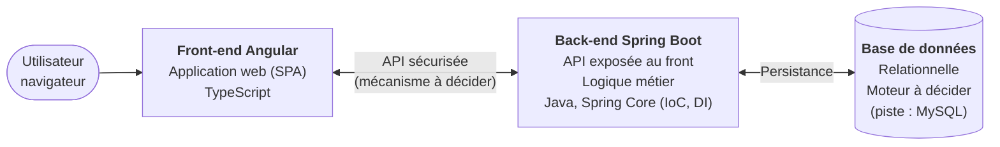

# Documentation et rapport du projet MDD

| Auteur | Version | Date |
|--------|---------|------|
| [Nom et prénom] | 0.0.1 | 10/11/2026 |

> Document de travail complété au fil du projet. Un élément non encore tranché est marqué **À décider**, une section non encore traitée **À compléter**.

## Sommaire

1. [Présentation générale du projet](#1-présentation-générale-du-projet)
2. [Architecture et conception technique](#2-architecture-et-conception-technique)
3. [Tests, performance et qualité](#3-tests-performance-et-qualité)
4. [Documentation utilisateur et supervision](#4-documentation-utilisateur-et-supervision)
5. [Annexes](#5-annexes)

---

## 1. Présentation générale du projet

### 1.1 Objectifs du projet

ORION développe **MDD (Monde de Dév)**, un réseau social destiné aux développeurs. Son but est d'aider les développeurs en recherche d'emploi grâce à la mise en relation et à la collaboration entre pairs. À terme, MDD pourra devenir un vivier de recrutement pour les entreprises.

Avant une ouverture au grand public, ORION teste le concept avec un **MVP déployé en interne**. Ce MVP permet de :

- s'abonner à des thèmes de programmation (JavaScript, Java, Python, Web3…) ;
- consulter un fil d'actualité chronologique des articles de ces thèmes ;
- écrire des articles et les commenter.

Le MVP ne comporte pas de back-office (zone d'administration).

### 1.2 Périmètre fonctionnel

Statuts possibles : **Terminée** / **En cours** / **À venir**.

| Fonctionnalités | Description | Statut |
|-----------------|-------------|--------|
| Accueil non connecté | Accès au formulaire de connexion et d'inscription | À venir |
| Inscription | E-mail, nom d'utilisateur et mot de passe ; validation du mot de passe (8 caractères min., chiffre, minuscule, majuscule, caractère spécial) | À venir |
| Connexion | Par e-mail ou nom d'utilisateur + mot de passe ; connexion persistante entre les sessions | À venir |
| Déconnexion | Fin de la session de l'utilisateur | À venir |
| Profil | Consultation (e-mail, nom d'utilisateur, abonnements) et modification (e-mail, nom d'utilisateur, mot de passe) | À venir |
| Liste des thèmes | Tous les thèmes, abonné ou non | À venir |
| Abonnement | S'abonner depuis la page des thèmes ; le bouton devient inactif et affiche « Déjà abonné » | À venir |
| Désabonnement | Depuis la page de profil | À venir |
| Fil d'actualité | Articles des thèmes suivis, triables du plus récent au plus ancien et inversement | À venir |
| Création d'article | Choix du thème, titre et contenu ; auteur et date définis automatiquement | À venir |
| Consultation d'article | Thème, titre, auteur, date, contenu et commentaires | À venir |
| Commentaires | Ajout d'un commentaire à un article (non récursif) ; auteur et date définis automatiquement | À venir |
| Responsive | Chaque écran s'adapte au mobile et à l'ordinateur | À venir |

---

## 2. Architecture et conception technique

### 2.1 Schéma global de l'architecture

Le MVP est découpé en **deux applications distinctes** : un front-end Angular et un back-end Spring Boot qui expose une API et gère la base de données.



**Légende**
- **Front-end** : l'interface affichée dans le navigateur ; il ne communique qu'avec l'API.
- **Back-end** : expose l'API, applique les règles métier et la sécurité ; il est le seul à accéder à la base de données.
- **Base de données** : stocke les utilisateurs, thèmes, abonnements, articles et commentaires.
- **Services tiers** : aucun prévu pour le MVP.

**Organisation du repository** (un seul repository GitHub, imposé par ORION) :

```
projet_5/
├── back/    # API Spring Boot (Maven)
├── front/   # Application Angular (Angular CLI)
└── README.md
```

Organisation interne des modules, dossiers et conventions : **À décider** (voir [Choix à décider](#choix-à-décider)).

### 2.2 Choix techniques

#### Contraintes imposées

Ces contraintes viennent des spécifications fonctionnelles et du document de contraintes techniques d'ORION. Tous les choix doivent les respecter.

| Domaine | Contrainte |
|---------|------------|
| Architecture | Back-end distinct du front-end, communication par une API |
| Sécurité | Interaction front / back sécurisée (méthode libre) |
| Conception | Respect des principes SOLID |
| Back-end | Java / Spring, Spring Core obligatoire (IoC, DI), Spring Boot recommandé |
| Modules | Un module Spring est prioritaire sur une librairie tierce (ex. Spring Data plutôt qu'EclipseLink) |
| Front-end | TypeScript / Angular, Angular CLI recommandé, bonnes pratiques de sécurité Angular |
| Code | Git et GitHub, un seul repository pour tout le projet |
| Ergonomie | Écrans responsive, maquettes de la designer respectées |

#### Existant repris

Le projet a été initialisé par une collègue développeuse. Ce socle est conservé tant qu'un choix ne justifie pas de le modifier.

| Partie | Ce qui existe |
|--------|---------------|
| Back-end (`back/`) | Spring Boot 2.7.3, Java 11, Maven ; dépendances `spring-boot-starter-web`, `spring-boot-starter-data-jpa`, `mysql-connector-java`, `spring-boot-starter-test` |
| Front-end (`front/`) | Angular 14 (CLI 14.1.3), TypeScript 4.7, Angular Material 14 configuré ; une page `home` et un routing de base |

Piste proposée : base relationnelle MySQL avec Spring Data JPA (préféré à Spring Data JDBC).

#### Tableau des choix

| Éléments choisis | Type | Lien documentation | Objectif du choix | Justification |
|------------------|------|--------------------|-------------------|---------------|
| Angular 22 | Framework front-end | [angular.dev](https://angular.dev) | Structurer l'application web : composants, routing, formulaires, appels HTTP | Angular imposé par ORION ; version 22 = version active, supportée jusqu'en juin 2028 (voir [Choix des versions](#choix-des-versions)) |
| TypeScript 6.0 | Langage front-end | [typescriptlang.org](https://www.typescriptlang.org/docs/) | Typer le code du front | Langage natif d'Angular ; version imposée par Angular 22 (>= 6.0 < 6.1) |
| Java 21 (LTS) | Langage back-end | [dev.java](https://dev.java) | Développer l'API | Java imposé par ORION ; version LTS supportée jusqu'en septembre 2028 |
| Spring Boot 4.1 (inclut Spring Core) | Framework back-end | [docs.spring.io/spring-boot](https://docs.spring.io/spring-boot/) | Fournir l'IoC / DI et accélérer la configuration de l'API | Spring Core obligatoire, Spring Boot recommandé ; 4.1 = seule version avec un support OSS durable (juillet 2027) |
| NgRx SignalStore | Gestion de l'état front-end | [ngrx.io/guide/signals](https://ngrx.io/guide/signals) | Partager l'état entre composants (utilisateur connecté, abonnements, fil d'articles) et mettre l'interface à jour automatiquement | Suit la recommandation NgRx des directives, dans sa version légère basée sur les signals (voir [Gestion de l'état front-end](#gestion-de-létat-front-end)) |
| Vitest | Tests unitaires front-end | [vitest.dev](https://vitest.dev) · [angular.dev/guide/testing](https://angular.dev/guide/testing) | Tester les composants et services Angular, mesurer la couverture | Lanceur de tests officiel et par défaut d'Angular 22, déjà configuré ; Jest étudié et écarté (voir [Tests unitaires front-end](#tests-unitaires-front-end)) |
| Git et GitHub, un seul repository | Gestion de code | [docs.github.com](https://docs.github.com) | Versionner le front et le back ensemble | Imposé par ORION |

#### Avantages et inconvénients

| Choix | Avantages | Inconvénients |
|-------|-----------|---------------|
| Angular | Framework complet (routing, formulaires réactifs, client HTTP, intercepteurs) ; protection XSS intégrée aux templates | Courbe d'apprentissage plus raide que React ou Vue ; bundle plus lourd |
| TypeScript | Erreurs détectées à la compilation ; modèles partagés entre services et composants | Étape de compilation ; types à maintenir face à l'API |
| Java | Écosystème mature, typage fort, large communauté | Code plus verbeux que Kotlin ou des langages de script |
| Spring Boot | Auto-configuration, serveur embarqué, starters (Web, Data, Security) ; IoC et DI au service des principes SOLID | Configuration implicite parfois difficile à diagnostiquer ; démarrage et mémoire plus lourds qu'un micro-framework |
| NgRx SignalStore | Structure commune à tous les stores, peu de code ; basé sur les signals ; état séparé des appels HTTP | Dépendance supplémentaire ; API à apprendre, moins de ressources que le Store classique |
| Vitest | Intégré à `ng test` et maintenu par Angular ; rapide (esbuild, mode watch ciblé) ; syntaxe compatible avec Jest | Plus récent que Jest : moins de tutoriels Angular existants l'utilisent |
| Git / GitHub, un seul repository | Historique partagé, revue par pull request ; front et back versionnés ensemble | Deux chaînes de build dans un même repository ; organisation des dossiers à garder rigoureuse |

#### Choix des versions

**Décision (10/11/2026) :** monter de version l'existant, qui n'était plus maintenu.

| Élément | Avant | Après | État de l'ancienne version | Support de la nouvelle |
|---------|-------|-------|----------------------------|------------------------|
| Java | 11 | **21 (LTS)** | Support Premier Oracle terminé en septembre 2023 | Premier jusqu'en septembre 2028 |
| Spring Boot | 2.7.3 | **4.1.2** | Support OSS terminé en juin 2023, plus de correctifs de sécurité | OSS jusqu'en juillet 2027 |
| Angular | 14 | **22.2** | Plus supporté (seules les versions 20 à 22 le sont) | Active, puis LTS jusqu'en juin 2028 |

Sources : [endoflife.date – Spring Boot](https://endoflife.date/spring-boot), [endoflife.date – Oracle JDK](https://endoflife.date/oracle-jdk), [Angular – Releases](https://angular.dev/reference/releases), [Angular – Compatibilité des versions](https://angular.dev/reference/versions), [Spring Boot – Prérequis](https://docs.spring.io/spring-boot/system-requirements.html).

**Alternatives écartées**
- *Conserver les versions d'origine* : plus de correctifs de sécurité, incompatible avec l'exigence d'une interaction front / back sécurisée ; Angular 14 ne fonctionne pas avec Node 22.
- *Spring Boot 3.5* : support OSS terminé en juin 2026. *Spring Boot 4.0* : support OSS jusqu'en décembre 2026 seulement.
- *Java 25 (LTS plus récente)* : possible, mais Java 21 est supporté plus longtemps que la durée du projet et compatible avec tout l'outillage.

**Méthode de migration**
- **Back-end** : `pom.xml` réaligné sur celui généré par Spring Initializr pour Spring Boot 4.1.2 / Java 21. Les starters changent de nom (`spring-boot-starter-web` → `spring-boot-starter-webmvc`, starters de test dédiés) et le driver MySQL devient `com.mysql:mysql-connector-j`. Le seul code existant (`MddApiApplication`) n'a pas changé.
- **Front-end** : projet **régénéré** avec Angular CLI 22 plutôt que migré. L'existant se limitait à une page de démonstration ; `ng update` aurait imposé 8 migrations successives (14 → 22) sans réécrire la structure en composants standalone. Les éléments personnalisés ont été repris à la main : page d'accueil, route, Angular Material, styles, logo et favicon.

**Inconvénients assumés**
- Remise en cause partielle du socle initial (impact faible : une classe côté back, une page côté front).
- Spring Boot 4 et Angular 22 diffèrent des nombreux tutoriels écrits pour Spring Boot 2 / 3 et Angular à base de `NgModule` : les exemples trouvés en ligne doivent être adaptés.
- Le thème Angular Material passe au système Material 3 (thème `azure-blue` par défaut), à ajuster aux maquettes.

#### Gestion de l'état front-end

**Décision (11/11/2026) :** **NgRx SignalStore** (`@ngrx/signals` 22, compatible avec Angular 22). Un premier choix de services + signals a été réévalué au profit de SignalStore pour suivre la recommandation NgRx des directives.

L'état partagé du MVP est réduit : l'utilisateur connecté, ses abonnements (partagés entre la page des thèmes et la page profil) et le fil d'articles avec son tri. Il sera réparti en trois stores :

| Store | État géré |
|-------|-----------|
| `AuthStore` | Utilisateur connecté, token |
| `TopicStore` | Liste des thèmes, abonnements de l'utilisateur |
| `PostStore` | Fil d'articles, sens du tri, article consulté |

Les appels HTTP restent dans des services dédiés (un par ressource de l'API), utilisés par les stores : les services communiquent avec l'API, les stores gèrent l'état (principe de responsabilité unique).

| Critère | Services + signals | NgRx Store (Redux) | NgRx SignalStore |
|---------|--------------------|--------------------|------------------|
| Principe | Un service par domaine expose des signals ; les composants les lisent | Store global unique ; l'état change uniquement via des actions traitées par des reducers ; effets de bord dans des effects | Un store par domaine, déclaré avec `signalStore()` (état, méthodes, valeurs calculées), exposé en signals |
| Code par fonctionnalité | ~1 fichier | ~4 fichiers (actions, reducer, effects, selectors) | ~1 fichier |
| Dépendance | Aucune (Angular natif) | `@ngrx/store`, `@ngrx/effects` | `@ngrx/signals` |
| Structure imposée | Aucune : conventions à fixer soi-même | Très forte, flux unidirectionnel prévisible | Moyenne, structure commune à tous les stores |
| Débogage | Outils Angular standard | Redux DevTools (historique et rejeu des actions) | Redux DevTools via une extension |
| Courbe d'apprentissage | Faible | Élevée (RxJS, actions, effects) | Moyenne |
| Adapté à un MVP de 5 écrans | Oui | Surdimensionné | Oui |

**Justification**
- Les directives recommandent NgRx. SignalStore en est la version moderne, recommandée par l'équipe NgRx pour les nouveaux projets.
- Il donne une structure commune à tous les stores (état, méthodes, valeurs calculées), sans le code répétitif du Store classique, surdimensionné pour 5 écrans.
- Il repose sur les signals, le mécanisme de réactivité natif d'Angular : les composants lisent l'état comme de simples signals.
- Il sépare clairement l'état (stores) des appels HTTP (services), ce qui facilite les tests et applique le principe de responsabilité unique.

**Alternatives écartées**
- *Services + signals* : plus simple et sans dépendance, mais aucune structure imposée, et écart avec la recommandation NgRx des directives.
- *NgRx Store classique* : très structuré, avec l'historique des actions dans les Redux DevTools, mais environ 4 fichiers par fonctionnalité et une courbe d'apprentissage élevée, disproportionnés pour ce MVP.

**Inconvénients assumés**
- Une dépendance supplémentaire (`@ngrx/signals`) à maintenir lors des montées de version d'Angular.
- API à apprendre (`signalStore`, `withState`, `withMethods`, `withComputed`, `patchState`) ; moins de ressources en ligne que pour le Store classique.

#### Tests unitaires front-end

**Décision (11/11/2026) :** **Vitest** (avec `jsdom`), lancé par `ng test` via le builder officiel `@angular/build:unit-test`.

L'existant utilisait Karma + Jasmine (configuration par défaut d'Angular 14), aujourd'hui déprécié par Angular. Aucune configuration Jest n'existait dans le projet.

| Critère | Vitest | Jest | Karma + Jasmine |
|---------|--------|------|-----------------|
| Support dans Angular 22 | Officiel, lanceur par défaut | Non officiel : builder communautaire `@angular-builders/jest` (le builder Jest d'Angular est resté expérimental) | Encore supporté, mais déprécié |
| Configuration dans le projet | Déjà en place depuis la régénération | À installer et configurer (`jest`, `jest-preset-angular`, `angular.json`, `jest.config.ts`) | Supprimée lors de la régénération |
| Moteur | Vite / esbuild, modules ES et TypeScript natifs | CommonJS, transformation préalable du TypeScript | Vrai navigateur (Chrome) |
| Vitesse | Rapide, ne relance que les tests touchés en mode watch | Correcte | Plus lente (lancement d'un navigateur) |
| Syntaxe | `describe` / `it` / `expect`, mocks `vi.fn()` | `describe` / `it` / `expect`, mocks `jest.fn()` | `describe` / `it` / `expect`, espions `jasmine.createSpy()` |

**Justification**
- Les directives recommandent Jest (étape 7 : « Utiliser les outils de test recommandés : JUnit, Jest, Cypress »). Angular a depuis fait de Vitest son lanceur officiel : c'est l'outil présenté par la documentation Angular.
- La syntaxe étant quasi identique à celle de Jest, les bonnes pratiques visées (nommage, isolation, Arrange–Act–Assert, couverture) s'appliquent de la même façon.
- Vitest évite d'ajouter et de maintenir une configuration communautaire, qui risquerait de casser à chaque montée de version d'Angular.

**Inconvénients assumés**
- Écart avec la recommandation Jest des directives, justifié ci-dessus.
- Outil plus récent : une partie des ressources Angular en ligne montre encore Jest ou Karma.

#### Choix à décider

Chaque décision rejoint le tableau des choix une fois tranchée. La piste indiquée est un point de départ, pas un choix.

- [x] **Versions** : Java 21, Spring Boot 4.1, Angular 22 (voir [Choix des versions](#choix-des-versions)).
- [ ] **Base de données** — piste : MySQL (relationnelle).
- [ ] **Accès aux données** — piste : Spring Data JPA plutôt que Spring Data JDBC.
- [ ] **Authentification et sécurisation de l'API** : mécanisme (session, JWT…), hachage des mots de passe, persistance de la connexion. Module Spring à privilégier : Spring Security.
- [ ] **Architecture back-end** : découpage en couches, organisation des packages, DTO et mapping.
- [ ] **Validation des données** : règles du mot de passe côté front et côté back.
- [ ] **Bibliothèque d'interface** — piste : Angular Material, déjà configuré.
- [x] **Gestion de l'état front-end** : NgRx SignalStore (voir [Gestion de l'état front-end](#gestion-de-létat-front-end)).
- [ ] **Architecture front-end** : organisation des dossiers, composants et services.
- [ ] **Outils de build** : Maven (en place côté back) et Angular CLI (en place côté front).
- [x] **Tests unitaires front** : Vitest (voir [Tests unitaires front-end](#tests-unitaires-front-end)).
- [ ] **Tests back et e2e** : tests unitaires et d'intégration back, tests end-to-end, outil de couverture back.
- [ ] **Documentation de l'API** : format et outil.
- [ ] **Conventions de code** : formatage, nommage, messages de commit.

### 2.3 API et schémas de données

**À compléter** une fois l'API conçue.

| Endpoint | Méthode | Description | Corps / Réponse |
|----------|---------|-------------|-----------------|
| | | | |

Représentation visuelle des entités et de leurs relations : **À compléter**.

---

## 3. Tests, performance et qualité

### 3.1 Stratégie de test

**À compléter** (outils à décider).

| Type de test | Outil / framework | Portée | Résultats |
|--------------|-------------------|--------|-----------|
| Test unitaire (front) | Vitest + jsdom | Composants et services Angular | |
| Test unitaire (back) | | | |
| Test d'intégration | | | |
| Test e2e | | | |

### 3.2 Rapport de performance et optimisation

**À compléter** : résultats d'audit (Lighthouse, SonarQube…), points d'amélioration identifiés, actions correctives appliquées.

### 3.3 Revue technique

**À compléter**.

- **Points forts** :
- **Points à améliorer** :
- **Actions correctives appliquées** :

---

## 4. Documentation utilisateur et supervision

### 4.1 FAQ utilisateur

**À compléter** une fois les fonctionnalités livrées.

**Q :** …
**R :** …

### 4.2 Supervision et tâches déléguées à l'IA

| Tâche déléguée | Outil / collaborateur | Objectif | Vérification effectuée |
|----------------|-----------------------|----------|------------------------|
| Synthèse du contexte, des spécifications et des contraintes du projet | Claude Code | Disposer d'un résumé de travail exhaustif | [À compléter] |
| Structure initiale de ce document à partir du template | Claude Code | Gagner du temps sur la mise en forme | [À compléter] |
| Recherche des versions supportées, mise à jour du `pom.xml`, régénération du front Angular 22 | Claude Code | Accélérer une migration mécanique | [À compléter] |

---

## 5. Annexes

- [ ] Captures d'écran de l'UI et vues principales
- [x] Analyse des besoins front-end (liens avec les spécifications et les maquettes) — [Annexe A](#annexe-a--analyse-des-maquettes-et-des-besoins-front-end)
- [x] Analyse du code existant — [Annexe B](#annexe-b--analyse-du-code-existant)
- [ ] Définition des données (schémas, formats, règles de validation et sécurisation)
- [ ] Rapports de couverture et de tests
- [ ] Rapport de revue technique

### Annexe A — Analyse des maquettes et des besoins front-end

Source : maquettes de Juana, [`docs/maquettes/maquettes-mdd.pdf`](docs/maquettes/maquettes-mdd.pdf) (export Figma, desktop et mobile). La consigne de la maquette est : « Chaque écran doit être responsive (utilisable à la fois sur ordinateur, tablette et téléphone) ». L'objectif est un respect global des écrans, pas un rendu au pixel près.

#### A.1 Écrans et lien avec les spécifications

| # | Écran | Contenu de la maquette | Spécification couverte |
|---|-------|------------------------|------------------------|
| 1 | Accueil (non connecté) | Logo MDD, boutons « Se connecter » et « S'inscrire » | Accéder au formulaire de connexion et d'inscription depuis la page d'accueil |
| 2 | Inscription | Flèche retour ; champs Nom d'utilisateur, Adresse e-mail, Mot de passe ; bouton « S'inscrire » | S'inscrire avec un e-mail, un mot de passe et un nom d'utilisateur |
| 3 | Connexion | Flèche retour ; champs « E-mail ou nom d'utilisateur », Mot de passe ; bouton « Se connecter » | Se connecter avec un e-mail ou un nom d'utilisateur |
| 4 | Fil d'actualité (« Articles ») | Bouton « Créer un article », « Trier par ↓ » ; cartes avec titre, date, auteur, extrait du contenu | Consulter son fil ; trier du plus récent au plus ancien et inversement |
| 5 | Thèmes | Cartes avec titre et description du thème ; bouton « S'abonner », ou « Déjà abonné » grisé | Consulter tous les thèmes ; s'abonner ; bouton inactif « Déjà abonné » |
| 6 | Détail d'un article | Flèche retour ; titre, date, auteur, thème, contenu complet ; section « Commentaires » (nom d'utilisateur + contenu) ; zone « Écrivez ici votre commentaire » + icône d'envoi | Consulter un article ; ajouter un commentaire |
| 7 | Création d'un article | Flèche retour ; liste « Sélectionner un thème », champs Titre et Contenu ; bouton « Créer » | Ajouter un article (thème, titre, contenu) |
| 8 | Profil | Champs Username, e-mail, Mot de passe ; bouton « Sauvegarder » ; section « Abonnements » : cartes de thème avec « Se désabonner » | Consulter et modifier son profil ; se désabonner |

Toutes les fonctionnalités des spécifications ont un écran, et aucun écran n'introduit de fonctionnalité hors spécifications. La déconnexion se fait par le lien « Se déconnecter » de l'en-tête.

#### A.2 Navigation et mise en page

- **En-tête connecté (desktop)** : logo à gauche ; à droite, « Se déconnecter » (en rouge), « Articles », « Thèmes » (lien actif en violet) et une icône d'utilisateur qui mène au profil.
- **En-tête connecté (mobile)** : logo et menu burger. Au clic, un panneau latéral s'ouvre à droite avec « Se déconnecter », « Articles », « Thèmes » et l'icône de profil en bas.
- **Inscription et connexion** : en-tête réduit au logo sur desktop ; sur mobile, pas d'en-tête, flèche retour et grand logo au-dessus du formulaire.
- **Grilles responsive** : cartes d'articles et de thèmes sur 2 colonnes en desktop, 1 colonne en mobile.
- **Flèche retour** sur l'inscription, la connexion, le détail et la création d'un article.

#### A.3 Composants front-end identifiés

| Composant | Utilisé sur | Remarque |
|-----------|-------------|----------|
| En-tête connecté + menu mobile | Fil, thèmes, article, création, profil | Un seul composant de mise en page, avec un panneau latéral en mobile |
| En-tête minimal (logo) | Inscription, connexion | Masqué en mobile |
| Bouton retour | Inscription, connexion, article, création | Revient à la page précédente |
| Carte d'article | Fil | Titre, date, auteur, extrait du contenu |
| Carte de thème | Thèmes, profil | **Réutilisable** : seuls le bouton et son action changent (« S'abonner » / « Déjà abonné » sur la page des thèmes, « Se désabonner » sur le profil) |
| Commentaire | Détail d'un article | Nom d'utilisateur + bulle de contenu |
| Formulaires | Inscription, connexion, création, profil, commentaire | Champs et bouton violet, messages de validation à afficher |

Style relevé : couleur principale violette (boutons, logo, lien actif), rouge pour « Se déconnecter », cartes sur fond gris clair, bouton désactivé gris. Les valeurs exactes (couleurs, police, espacements) seront relevées dans Figma lors de l'intégration (étape 6).

#### A.4 Données nécessaires (impact sur le modèle et l'API)

| Élément | Données affichées ou saisies |
|---------|------------------------------|
| Thème | Titre, **description** (la description n'est pas citée dans les spécifications, mais elle figure sur la maquette) |
| Article, carte du fil | Titre, date, nom de l'auteur, extrait du contenu |
| Article, détail | Titre, date, nom de l'auteur, nom du thème, contenu complet, commentaires |
| Commentaire | Nom de l'auteur, contenu (la date est enregistrée automatiquement, mais n'est pas affichée sur la maquette) |
| Profil | Nom d'utilisateur, e-mail, nouveau mot de passe, abonnements (titre et description de chaque thème) |
| Page des thèmes | Pour chaque thème : savoir si l'utilisateur y est déjà abonné |
| Création d'un article | Liste des thèmes à proposer dans la liste de sélection |

#### A.5 Points non précisés par la maquette (à trancher sans ajouter de fonctionnalité)

- **Messages d'erreur et de validation** (mot de passe invalide, identifiants incorrects, champ vide) : non dessinés, à afficher sous les champs concernés.
- **Fil ou liste d'abonnements vides** : aucun état vide dessiné ; un message court suffira.
- **Champ mot de passe du profil** : il sert à saisir un nouveau mot de passe ; il sera vide par défaut et facultatif.
- **Tri du fil** : « Trier par ↓ » ne précise pas le critère ; d'après les spécifications, il s'agit de la date, en ordre décroissant ou croissant, et la flèche indique le sens.
- **Pagination** : non prévue sur la maquette ni dans les spécifications, donc pas de pagination.

### Annexe B — Analyse du code existant

État du repository au démarrage (commit `d3e5bf5`).

| Partie | Existant | À compléter ou corriger | Traitement |
|--------|----------|-------------------------|------------|
| Back-end | `MddApiApplication` ; dépendances Web, Data JPA, MySQL | Spring Boot 2.7.3 et Java 11 ne sont plus maintenus | Mis à jour : Spring Boot 4.1.2, Java 21 |
| Back-end | `application.properties` vide | Pas de connexion à la base : le test `contextLoads` échoue | Étape 3 |
| Back-end | — | Aucune entité, aucun endpoint, aucune sécurité | Étapes 2 à 6 |
| Front-end | Angular 14, structure à `NgModule` ; Karma + Jasmine | Angular 14 n'est plus supporté et ne fonctionne pas avec Node 22 ; Karma est déprécié | Régénéré en Angular 22 (standalone, Vitest) |
| Front-end | Page `home` de démonstration (logo, titre, bouton avec `alert`) | Ne correspond pas à l'écran d'accueil de la maquette | Remplacée à l'étape 5 / 6 |
| Front-end | Angular Material, thème `deeppurple-amber` | Thème à adapter aux couleurs de la maquette | Material conservé, thème à l'étape 6 |
| Front-end | Commentaire du routing suggérant des guards pour les routes privées | — | Repris dans la conception (guards) |
