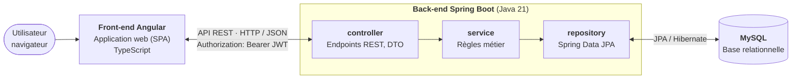
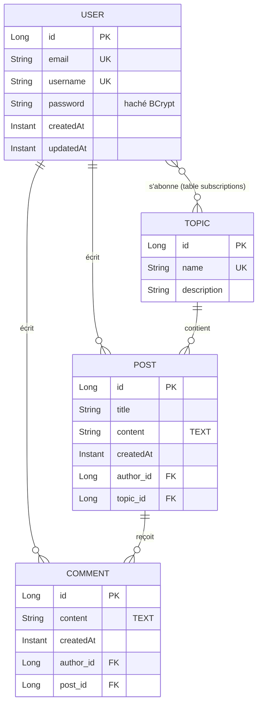

# Documentation et rapport du projet MDD

| Auteur | Version | Date |
|--------|---------|------|
| [Nom et prénom] | 0.0.1 | 10/11/2026 |

> Document de travail complété au fil du projet. Un élément non encore tranché est marqué **À décider**, une section non encore traitée **À compléter**.

## Sommaire

1. [Présentation générale du projet](#1-présentation-générale-du-projet)
2. [Architecture et conception technique](#2-architecture-et-conception-technique)
3. [Tests, performance et qualité](#3-tests-performance-et-qualité)
4. [Documentation utilisateur et supervision](#4-documentation-utilisateur-et-supervision)
5. [Annexes](#5-annexes)

---

## 1. Présentation générale du projet

### 1.1 Objectifs du projet

ORION développe **MDD (Monde de Dév)**, un réseau social destiné aux développeurs. Son but est d'aider les développeurs en recherche d'emploi grâce à la mise en relation et à la collaboration entre pairs. À terme, MDD pourra devenir un vivier de recrutement pour les entreprises.

Avant une ouverture au grand public, ORION teste le concept avec un **MVP déployé en interne**. Ce MVP permet de :

- s'abonner à des thèmes de programmation (JavaScript, Java, Python, Web3…) ;
- consulter un fil d'actualité chronologique des articles de ces thèmes ;
- écrire des articles et les commenter.

Le MVP ne comporte pas de back-office (zone d'administration).

### 1.2 Périmètre fonctionnel

Statuts possibles : **Terminée** / **En cours** / **À venir**.

| Fonctionnalités | Description | Statut |
|-----------------|-------------|--------|
| Accueil non connecté | Accès au formulaire de connexion et d'inscription | À venir |
| Inscription | E-mail, nom d'utilisateur et mot de passe ; validation du mot de passe (8 caractères min., chiffre, minuscule, majuscule, caractère spécial) | À venir |
| Connexion | Par e-mail ou nom d'utilisateur + mot de passe ; connexion persistante entre les sessions | À venir |
| Déconnexion | Fin de la session de l'utilisateur | À venir |
| Profil | Consultation (e-mail, nom d'utilisateur, abonnements) et modification (e-mail, nom d'utilisateur, mot de passe) | À venir |
| Liste des thèmes | Tous les thèmes, abonné ou non | À venir |
| Abonnement | S'abonner depuis la page des thèmes ; le bouton devient inactif et affiche « Déjà abonné » | À venir |
| Désabonnement | Depuis la page de profil | À venir |
| Fil d'actualité | Articles des thèmes suivis, triables du plus récent au plus ancien et inversement | À venir |
| Création d'article | Choix du thème, titre et contenu ; auteur et date définis automatiquement | À venir |
| Consultation d'article | Thème, titre, auteur, date, contenu et commentaires | À venir |
| Commentaires | Ajout d'un commentaire à un article (non récursif) ; auteur et date définis automatiquement | À venir |
| Responsive | Chaque écran s'adapte au mobile et à l'ordinateur | À venir |

---

## 2. Architecture et conception technique

### 2.1 Schéma global de l'architecture

Le MVP suit une **architecture client-serveur** : un front-end Angular (client) appelle en HTTP / JSON une **API REST** Spring Boot (serveur), seule à accéder à la base de données MySQL. Le back-end est organisé **en couches**.



**Légende**
- **Front-end** : l'interface affichée dans le navigateur ; il ne communique qu'avec l'API.
- **Sécurité** : Spring Security vérifie le JWT de chaque requête avant qu'elle atteigne un contrôleur (sauf inscription et connexion).
- **controller** : reçoit les requêtes HTTP, valide les données reçues, renvoie des DTO en JSON. Aucune règle métier.
- **service** : applique les règles métier (auteur et date automatiques, abonnements, tri du fil…).
- **repository** : accès aux données via Spring Data JPA ; seule couche qui parle à la base.
- **MySQL** : stocke les utilisateurs, thèmes, abonnements, articles et commentaires. Tables créées par l'ORM.
- **Services tiers** : aucun prévu pour le MVP.

**Organisation du repository** (un seul repository GitHub, imposé par ORION) :

```
projet_5/
├── back/    # API Spring Boot (Maven)
├── front/   # Application Angular (Angular CLI)
├── docs/    # Maquettes et documents annexes
├── JUSTIFICATION_CHOIX_TECHNIQUES.md
└── README.md
```

**Organisation des packages du back-end** (par couche) :

```
com.openclassrooms.mddapi/
├── controller/   # Contrôleurs REST
├── service/      # Logique métier
├── repository/   # Interfaces Spring Data JPA
├── entity/       # Entités JPA (tables)
├── dto/          # Objets échangés avec le front
├── mapper/       # Conversion entité <-> DTO
├── exception/    # Exceptions métier et gestion globale des erreurs
├── security/     # Configuration Spring Security, authentification
└── config/       # Autres configurations (CORS…)
```

Organisation du front-end : **À décider** (voir [Choix à décider](#choix-à-décider)).

### 2.2 Choix techniques

#### Contraintes imposées

Ces contraintes viennent des spécifications fonctionnelles et du document de contraintes techniques d'ORION. Tous les choix doivent les respecter.

| Domaine | Contrainte |
|---------|------------|
| Architecture | Back-end distinct du front-end, communication par une API |
| Sécurité | Interaction front / back sécurisée (méthode libre) |
| Conception | Respect des principes SOLID |
| Back-end | Java / Spring, Spring Core obligatoire (IoC, DI), Spring Boot recommandé |
| Modules | Un module Spring est prioritaire sur une librairie tierce (ex. Spring Data plutôt qu'EclipseLink) |
| Front-end | TypeScript / Angular, Angular CLI recommandé, bonnes pratiques de sécurité Angular |
| Code | Git et GitHub, un seul repository pour tout le projet |
| Ergonomie | Écrans responsive, maquettes de la designer respectées |

#### Existant repris

Le projet a été initialisé par une collègue développeuse. Ce socle est conservé tant qu'un choix ne justifie pas de le modifier.

| Partie | Ce qui existe |
|--------|---------------|
| Back-end (`back/`) | Spring Boot 2.7.3, Java 11, Maven ; dépendances `spring-boot-starter-web`, `spring-boot-starter-data-jpa`, `mysql-connector-java`, `spring-boot-starter-test` |
| Front-end (`front/`) | Angular 14 (CLI 14.1.3), TypeScript 4.7, Angular Material 14 configuré ; une page `home` et un routing de base |

Piste proposée : base relationnelle MySQL avec Spring Data JPA (préféré à Spring Data JDBC).

#### Tableau des choix

| Éléments choisis | Type | Lien documentation | Objectif du choix | Justification |
|------------------|------|--------------------|-------------------|---------------|
| Angular 22 | Framework front-end | [angular.dev](https://angular.dev) | Structurer l'application web : composants, routing, formulaires, appels HTTP | Angular imposé par ORION ; version 22 = version active, supportée jusqu'en juin 2028 (voir [Choix des versions](#choix-des-versions)) |
| TypeScript 6.0 | Langage front-end | [typescriptlang.org](https://www.typescriptlang.org/docs/) | Typer le code du front | Langage natif d'Angular ; version imposée par Angular 22 (>= 6.0 < 6.1) |
| Java 21 (LTS) | Langage back-end | [dev.java](https://dev.java) | Développer l'API | Java imposé par ORION ; version LTS supportée jusqu'en septembre 2028 |
| Spring Boot 4.1 (inclut Spring Core) | Framework back-end | [docs.spring.io/spring-boot](https://docs.spring.io/spring-boot/) | Fournir l'IoC / DI et accélérer la configuration de l'API | Spring Core obligatoire, Spring Boot recommandé ; 4.1 = seule version avec un support OSS durable (juillet 2027) |
| Client-serveur, API REST | Architecture globale | [Spring – Building REST services](https://spring.io/guides/tutorials/rest) | Séparer le front et le back, qui communiquent en HTTP / JSON | Imposé par les contraintes (back-end distinct, communication par une API) ; standard le plus répandu (voir [Architecture logicielle](#architecture-logicielle)) |
| Architecture en couches, packages par couche | Architecture back-end | [Spring Boot – Structuring your code](https://docs.spring.io/spring-boot/reference/using/structuring-your-code.html) | Séparer les responsabilités : HTTP, métier, accès aux données | Standard Spring, lisible, applique SOLID ; adaptée à 5 entités (voir [Architecture logicielle](#architecture-logicielle)) |
| MySQL | Base de données | [dev.mysql.com/doc](https://dev.mysql.com/doc/) | Stocker les données relationnelles du MVP | Données fortement liées ; choix initial d'Heidi, déjà installé et configuré dans le `pom.xml` (voir [Base de données et accès aux données](#base-de-données-et-accès-aux-données)) |
| Spring Data JPA (Hibernate) | Accès aux données (ORM) | [docs.spring.io/spring-data/jpa](https://docs.spring.io/spring-data/jpa/reference/) | Associer les entités Java aux tables, générer les requêtes et le schéma | Module Spring prioritaire (contrainte) ; création de la base via l'ORM ; choix initial d'Heidi (voir [Base de données et accès aux données](#base-de-données-et-accès-aux-données)) |
| Spring Security | Sécurité back-end | [docs.spring.io/spring-security](https://docs.spring.io/spring-security/reference/) | Protéger l'API : authentification, routes publiques / protégées, CORS | Module Spring prioritaire (contrainte) ; standard de la sécurité dans Spring (voir [Sécurité et authentification](#sécurité-et-authentification)) |
| JWT via Spring Security OAuth2 Resource Server | Authentification | [Spring Security – OAuth2 Resource Server JWT](https://docs.spring.io/spring-security/reference/servlet/oauth2/resource-server/jwt.html) | Authentifier chaque requête par un token signé (HS256), valable 7 jours | API sans état ; connexion persistante sans stocker le mot de passe ; module Spring plutôt que la librairie jjwt (voir [Sécurité et authentification](#sécurité-et-authentification)) |
| BCrypt | Hachage des mots de passe | [Spring Security – Password Storage](https://docs.spring.io/spring-security/reference/features/authentication/password-storage.html) | Ne jamais stocker un mot de passe en clair | Algorithme de référence de Spring Security, sel intégré, coût réglable |
| Records Java + Lombok (usage limité) | Réduction du code répétitif | [Java – Records](https://docs.oracle.com/en/java/javase/21/language/records.html) · [projectlombok.org](https://projectlombok.org/features/) | Écrire des DTO immuables et des entités sans getters / setters manuels | Records natifs pour les DTO ; Lombok limité aux entités et à l'injection par constructeur, sans `@Data` (voir [Librairies back-end](#librairies-back-end)) |
| MapStruct | Conversion entité ↔ DTO | [mapstruct.org](https://mapstruct.org/documentation/stable/reference/html/) | Convertir les entités en DTO et inversement | Code généré à la compilation, oublis de champs détectés ; outil de référence en Spring (voir [Librairies back-end](#librairies-back-end)) |
| Bean Validation (`spring-boot-starter-validation`) | Validation des données | [Spring – Validation](https://docs.spring.io/spring-framework/reference/core/validation/beanvalidation.html) | Valider les données reçues par l'API, dont la règle du mot de passe | Module Spring ; règles déclarées sur les DTO, erreurs renvoyées champ par champ (voir [Librairies back-end](#librairies-back-end)) |
| `ProblemDetail` (RFC 9457) | Format des erreurs | [Spring – Error Responses](https://docs.spring.io/spring-framework/reference/web/webmvc/mvc-ann-rest-exceptions.html) | Renvoyer des erreurs au format standard, gérées en un seul endroit | Natif Spring, aucun format à inventer ; centralisé dans un `@RestControllerAdvice` (voir [Librairies back-end](#librairies-back-end)) |
| springdoc-openapi (Swagger UI) | Documentation de l'API | [springdoc.org](https://springdoc.org) | Documenter et tester les endpoints dans le navigateur | Documentation générée depuis le code, toujours à jour ; écart assumé avec la priorité aux modules Spring (voir [Librairies back-end](#librairies-back-end)) |
| NgRx SignalStore | Gestion de l'état front-end | [ngrx.io/guide/signals](https://ngrx.io/guide/signals) | Partager l'état entre composants (utilisateur connecté, abonnements, fil d'articles) et mettre l'interface à jour automatiquement | Suit la recommandation NgRx des directives, dans sa version légère basée sur les signals (voir [Gestion de l'état front-end](#gestion-de-létat-front-end)) |
| Vitest | Tests unitaires front-end | [vitest.dev](https://vitest.dev) · [angular.dev/guide/testing](https://angular.dev/guide/testing) | Tester les composants et services Angular, mesurer la couverture | Lanceur de tests officiel et par défaut d'Angular 22, déjà configuré ; Jest étudié et écarté (voir [Tests unitaires front-end](#tests-unitaires-front-end)) |
| Git et GitHub, un seul repository | Gestion de code | [docs.github.com](https://docs.github.com) | Versionner le front et le back ensemble | Imposé par ORION |

#### Avantages et inconvénients

| Choix | Avantages | Inconvénients |
|-------|-----------|---------------|
| Angular | Framework complet (routing, formulaires réactifs, client HTTP, intercepteurs) ; protection XSS intégrée aux templates | Courbe d'apprentissage plus raide que React ou Vue ; bundle plus lourd |
| TypeScript | Erreurs détectées à la compilation ; modèles partagés entre services et composants | Étape de compilation ; types à maintenir face à l'API |
| Java | Écosystème mature, typage fort, large communauté | Code plus verbeux que Kotlin ou des langages de script |
| Spring Boot | Auto-configuration, serveur embarqué, starters (Web, Data, Security) ; IoC et DI au service des principes SOLID | Configuration implicite parfois difficile à diagnostiquer ; démarrage et mémoire plus lourds qu'un micro-framework |
| Client-serveur, API REST | Front et back indépendants (développement, déploiement, évolution) ; standard compris de tous ; API sans état, réutilisable par un autre client (application mobile) | Deux applications à lancer et configurer ; communication réseau à sécuriser (authentification, CORS) |
| Architecture en couches | Responsabilités séparées, code lisible et testable couche par couche ; standard Spring | Le métier dépend des entités JPA ; risque de services « fourre-tout » si le projet grossit |
| MySQL | Gratuit, très répandu, déjà installé ; relations et contraintes d'intégrité gérées par la base | Moins de fonctionnalités avancées que PostgreSQL (inutiles pour le MVP) |
| Spring Data JPA | Relations gérées automatiquement ; requêtes générées depuis le nom des méthodes ; schéma créé par l'ORM | « Magie » à maîtriser : chargement paresseux, requêtes N+1 ; SQL généré moins visible |
| Spring Security | Protection complète et éprouvée (filtres, CORS, en-têtes de sécurité) ; intégré à Spring Boot | Configuration dense, comportement par défaut parfois surprenant (tout est protégé) |
| JWT (OAuth2 Resource Server) | API sans état ; connexion persistante ; vérification du token gérée par Spring, sans filtre écrit à la main | Token volé valable jusqu'à son expiration ; déconnexion uniquement côté client |
| BCrypt | Lent par conception (résiste à la force brute) ; sel intégré ; standard Spring | Argon2 est plus récent et plus robuste (non nécessaire pour le MVP) |
| Records + Lombok | DTO immuables sans dépendance ; entités courtes et lisibles | Code généré invisible, plugin d'IDE nécessaire ; pièges de `@Data` sur les entités (évité) |
| MapStruct | Peu de code ; erreurs de mapping détectées à la compilation ; aussi rapide que du code manuel | Dépendance et processeur d'annotations à configurer avec Lombok |
| Bean Validation | Validation déclarative et centralisée sur les DTO ; module Spring | Les règles métier (unicité) restent à vérifier dans le service |
| `ProblemDetail` | Format standard, natif, extensible | Un peu plus verbeux qu'un format maison |
| springdoc-openapi | Documentation interactive, à jour, importable dans Postman ; presque aucune configuration | Librairie tierce ; annotations ajoutées dans les contrôleurs |
| NgRx SignalStore | Structure commune à tous les stores, peu de code ; basé sur les signals ; état séparé des appels HTTP | Dépendance supplémentaire ; API à apprendre, moins de ressources que le Store classique |
| Vitest | Intégré à `ng test` et maintenu par Angular ; rapide (esbuild, mode watch ciblé) ; syntaxe compatible avec Jest | Plus récent que Jest : moins de tutoriels Angular existants l'utilisent |
| Git / GitHub, un seul repository | Historique partagé, revue par pull request ; front et back versionnés ensemble | Deux chaînes de build dans un même repository ; organisation des dossiers à garder rigoureuse |

#### Choix des versions

**Décision (10/11/2026) :** monter de version l'existant, qui n'était plus maintenu.

| Élément | Avant | Après | État de l'ancienne version | Support de la nouvelle |
|---------|-------|-------|----------------------------|------------------------|
| Java | 11 | **21 (LTS)** | Support Premier Oracle terminé en septembre 2023 | Premier jusqu'en septembre 2028 |
| Spring Boot | 2.7.3 | **4.1.2** | Support OSS terminé en juin 2023, plus de correctifs de sécurité | OSS jusqu'en juillet 2027 |
| Angular | 14 | **22.2** | Plus supporté (seules les versions 20 à 22 le sont) | Active, puis LTS jusqu'en juin 2028 |

Sources : [endoflife.date – Spring Boot](https://endoflife.date/spring-boot), [endoflife.date – Oracle JDK](https://endoflife.date/oracle-jdk), [Angular – Releases](https://angular.dev/reference/releases), [Angular – Compatibilité des versions](https://angular.dev/reference/versions), [Spring Boot – Prérequis](https://docs.spring.io/spring-boot/system-requirements.html).

**Alternatives écartées**
- *Conserver les versions d'origine* : plus de correctifs de sécurité, incompatible avec l'exigence d'une interaction front / back sécurisée ; Angular 14 ne fonctionne pas avec Node 22.
- *Spring Boot 3.5* : support OSS terminé en juin 2026. *Spring Boot 4.0* : support OSS jusqu'en décembre 2026 seulement.
- *Java 25 (LTS plus récente)* : possible, mais Java 21 est supporté plus longtemps que la durée du projet et compatible avec tout l'outillage.

**Méthode de migration**
- **Back-end** : `pom.xml` réaligné sur celui généré par Spring Initializr pour Spring Boot 4.1.2 / Java 21. Les starters changent de nom (`spring-boot-starter-web` → `spring-boot-starter-webmvc`, starters de test dédiés) et le driver MySQL devient `com.mysql:mysql-connector-j`. Le seul code existant (`MddApiApplication`) n'a pas changé.
- **Front-end** : projet **régénéré** avec Angular CLI 22 plutôt que migré. L'existant se limitait à une page de démonstration ; `ng update` aurait imposé 8 migrations successives (14 → 22) sans réécrire la structure en composants standalone. Les éléments personnalisés ont été repris à la main : page d'accueil, route, Angular Material, styles, logo et favicon.

**Inconvénients assumés**
- Remise en cause partielle du socle initial (impact faible : une classe côté back, une page côté front).
- Spring Boot 4 et Angular 22 diffèrent des nombreux tutoriels écrits pour Spring Boot 2 / 3 et Angular à base de `NgModule` : les exemples trouvés en ligne doivent être adaptés.
- Le thème Angular Material passe au système Material 3 (thème `azure-blue` par défaut), à ajuster aux maquettes.

#### Architecture logicielle

**Décision (11/11/2026) :** architecture **client-serveur avec une API REST** ; back-end **en couches** (`controller` → `service` → `repository`), packages organisés **par couche**.

**Architecture globale**

| Option | Principe | Pour MDD |
|--------|----------|----------|
| **Client-serveur, API REST** (retenue) | Le front (Angular) appelle en HTTP / JSON une API (Spring Boot), seule à accéder à la base | Imposée par les contraintes : back-end distinct du front-end, communication par une API |
| Monolithe avec rendu serveur | Le serveur génère les pages HTML (ex. Thymeleaf) | Incompatible avec Angular, imposé pour le front |
| Microservices | Un service par domaine (utilisateurs, articles…), chacun avec sa base | Surdimensionné : communication entre services, déploiements multiples, supervision |
| Pilotée par les événements | Les composants communiquent par messages (Kafka, RabbitMQ) | Aucun besoin asynchrone dans les spécifications |

**Architecture du back-end**

| Option | Principe | Avantages | Inconvénients |
|--------|----------|-----------|---------------|
| **En couches** (retenue) | `controller` (HTTP) → `service` (métier) → `repository` (données) ; chaque couche n'appelle que celle du dessous | Standard Spring, simple à lire et à tester ; applique directement SOLID | Le métier dépend un peu de la persistance (entités JPA) |
| Hexagonale (ports et adaptateurs) | Métier au centre, indépendant de Spring et de la base ; interfaces (ports) et implémentations (adaptateurs) autour | Métier totalement isolé et testable | Beaucoup d'interfaces et de conversions pour un CRUD de 5 entités : surdimensionné |

**Organisation des packages**

| Option | Avantages | Inconvénients |
|--------|-----------|---------------|
| **Par couche** (retenue) : `controller/`, `service/`, `repository/`… | Lisible immédiatement par tout développeur Spring ; adaptée à 5 entités | Les fichiers d'une même fonctionnalité sont répartis dans plusieurs packages |
| Par fonctionnalité : `user/`, `topic/`, `post/`, `comment/` | Tout le code d'une fonctionnalité au même endroit ; mieux adaptée à un gros projet | Moins habituelle ; découpage peu utile avec 5 entités |

**Application des principes SOLID**
- **S** (responsabilité unique) : chaque couche et chaque classe a un rôle (le contrôleur ne contient pas de métier, le service n'écrit pas de SQL).
- **O** (ouvert / fermé) : gestion des erreurs centralisée et extensible (nouvelle exception = nouveau gestionnaire, sans modifier les contrôleurs).
- **L** (substitution de Liskov) : les repositories étendent les interfaces Spring Data sans en changer le contrat.
- **I** (ségrégation des interfaces) : un repository par entité, exposant uniquement les requêtes utiles.
- **D** (inversion des dépendances) : les dépendances sont injectées par Spring (IoC / DI), par constructeur.

**Évolutivité**
- L'API ne garde pas d'état entre deux requêtes : plusieurs instances du back-end peuvent tourner derrière un répartiteur de charge.
- Les couches permettent de remplacer une technologie (base, sécurité) sans toucher aux autres.
- Si le projet grossit, le passage à des packages par fonctionnalité reste un simple déplacement de fichiers.

#### Base de données et accès aux données

**Décision (11/11/2026) :** base relationnelle **MySQL**, accès par **Spring Data JPA** (Hibernate), tables créées par l'ORM.

Les données de MDD sont fortement liées : un article a un auteur et un thème, un commentaire a un article et un auteur, un utilisateur est abonné à plusieurs thèmes. Une base relationnelle garantit ces liens (clés étrangères, contraintes d'unicité) ; une base NoSQL (ex. MongoDB) serait moins adaptée.

| Critère | **MySQL** (retenue) | PostgreSQL |
|---------|---------------------|------------|
| Type | Relationnelle | Relationnelle |
| Avantages | Choix initial d'Heidi ; déjà installé (MySQL 26.7) ; pilote déjà dans le `pom.xml` ; très répandu | Plus riche (types JSON, contraintes avancées), réputé plus strict sur le standard SQL |
| Inconvénients | Moins de fonctionnalités avancées, inutiles ici | À installer ; remettrait en cause le choix initial sans gain pour le MVP |

| Critère | **Spring Data JPA** (retenu) | Spring Data JDBC |
|---------|------------------------------|------------------|
| Principe | ORM : les classes `@Entity` sont associées aux tables ; requêtes générées depuis le nom des méthodes | Correspondance simple objet / table, sans chargement paresseux ni cache, plus de SQL écrit à la main |
| Avantages | Relations (`@ManyToOne`, `@ManyToMany`) gérées automatiquement ; création du schéma par l'ORM ; très documenté | Plus prévisible, moins de « magie » |
| Inconvénients | Pièges à connaître : chargement paresseux, requêtes N+1 | Relations entre agrégats moins pratiques ; schéma à écrire soi-même |

**Justification**
- Les contraintes imposent de privilégier un module Spring Data ; les deux candidats en sont.
- JPA permet de **créer la base via l'ORM**, comme demandé pour la mise en place de l'environnement, et gère les relations du modèle sans SQL manuel.
- MySQL et JPA étaient les choix initiaux d'Heidi : les conserver évite de remettre en cause le socle sans gain.

#### Sécurité et authentification

**Décision (11/11/2026) :** **Spring Security** avec authentification par **JWT**, généré et vérifié par le module **OAuth2 Resource Server** ; mots de passe hachés avec **BCrypt**.

Besoins à couvrir : interaction front / back sécurisée (contrainte), connexion par e-mail ou nom d'utilisateur, **connexion persistante entre les sessions**, règles du mot de passe (spécifications), sans surcomplexifier la sécurité d'un MVP interne (directives).

**Mécanisme d'authentification**

| Critère | **JWT** (retenu) | Basic Auth | Session serveur (cookie) |
|---------|------------------|------------|--------------------------|
| Principe | À la connexion, le back renvoie un token signé ; le front l'envoie dans l'en-tête `Authorization: Bearer …` à chaque requête | Identifiant et mot de passe (Base64) envoyés à chaque requête | Session en mémoire côté serveur, cookie `JSESSIONID` dans le navigateur |
| Connexion persistante | Oui : token stocké côté front, valable jusqu'à son expiration | Impose de stocker le mot de passe côté front : à proscrire | Cookie de session perdu à la fermeture du navigateur (sauf « remember-me ») |
| API sans état | Oui | Oui | Non |
| Complexité | Moyenne | Faible | Moyenne (protection CSRF) |
| Inconvénient principal | Token volé valable jusqu'à son expiration | Mot de passe circulant et stocké côté client | Peu adapté à une SPA et à une API REST |

**Génération et vérification du token**

| Critère | **Spring Security OAuth2 Resource Server** (retenu) | Librairie jjwt |
|---------|-----------------------------------------------------|----------------|
| Principe | Module officiel : vérification automatique du JWT à chaque requête ; génération avec le `JwtEncoder` (Nimbus) fourni | Librairie tierce : filtre de lecture et de vérification du token à écrire soi-même |
| Avantages | Module Spring (contrainte) ; moins de code de sécurité écrit à la main | Très présente dans les tutoriels |
| Inconvénients | Moins de tutoriels « débutant » | Filtre et gestion des erreurs à écrire et tester soi-même |

Malgré son nom, ce module n'implique pas de serveur OAuth : il sert uniquement à vérifier des JWT. Le token est signé en **HS256** avec une clé secrète lue dans une **variable d'environnement**, jamais commitée.

**Mots de passe**
- Hachage avec **BCrypt** (`BCryptPasswordEncoder`).
- Règles (8 caractères minimum, un chiffre, une minuscule, une majuscule, un caractère spécial) vérifiées **côté front** (retour immédiat) **et côté back** (le front peut être contourné).
- Le mot de passe n'est jamais renvoyé par l'API, même haché, ni écrit dans les logs.

**Côté front-end**

| Sujet | Choix | Alternative écartée |
|-------|-------|---------------------|
| Stockage du token | `localStorage` : survit à la fermeture du navigateur, donc connexion persistante | Cookie `HttpOnly` : mieux protégé contre le vol par XSS, mais impose la gestion du CSRF et des cookies cross-origin, trop complexe pour le MVP. Le risque XSS est réduit par l'échappement automatique des templates Angular. |
| Envoi du token | Intercepteur HTTP qui ajoute `Authorization: Bearer …` | Ajout manuel dans chaque service : répétitif, oublis possibles |
| Routes protégées | Guard (`canActivate`) qui redirige vers la connexion | — |
| Token expiré ou invalide | Réponse 401 : l'intercepteur déconnecte l'utilisateur et le redirige vers la connexion | — |
| Déconnexion | Suppression du token côté front | Liste noire de tokens côté serveur : inutile pour le MVP |

**Durée de validité du token :** **7 jours**, réglable dans la configuration, sans refresh token. Une durée courte (1 h) serait plus sûre mais imposerait un refresh token pour garder la connexion persistante, ce qui ajoute de la complexité.

**Autorisations et protection de l'API**
- Routes publiques : uniquement `POST /api/auth/register` et `POST /api/auth/login`. Toutes les autres exigent un token valide.
- L'utilisateur courant est **toujours déduit du token** : pas d'identifiant dans les URL du profil ou des abonnements (`/api/users/me`), impossible de modifier les données d'un autre utilisateur.
- L'auteur d'un article ou d'un commentaire vient du token, jamais du corps de la requête (règle « auteur défini automatiquement »).
- **CSRF désactivé** : sans risque, le token passe par un en-tête et non par un cookie.
- **CORS** limité à l'origine du front (`http://localhost:4200` en développement), configuré dans Spring Security.
- Erreurs : message générique en cas d'échec de connexion (« identifiants invalides »), aucune trace technique renvoyée au client.

**Inconvénients assumés**
- Un token volé reste valable jusqu'à 7 jours ; la déconnexion ne l'invalide pas côté serveur.
- Le `localStorage` est lisible par JavaScript : la protection repose sur l'absence de faille XSS.
- Axes d'amélioration après le MVP : refresh token avec durée d'accès courte, cookie `HttpOnly`, liste de révocation.

#### Librairies back-end

**Décision (11/11/2026) :** **records Java** pour les DTO et **Lombok** limité ; **MapStruct** pour le mapping ; **Bean Validation** ; erreurs au format **`ProblemDetail`** ; documentation avec **springdoc-openapi**.

**Réduction du code répétitif**

| Critère | **Lombok, usage limité** (retenu) | Sans Lombok |
|---------|-----------------------------------|-------------|
| Principe | Annotations (`@Getter`, `@Setter`, `@NoArgsConstructor`, `@RequiredArgsConstructor`) qui génèrent le code à la compilation | Getters, setters et constructeurs écrits dans le fichier |
| Avantages | Classes courtes et lisibles ; très répandu en Spring | Aucune dépendance, tout le code est visible |
| Inconvénients | Code invisible, plugin d'IDE ; `@Data` dangereux sur les entités JPA (`equals` / `hashCode` et `toString` qui chargent les relations ou bouclent) | Classes longues, bruit autour du métier |

Règles retenues :
- **DTO** : records Java (immuables, natifs), donc sans Lombok.
- **Entités** : `@Getter`, `@Setter`, `@NoArgsConstructor` uniquement ; **`@Data` interdit**.
- **Services et contrôleurs** : injection par constructeur via `@RequiredArgsConstructor`.

**Conversion entité ↔ DTO**

| Critère | **MapStruct** (retenu) | Mapping manuel | ModelMapper |
|---------|------------------------|----------------|-------------|
| Principe | Mappers générés à la compilation depuis une interface | Méthodes écrites à la main | Conversion à l'exécution par réflexion |
| Détection des erreurs | Compilation (avertissement si un champ n'est pas mappé) | Tests | Exécution |
| Performance | Équivalente à du code manuel | Optimale | Plus lente |
| Avantages | Peu de code ; champs imbriqués simples (`@Mapping(source = "author.username", target = "authorUsername")`) ; compatible avec les records | Aucune dépendance, explicite | Aucune configuration |
| Inconvénients | Processeur d'annotations à configurer avec Lombok (`lombok-mapstruct-binding`) | Répétitif, oublis lors de l'ajout d'un champ | Peu sûr, difficile à déboguer |

Le mapping manuel restait défendable pour 4 entités ; MapStruct est retenu pour la détection des oublis à la compilation et parce qu'il structure naturellement le package `mapper/`.

**Validation des données**

| Critère | **Bean Validation** (retenu) | Vérifications manuelles |
|---------|------------------------------|-------------------------|
| Principe | Annotations sur les DTO (`@NotBlank`, `@Email`, `@Size`, `@Pattern`) et `@Valid` dans les contrôleurs | Des `if` dans chaque service |
| Avantages | Module Spring ; déclaratif ; erreurs champ par champ | Aucun |
| Inconvénients | Règles métier à traiter ailleurs | Répétitif ; mélange validation et métier |

- **Mot de passe** : annotation personnalisée **`@ValidPassword`** (expression régulière centralisée), utilisée à l'inscription et à la modification du profil.
- **Unicité de l'e-mail et du nom d'utilisateur** : vérifiée dans le service, avec une contrainte d'unicité en base en garde-fou.

**Format des erreurs**

| Critère | **`ProblemDetail`** (retenu) | DTO d'erreur maison |
|---------|------------------------------|---------------------|
| Principe | Format standard RFC 9457 (`type`, `title`, `status`, `detail`) fourni par Spring | Classe `ErrorResponse` propre au projet |
| Avantages | Standard, aucun format à inventer, extensible (erreurs par champ) | Format libre |
| Inconvénients | Un peu plus verbeux | Format à documenter et maintenir |

Les erreurs sont centralisées dans un **`@RestControllerAdvice`** (package `exception/`) ; le front les affiche sous les champs concernés (voir Annexe A.5). Aucune trace technique n'est renvoyée au client.

**Documentation de l'API**

| Critère | **springdoc-openapi** (retenu) | Spring REST Docs | README seul |
|---------|--------------------------------|------------------|-------------|
| Principe | Spécification OpenAPI générée depuis le code, interface Swagger UI interactive | Documentation générée à partir des tests MockMvc (Asciidoctor) | Tableau des endpoints écrit à la main |
| Avantages | Presque aucune configuration ; endpoints testables avec le JWT ; spécification importable dans Postman | Module Spring ; documentation forcément exacte | Aucun outil |
| Inconvénients | Librairie tierce ; annotations dans les contrôleurs | Un test documenté par endpoint, configuration Asciidoctor, pas d'interface interactive | Se désynchronise du code |

En complément : une **collection Postman** pour les tests manuels et le **tableau des endpoints dans le README**.

**Inconvénients assumés**
- springdoc-openapi est une librairie tierce, alors que les contraintes privilégient les modules Spring. Spring REST Docs, seul équivalent Spring, répond à un autre besoin (documentation tirée des tests) pour un coût bien supérieur, disproportionné pour un MVP. La version de springdoc compatible avec Spring Boot 4 sera vérifiée à l'installation.
- Lombok et MapStruct ajoutent deux processeurs d'annotations à configurer ensemble dans Maven.

#### Gestion de l'état front-end

**Décision (11/11/2026) :** **NgRx SignalStore** (`@ngrx/signals` 22, compatible avec Angular 22). Un premier choix de services + signals a été réévalué au profit de SignalStore pour suivre la recommandation NgRx des directives.

L'état partagé du MVP est réduit : l'utilisateur connecté, ses abonnements (partagés entre la page des thèmes et la page profil) et le fil d'articles avec son tri. Il sera réparti en trois stores :

| Store | État géré |
|-------|-----------|
| `AuthStore` | Utilisateur connecté, token |
| `TopicStore` | Liste des thèmes, abonnements de l'utilisateur |
| `PostStore` | Fil d'articles, sens du tri, article consulté |

Les appels HTTP restent dans des services dédiés (un par ressource de l'API), utilisés par les stores : les services communiquent avec l'API, les stores gèrent l'état (principe de responsabilité unique).

| Critère | Services + signals | NgRx Store (Redux) | NgRx SignalStore |
|---------|--------------------|--------------------|------------------|
| Principe | Un service par domaine expose des signals ; les composants les lisent | Store global unique ; l'état change uniquement via des actions traitées par des reducers ; effets de bord dans des effects | Un store par domaine, déclaré avec `signalStore()` (état, méthodes, valeurs calculées), exposé en signals |
| Code par fonctionnalité | ~1 fichier | ~4 fichiers (actions, reducer, effects, selectors) | ~1 fichier |
| Dépendance | Aucune (Angular natif) | `@ngrx/store`, `@ngrx/effects` | `@ngrx/signals` |
| Structure imposée | Aucune : conventions à fixer soi-même | Très forte, flux unidirectionnel prévisible | Moyenne, structure commune à tous les stores |
| Débogage | Outils Angular standard | Redux DevTools (historique et rejeu des actions) | Redux DevTools via une extension |
| Courbe d'apprentissage | Faible | Élevée (RxJS, actions, effects) | Moyenne |
| Adapté à un MVP de 5 écrans | Oui | Surdimensionné | Oui |

**Justification**
- Les directives recommandent NgRx. SignalStore en est la version moderne, recommandée par l'équipe NgRx pour les nouveaux projets.
- Il donne une structure commune à tous les stores (état, méthodes, valeurs calculées), sans le code répétitif du Store classique, surdimensionné pour 5 écrans.
- Il repose sur les signals, le mécanisme de réactivité natif d'Angular : les composants lisent l'état comme de simples signals.
- Il sépare clairement l'état (stores) des appels HTTP (services), ce qui facilite les tests et applique le principe de responsabilité unique.

**Alternatives écartées**
- *Services + signals* : plus simple et sans dépendance, mais aucune structure imposée, et écart avec la recommandation NgRx des directives.
- *NgRx Store classique* : très structuré, avec l'historique des actions dans les Redux DevTools, mais environ 4 fichiers par fonctionnalité et une courbe d'apprentissage élevée, disproportionnés pour ce MVP.

**Inconvénients assumés**
- Une dépendance supplémentaire (`@ngrx/signals`) à maintenir lors des montées de version d'Angular.
- API à apprendre (`signalStore`, `withState`, `withMethods`, `withComputed`, `patchState`) ; moins de ressources en ligne que pour le Store classique.

#### Tests unitaires front-end

**Décision (11/11/2026) :** **Vitest** (avec `jsdom`), lancé par `ng test` via le builder officiel `@angular/build:unit-test`.

L'existant utilisait Karma + Jasmine (configuration par défaut d'Angular 14), aujourd'hui déprécié par Angular. Aucune configuration Jest n'existait dans le projet.

| Critère | Vitest | Jest | Karma + Jasmine |
|---------|--------|------|-----------------|
| Support dans Angular 22 | Officiel, lanceur par défaut | Non officiel : builder communautaire `@angular-builders/jest` (le builder Jest d'Angular est resté expérimental) | Encore supporté, mais déprécié |
| Configuration dans le projet | Déjà en place depuis la régénération | À installer et configurer (`jest`, `jest-preset-angular`, `angular.json`, `jest.config.ts`) | Supprimée lors de la régénération |
| Moteur | Vite / esbuild, modules ES et TypeScript natifs | CommonJS, transformation préalable du TypeScript | Vrai navigateur (Chrome) |
| Vitesse | Rapide, ne relance que les tests touchés en mode watch | Correcte | Plus lente (lancement d'un navigateur) |
| Syntaxe | `describe` / `it` / `expect`, mocks `vi.fn()` | `describe` / `it` / `expect`, mocks `jest.fn()` | `describe` / `it` / `expect`, espions `jasmine.createSpy()` |

**Justification**
- Les directives recommandent Jest (étape 7 : « Utiliser les outils de test recommandés : JUnit, Jest, Cypress »). Angular a depuis fait de Vitest son lanceur officiel : c'est l'outil présenté par la documentation Angular.
- La syntaxe étant quasi identique à celle de Jest, les bonnes pratiques visées (nommage, isolation, Arrange–Act–Assert, couverture) s'appliquent de la même façon.
- Vitest évite d'ajouter et de maintenir une configuration communautaire, qui risquerait de casser à chaque montée de version d'Angular.

**Inconvénients assumés**
- Écart avec la recommandation Jest des directives, justifié ci-dessus.
- Outil plus récent : une partie des ressources Angular en ligne montre encore Jest ou Karma.

#### Choix à décider

Chaque décision rejoint le tableau des choix une fois tranchée. La piste indiquée est un point de départ, pas un choix.

- [x] **Versions** : Java 21, Spring Boot 4.1, Angular 22 (voir [Choix des versions](#choix-des-versions)).
- [x] **Architecture globale** : client-serveur, API REST (voir [Architecture logicielle](#architecture-logicielle)).
- [x] **Base de données** : MySQL (voir [Base de données et accès aux données](#base-de-données-et-accès-aux-données)).
- [x] **Accès aux données** : Spring Data JPA.
- [x] **Authentification et sécurisation de l'API** : Spring Security, JWT (OAuth2 Resource Server), BCrypt (voir [Sécurité et authentification](#sécurité-et-authentification)).
- [x] **Architecture back-end** : en couches, packages par couche (voir [Architecture logicielle](#architecture-logicielle)).
- [x] **DTO et mapping** : records Java, MapStruct (voir [Librairies back-end](#librairies-back-end)).
- [x] **Validation des données** : Bean Validation, `@ValidPassword` ; règles vérifiées côté front et côté back (voir [Librairies back-end](#librairies-back-end)).
- [x] **Format des erreurs** : `ProblemDetail`, `@RestControllerAdvice` (voir [Librairies back-end](#librairies-back-end)).
- [ ] **Bibliothèque d'interface** — piste : Angular Material, déjà configuré.
- [x] **Gestion de l'état front-end** : NgRx SignalStore (voir [Gestion de l'état front-end](#gestion-de-létat-front-end)).
- [ ] **Architecture front-end** : organisation des dossiers, composants et services.
- [ ] **Outils de build** : Maven (en place côté back) et Angular CLI (en place côté front).
- [x] **Tests unitaires front** : Vitest (voir [Tests unitaires front-end](#tests-unitaires-front-end)).
- [ ] **Tests back et e2e** : tests unitaires et d'intégration back, tests end-to-end, outil de couverture back.
- [x] **Modèle de données et endpoints** : 4 entités, abonnements en `@ManyToMany`, 12 endpoints (voir [2.3 API et schémas de données](#23-api-et-schémas-de-données)).
- [x] **Documentation de l'API** : springdoc-openapi, collection Postman, tableau dans le README (voir [Librairies back-end](#librairies-back-end)).
- [ ] **Conventions de code** : formatage, nommage, messages de commit.

### 2.3 API et schémas de données

**Décision (11/11/2026) :** modèle à 4 entités (`User`, `Topic`, `Post`, `Comment`) et une table de jointure pour les abonnements ; API de 12 endpoints sous `/api`.

#### Modèle de données



Les spécifications ne prévoient ni suppression ni back-office : aucune cascade de suppression n'est nécessaire.

**Choix de modélisation**

| Sujet | Choix retenu | Alternative écartée |
|-------|--------------|---------------------|
| Abonnement User ↔ Topic | `@ManyToMany` avec la table de jointure `subscriptions (user_id, topic_id)`, clé primaire composée : un double abonnement est impossible | Entité `Subscription` dédiée : utile seulement si l'abonnement portait une donnée (date…), non demandée |
| Sens des relations | `@ManyToOne` uniquement (article → auteur et thème, commentaire → auteur et article), plus `User.subscriptions` ; les commentaires d'un article sont lus par une requête du repository | `@OneToMany` bidirectionnel : risque de boucles dans le JSON et de requêtes N+1, sans besoin réel |
| Identifiants | `Long` auto-incrémentés par MySQL (`IDENTITY`) | UUID : utile en système distribué, plus lourd en index |
| Dates | `Instant` (UTC), rempli par **Spring Data JPA Auditing** (`@CreatedDate`, `@LastModifiedDate`) ; affiché dans le fuseau du navigateur par le pipe `date` d'Angular | `@CreationTimestamp` (spécifique à Hibernate, alors que les modules Spring sont prioritaires) ; `LocalDateTime` (sans fuseau, ambigu) |
| Thèmes | Données de référence insérées au démarrage (étape 3) ; aucun endpoint de création, faute de back-office | — |
| Sujet (`sub`) du JWT | Id de l'utilisateur | E-mail ou nom d'utilisateur : modifiables dans le profil, ils invalideraient le token |
| Tailles des champs | E-mail 255, nom d'utilisateur 50, titre 255, contenus en `TEXT` ; validation `@NotBlank` + `@Size` alignée sur les colonnes | Les spécifications ne fixent pas de limite : aucune autre règle n'est inventée |

#### Endpoints

Toutes les routes sont préfixées par `/api`. 🔒 = JWT obligatoire (en-tête `Authorization: Bearer …`).

| Endpoint | Méthode | Description | Corps / Réponse |
|----------|---------|-------------|-----------------|
| `/auth/register` | POST | Inscription ; l'utilisateur est connecté directement | Corps `{ username, email, password }` → `201` `{ token }` |
| `/auth/login` | POST | Connexion par e-mail **ou** nom d'utilisateur | Corps `{ identifier, password }` → `200` `{ token }` |
| `/users/me` 🔒 | GET | Profil de l'utilisateur connecté | → `200` `{ id, username, email }` |
| `/users/me` 🔒 | PUT | Modification du profil (mot de passe facultatif) | Corps `{ username, email, password? }` → `200` `{ id, username, email }` |
| `/topics` 🔒 | GET | Tous les thèmes avec l'état d'abonnement | → `200` `[{ id, name, description, subscribed }]` |
| `/users/me/subscriptions/{topicId}` 🔒 | POST | S'abonner à un thème | → `204` |
| `/users/me/subscriptions/{topicId}` 🔒 | DELETE | Se désabonner d'un thème | → `204` |
| `/posts` 🔒 | GET | Fil : articles des thèmes suivis, du plus récent au plus ancien | → `200` `[{ id, title, content, createdAt, authorUsername, topicId, topicName }]` |
| `/posts` 🔒 | POST | Créer un article (auteur et date automatiques) | Corps `{ topicId, title, content }` → `201` article créé |
| `/posts/{id}` 🔒 | GET | Détail d'un article | → `200` même format que le fil |
| `/posts/{id}/comments` 🔒 | GET | Commentaires d'un article, ordre chronologique | → `200` `[{ id, content, createdAt, authorUsername }]` |
| `/posts/{id}/comments` 🔒 | POST | Ajouter un commentaire (auteur et date automatiques) | Corps `{ content }` → `201` commentaire créé |

**Codes d'erreur** (format `ProblemDetail`) :

| Code | Cas |
|------|-----|
| `400` | Validation échouée, avec la liste des erreurs par champ |
| `401` | Token absent ou invalide ; identifiants incorrects à la connexion |
| `404` | Thème ou article introuvable |
| `409` | E-mail ou nom d'utilisateur déjà utilisé |

**Choix de conception de l'API**
- **Inscription = connexion** : l'API renvoie un token, le front redirige vers le fil. Ce n'est pas une fonctionnalité supplémentaire, seulement l'enchaînement des écrans.
- **Champ `subscribed` sur les thèmes** : un seul appel alimente la page des thèmes (« Déjà abonné ») et la page profil ; le `TopicStore` en déduit les thèmes suivis par une valeur calculée.
- **Tri du fil côté front** : l'API renvoie l'ordre décroissant et le `PostStore` inverse l'ordre à la demande. Sans pagination, toutes les données sont déjà chargées : tri instantané, sans requête. Un paramètre `?sort=asc|desc` ne deviendrait utile qu'avec de la pagination.
- **Commentaires dans un endpoint séparé** : plus conforme à REST ; après un ajout, seule la liste des commentaires est rechargée.
- **Extrait dans le fil** : le contenu complet est renvoyé et tronqué en CSS ; pas de DTO spécifique sans pagination.
- **Aucun identifiant d'utilisateur dans les URL** : l'utilisateur est déduit du token (voir [Sécurité et authentification](#sécurité-et-authentification)).

---

## 3. Tests, performance et qualité

### 3.1 Stratégie de test

**À compléter** (outils à décider).

| Type de test | Outil / framework | Portée | Résultats |
|--------------|-------------------|--------|-----------|
| Test unitaire (front) | Vitest + jsdom | Composants et services Angular | |
| Test unitaire (back) | | | |
| Test d'intégration | | | |
| Test e2e | | | |

### 3.2 Rapport de performance et optimisation

**À compléter** : résultats d'audit (Lighthouse, SonarQube…), points d'amélioration identifiés, actions correctives appliquées.

### 3.3 Revue technique

**À compléter**.

- **Points forts** :
- **Points à améliorer** :
- **Actions correctives appliquées** :

---

## 4. Documentation utilisateur et supervision

### 4.1 FAQ utilisateur

**À compléter** une fois les fonctionnalités livrées.

**Q :** …
**R :** …

### 4.2 Supervision et tâches déléguées à l'IA

| Tâche déléguée | Outil / collaborateur | Objectif | Vérification effectuée |
|----------------|-----------------------|----------|------------------------|
| Synthèse du contexte, des spécifications et des contraintes du projet | Claude Code | Disposer d'un résumé de travail exhaustif | [À compléter] |
| Structure initiale de ce document à partir du template | Claude Code | Gagner du temps sur la mise en forme | [À compléter] |
| Recherche des versions supportées, mise à jour du `pom.xml`, régénération du front Angular 22 | Claude Code | Accélérer une migration mécanique | [À compléter] |
| Comparaison des options de sécurité (JWT, Basic Auth, session, stockage du token) | Claude Code | Préparer la décision avec les avantages et inconvénients de chaque option | [À compléter] |
| Comparaison des librairies back-end (Lombok, mapping, validation, format des erreurs, documentation de l'API) | Claude Code | Préparer la décision avec les avantages et inconvénients de chaque option | [À compléter] |
| Proposition du modèle de données, du diagramme et de la liste des endpoints | Claude Code | Disposer d'une première conception à confronter aux spécifications et aux maquettes | [À compléter] |

---

## 5. Annexes

- [ ] Captures d'écran de l'UI et vues principales
- [x] Analyse des besoins front-end (liens avec les spécifications et les maquettes) — [Annexe A](#annexe-a--analyse-des-maquettes-et-des-besoins-front-end)
- [x] Analyse du code existant — [Annexe B](#annexe-b--analyse-du-code-existant)
- [x] Définition des données (schémas, formats, règles de validation et sécurisation) — voir [2.3](#23-api-et-schémas-de-données), [Sécurité et authentification](#sécurité-et-authentification) et [Librairies back-end](#librairies-back-end)
- [ ] Rapports de couverture et de tests
- [ ] Rapport de revue technique

### Annexe A — Analyse des maquettes et des besoins front-end

Source : maquettes de Juana, [`docs/maquettes/maquettes-mdd.pdf`](docs/maquettes/maquettes-mdd.pdf) (export Figma, desktop et mobile). La consigne de la maquette est : « Chaque écran doit être responsive (utilisable à la fois sur ordinateur, tablette et téléphone) ». L'objectif est un respect global des écrans, pas un rendu au pixel près.

#### A.1 Écrans et lien avec les spécifications

| # | Écran | Contenu de la maquette | Spécification couverte |
|---|-------|------------------------|------------------------|
| 1 | Accueil (non connecté) | Logo MDD, boutons « Se connecter » et « S'inscrire » | Accéder au formulaire de connexion et d'inscription depuis la page d'accueil |
| 2 | Inscription | Flèche retour ; champs Nom d'utilisateur, Adresse e-mail, Mot de passe ; bouton « S'inscrire » | S'inscrire avec un e-mail, un mot de passe et un nom d'utilisateur |
| 3 | Connexion | Flèche retour ; champs « E-mail ou nom d'utilisateur », Mot de passe ; bouton « Se connecter » | Se connecter avec un e-mail ou un nom d'utilisateur |
| 4 | Fil d'actualité (« Articles ») | Bouton « Créer un article », « Trier par ↓ » ; cartes avec titre, date, auteur, extrait du contenu | Consulter son fil ; trier du plus récent au plus ancien et inversement |
| 5 | Thèmes | Cartes avec titre et description du thème ; bouton « S'abonner », ou « Déjà abonné » grisé | Consulter tous les thèmes ; s'abonner ; bouton inactif « Déjà abonné » |
| 6 | Détail d'un article | Flèche retour ; titre, date, auteur, thème, contenu complet ; section « Commentaires » (nom d'utilisateur + contenu) ; zone « Écrivez ici votre commentaire » + icône d'envoi | Consulter un article ; ajouter un commentaire |
| 7 | Création d'un article | Flèche retour ; liste « Sélectionner un thème », champs Titre et Contenu ; bouton « Créer » | Ajouter un article (thème, titre, contenu) |
| 8 | Profil | Champs Username, e-mail, Mot de passe ; bouton « Sauvegarder » ; section « Abonnements » : cartes de thème avec « Se désabonner » | Consulter et modifier son profil ; se désabonner |

Toutes les fonctionnalités des spécifications ont un écran, et aucun écran n'introduit de fonctionnalité hors spécifications. La déconnexion se fait par le lien « Se déconnecter » de l'en-tête.

#### A.2 Navigation et mise en page

- **En-tête connecté (desktop)** : logo à gauche ; à droite, « Se déconnecter » (en rouge), « Articles », « Thèmes » (lien actif en violet) et une icône d'utilisateur qui mène au profil.
- **En-tête connecté (mobile)** : logo et menu burger. Au clic, un panneau latéral s'ouvre à droite avec « Se déconnecter », « Articles », « Thèmes » et l'icône de profil en bas.
- **Inscription et connexion** : en-tête réduit au logo sur desktop ; sur mobile, pas d'en-tête, flèche retour et grand logo au-dessus du formulaire.
- **Grilles responsive** : cartes d'articles et de thèmes sur 2 colonnes en desktop, 1 colonne en mobile.
- **Flèche retour** sur l'inscription, la connexion, le détail et la création d'un article.

#### A.3 Composants front-end identifiés

| Composant | Utilisé sur | Remarque |
|-----------|-------------|----------|
| En-tête connecté + menu mobile | Fil, thèmes, article, création, profil | Un seul composant de mise en page, avec un panneau latéral en mobile |
| En-tête minimal (logo) | Inscription, connexion | Masqué en mobile |
| Bouton retour | Inscription, connexion, article, création | Revient à la page précédente |
| Carte d'article | Fil | Titre, date, auteur, extrait du contenu |
| Carte de thème | Thèmes, profil | **Réutilisable** : seuls le bouton et son action changent (« S'abonner » / « Déjà abonné » sur la page des thèmes, « Se désabonner » sur le profil) |
| Commentaire | Détail d'un article | Nom d'utilisateur + bulle de contenu |
| Formulaires | Inscription, connexion, création, profil, commentaire | Champs et bouton violet, messages de validation à afficher |

Style relevé : couleur principale violette (boutons, logo, lien actif), rouge pour « Se déconnecter », cartes sur fond gris clair, bouton désactivé gris. Les valeurs exactes (couleurs, police, espacements) seront relevées dans Figma lors de l'intégration (étape 6).

#### A.4 Données nécessaires (impact sur le modèle et l'API)

| Élément | Données affichées ou saisies |
|---------|------------------------------|
| Thème | Titre, **description** (la description n'est pas citée dans les spécifications, mais elle figure sur la maquette) |
| Article, carte du fil | Titre, date, nom de l'auteur, extrait du contenu |
| Article, détail | Titre, date, nom de l'auteur, nom du thème, contenu complet, commentaires |
| Commentaire | Nom de l'auteur, contenu (la date est enregistrée automatiquement, mais n'est pas affichée sur la maquette) |
| Profil | Nom d'utilisateur, e-mail, nouveau mot de passe, abonnements (titre et description de chaque thème) |
| Page des thèmes | Pour chaque thème : savoir si l'utilisateur y est déjà abonné |
| Création d'un article | Liste des thèmes à proposer dans la liste de sélection |

#### A.5 Points non précisés par la maquette (à trancher sans ajouter de fonctionnalité)

- **Messages d'erreur et de validation** (mot de passe invalide, identifiants incorrects, champ vide) : non dessinés, à afficher sous les champs concernés.
- **Fil ou liste d'abonnements vides** : aucun état vide dessiné ; un message court suffira.
- **Champ mot de passe du profil** : il sert à saisir un nouveau mot de passe ; il sera vide par défaut et facultatif.
- **Tri du fil** : « Trier par ↓ » ne précise pas le critère ; d'après les spécifications, il s'agit de la date, en ordre décroissant ou croissant, et la flèche indique le sens.
- **Pagination** : non prévue sur la maquette ni dans les spécifications, donc pas de pagination.

### Annexe B — Analyse du code existant

État du repository au démarrage (commit `d3e5bf5`).

| Partie | Existant | À compléter ou corriger | Traitement |
|--------|----------|-------------------------|------------|
| Back-end | `MddApiApplication` ; dépendances Web, Data JPA, MySQL | Spring Boot 2.7.3 et Java 11 ne sont plus maintenus | Mis à jour : Spring Boot 4.1.2, Java 21 |
| Back-end | `application.properties` vide | Pas de connexion à la base : le test `contextLoads` échoue | Étape 3 |
| Back-end | — | Aucune entité, aucun endpoint, aucune sécurité | Étapes 2 à 6 |
| Front-end | Angular 14, structure à `NgModule` ; Karma + Jasmine | Angular 14 n'est plus supporté et ne fonctionne pas avec Node 22 ; Karma est déprécié | Régénéré en Angular 22 (standalone, Vitest) |
| Front-end | Page `home` de démonstration (logo, titre, bouton avec `alert`) | Ne correspond pas à l'écran d'accueil de la maquette | Remplacée à l'étape 5 / 6 |
| Front-end | Angular Material, thème `deeppurple-amber` | Thème à adapter aux couleurs de la maquette | Material conservé, thème à l'étape 6 |
| Front-end | Commentaire du routing suggérant des guards pour les routes privées | — | Repris dans la conception (guards) |
